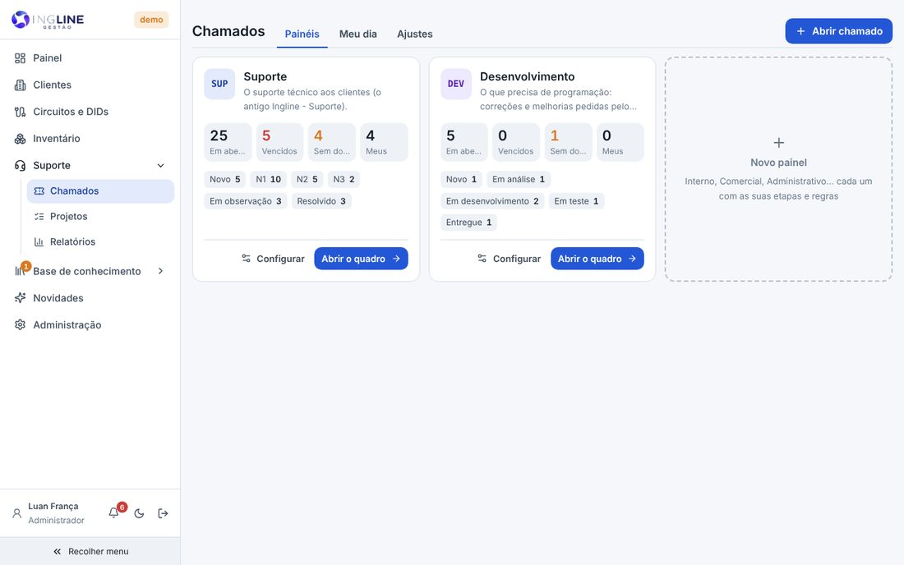
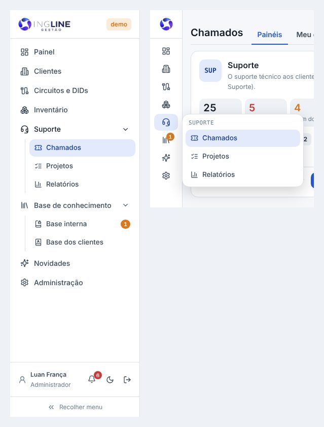
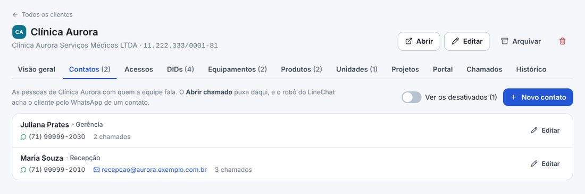
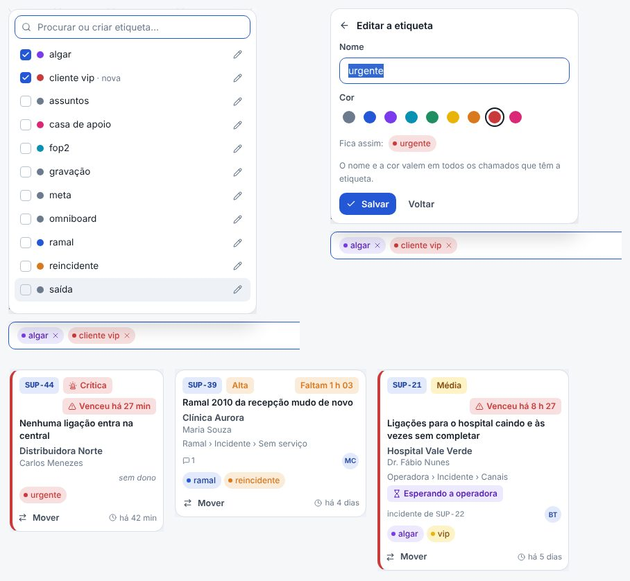
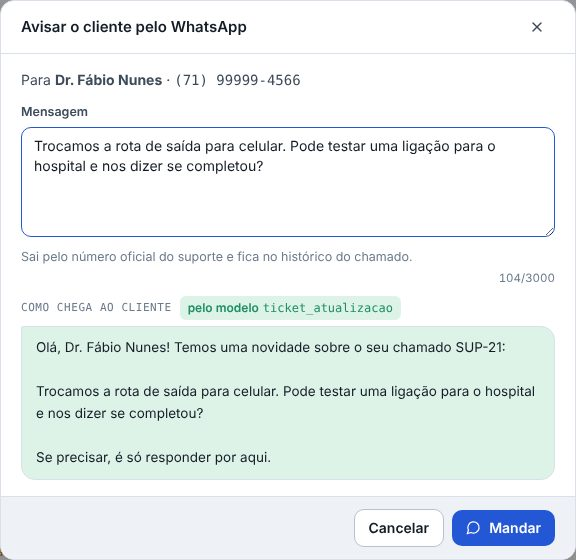
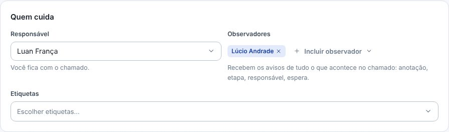
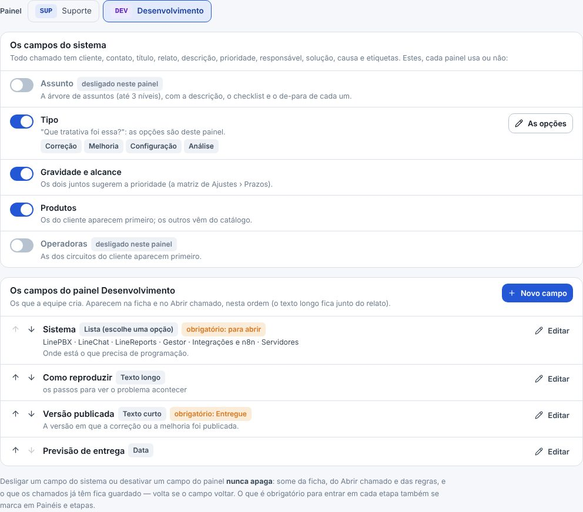

## atencao · Os chamados agora são do Gestor
Suporte › Chamados é o módulo novo: os chamados nascem, andam e fecham aqui. A primeira tela são os
painéis (Suporte, Desenvolvimento e os que vierem), cada um com os números de agora: em aberto,
vencidos, sem dono, os seus e quantos estão em cada etapa. Clique no painel para abrir o quadro; cada
número abre a lista já filtrada; Configurar abre a janela do painel, com as etapas e as regras. Os
antigos continuam no LineChat; para consultar, Suporte › Relatórios abre neles, na aba Hoje. A numeração
começa do zero: SUP-1, DEV-1.

## atencao · O menu mudou
O menu lateral ganhou grupos, para caber melhor: Suporte (os Chamados, os Projetos e os Relatórios,
que abrem nos tickets do LineChat de hoje) e Base de conhecimento (a Base interna e a Base dos
clientes, que era o Portal do cliente). Clique no nome do grupo para abrir e fechar; o da tela aberta abre sozinho, e com o menu
recolhido o ícone mostra a lista do lado. O Importar / Exportar foi para dentro da Administração. E
no computador a barra de cima saiu, para sobrar espaço: o sininho dos avisos, o tema claro ou escuro
e o Sair ficam no rodapé do menu, ao lado do seu nome. No celular a barra continua: é onde ficam o
botão do menu e o sininho.

## novo · Meu dia
A aba ao lado dos painéis: os seus em aberto, os que estão vencendo, os sem dono na fila (com o
botão Assumir), os que esperam o cliente, os que você observa e os agendados de hoje. Cada número
leva para a lista já filtrada.

## novo · O quadro
O quadro de um painel, uma coluna por etapa: N1, N2 e N3 continuam como colunas, finas, para caber
mais na tela. O alto é curto: o painel, Quadro | Lista (a lista mora dentro do painel), Trocar (outro
painel), a busca e o botão Filtros ficam numa linha só. Arraste o cartão para mover (no celular, use
Mover no pé do cartão). Escalonar e voltar de nível pedem o motivo; ir para uma etapa que exige um
campo vazio mostra o que falta. Fechou, tem comemoração.

## novo · A ficha do chamado
Clicar num chamado (no quadro, na lista, no Meu dia ou no sininho) abre a ficha numa janela grande, por
cima da tela, que continua lá embaixo do jeito que estava: fechou, voltou. Cada coisa no seu lugar: o
relato do cliente, a descrição do andamento, a solução e a causa. Do lado, a empresa e o contato em
destaque, a classificação (os campos que o painel usa: assunto, tipo, gravidade, alcance, a prioridade
sugerida e os campos do próprio painel), os produtos e as operadoras, as etiquetas inteiras, o
responsável, os prazos e o tempo gasto. Um código citado no
texto (SUP-12, ou um card antigo como IS-4280) vira link. Página inteira abre a ficha sozinha.

## novo · A trajetória
Por onde o chamado passou: cada etapa e nível, quanto tempo ficou em cada um, quem moveu e o motivo de
cada escalonamento. Fica na linha do tempo, ao lado das anotações e do histórico de tudo.

## novo · Pai, filhos, problema e ligações
O pai não fecha com filho aberto, e o filho pode estar em outro painel (como o Desenvolvimento). Criar
um filho, na ficha, abre o formulário numa janela por cima dela: abriu, a ficha já mostra o filho. O
problema junta os incidentes de clientes diferentes com a mesma causa e só resolve com a causa, a
solução e a validação. As ligações (relacionado, duplicado de, repete) são feitas à mão, e a ficha
desenha todas elas, com a legenda de cada traço.

## novo · Prazos que param e a operadora
Prazo de resposta e de solução pela prioridade, em horas úteis, com o horário de atendimento e os
feriados. Esperando o cliente, o prazo para; esperando a operadora, continua correndo. O caso na
operadora guarda o protocolo, o prometido e quando cobrar. Perto de vencer e vencido, o Gestor avisa.

## novo · Abrir chamado, ou reabrir o de antes
Dentro de um painel, o Abrir chamado já nasce nele, sem escolher outro. Ao escolher o cliente,
aparecem os contatos dele (um clique preenche o nome e o WhatsApp) e os chamados recentes: se é o
mesmo problema da manhã, Reabrir este em vez de abrir outro. A descrição já vem aberta, a gravidade
sugere a prioridade (trocar pede o motivo) e uma etiqueta nova se cria ali mesmo, já com a cor. O
formulário mostra só os campos que o painel usa; o obrigatório para abrir vem com *. O chamado também
nasce pelo botão Abrir chamado na conversa do LineChat e pelo robô.

## novo · Os contatos do cliente
A ficha do cliente (menu Clientes) ganhou a aba Contatos: o nome, o WhatsApp, o e-mail e o cargo ou o
setor das pessoas do cliente. No Abrir chamado, escolhido o cliente, os contatos dele aparecem: um
clique preenche o nome e o WhatsApp. Novo contato inclui um ali mesmo, e o nome escrito à mão ganha
Salvar nos contatos. Na ficha do chamado, Editar o contato também puxa da lista. O chamado que chega
só com o WhatsApp, pelo robô, já vem com o cliente e o nome. Nada se apaga: desativar tira o contato
do Abrir chamado.

## novo · Etiquetas com cor
No Abrir chamado e na ficha, clique na caixa das etiquetas: a lista abre, como as outras do Gestor.
Procure e marque (um clique põe ou tira); o que não existe vira Criar a etiqueta, com a cor (são
nove). O lápis de cada uma edita o nome e a cor, como no Helena: vale em todos os chamados que têm a
etiqueta. Ela aparece com a cor no quadro, no Meu dia e na ficha, redonda e com a bolinha, para não se
confundir com a prioridade. A que chega pelo robô, pela IA ou por uma resposta pronta nasce cinza. Em
Chamados › Ajustes › Etiquetas também se edita e se tira das sugestões a que nenhum chamado usa.

## novo · A lista do painel
Dentro do painel, Quadro | Lista troca a vista, com os mesmos filtros. A busca acha pelo código,
título, cliente, contato, telefone e pelo que o cliente disse (sem acento). Os atalhos Meus, Vencidos,
Perto de vencer, Sem dono e Esperando o cliente, as colunas que ordenam e o Exportar (CSV). Os filtros
ficam atrás do botão Filtros; o que está filtrado aparece escrito, com o X.

## novo · Os avisos
O sininho, no rodapé do menu: recebeu um chamado, chegou na sua etapa, o prazo está vencendo, o
cliente respondeu, a novidade de um chamado que você observa. O que chega com o Gestor aberto também
aparece num cartão perto do sininho, com o chamado e o botão Abrir o chamado. Ele fica até você abrir
o chamado ou fechar no X (fechado, continua no sininho). Embaixo da lista do sininho, em Além do
sininho, cada um liga a notificação do navegador — a do Windows, que aparece mesmo com o Gestor em
outra aba ou minimizado e também fica até você clicar — e testa como chega. Os mesmos avisos podem ir
pelo WhatsApp da equipe (o número de cada pessoa fica nos Ajustes).

## novo · A mensagem ao cliente pelo modelo aprovado
O cliente só recebe mensagem quando o atendente manda, pelo número oficial do suporte. Como ele é o
WhatsApp oficial, e o oficial só começa uma conversa com um modelo aprovado pela Meta (o template), a
mensagem sai dentro do modelo escolhido em Chamados › Ajustes › Avisos e WhatsApp: o Avisar o cliente
da ficha, a resposta pronta que manda ao cliente e o número do chamado ao abrir. Lá, Buscar os modelos
no LineChat traz os aprovados do número, e cada variável recebe um valor do chamado (o nome do
contato, o código, o que o atendente escreveu) ou um texto fixo. Antes de mandar, a ficha mostra como
a mensagem chega. A conversa que ela abrir no LineChat pode ir para uma equipe escolhida, ou para quem
mandou.

## novo · Preencher com IA
Na ficha, a IA lê a conversa do cliente no LineChat (ou o que já está no chamado) e sugere o título,
o relato, a descrição, o assunto, a gravidade e as etiquetas. Nada entra sozinho: marque o que quiser
e aplique.

## novo · Os observadores
Como no Helena: quem é posto como observador, ao abrir o chamado ou na ficha, recebe o aviso de tudo o
que acontece nele — a anotação, a mudança de etapa e de responsável, a espera, a mensagem ao cliente, o
cliente que respondeu. As mudanças de campo chegam juntas num aviso só, enquanto ele não for lido. O
aviso vai pelo sininho e, se ligado em Ajustes › Avisos e WhatsApp, pelo WhatsApp. Na ficha, Observar
põe você mesmo; o Meu dia mostra os chamados que você observa.

## novo · Os campos de cada painel
Cada painel usa os campos dele. Em Chamados › Ajustes › Campos, escolha o painel: os campos do sistema
(assunto, tipo, gravidade, alcance, produtos e operadoras) ligam e desligam ali — o Desenvolvimento,
por exemplo, não usa assunto, e o alcance nasce desligado: a prioridade sai só da gravidade. E Novo
campo cria os do painel: texto, texto longo, número, data, sim ou não e lista (de uma ou de várias
opções). Cada um pode ser obrigatório para abrir o chamado ou para entrar numa etapa, como os de
sempre. Aparecem na ficha e no Abrir chamado, e entram na busca e no
CSV. Desligar ou desativar não apaga nada: o que os chamados já têm volta se o campo voltar.

## novo · Os Ajustes do módulo
Os painéis e as etapas são da equipe. Tudo de um painel fica numa janela só, ao criar e ao editar: o
nome, quem vê, as etapas (criar, renomear, mudar a ordem, o que cada uma exige e quem é avisado) e as
regras; o painel novo pode começar com as etapas de outro. E mais: os campos de cada painel (com a
árvore de assuntos, que nasce em branco: cole a lista da equipe), as etiquetas e a cor de cada uma, os
prazos, os avisos e o WhatsApp,
as respostas prontas, os chamados agendados, as integrações (o robô, o n8n e o Gestor dentro do
LineChat) e a IA.

