## atencao · Os chamados agora são do Gestor
O menu Chamados é o módulo novo: os chamados nascem, andam e fecham aqui. Os antigos continuam no
LineChat para consulta, no menu Chamados do LineChat (com os relatórios de sempre). A numeração
começa do zero: SUP-1 no Suporte, DEV-1 no Desenvolvimento.
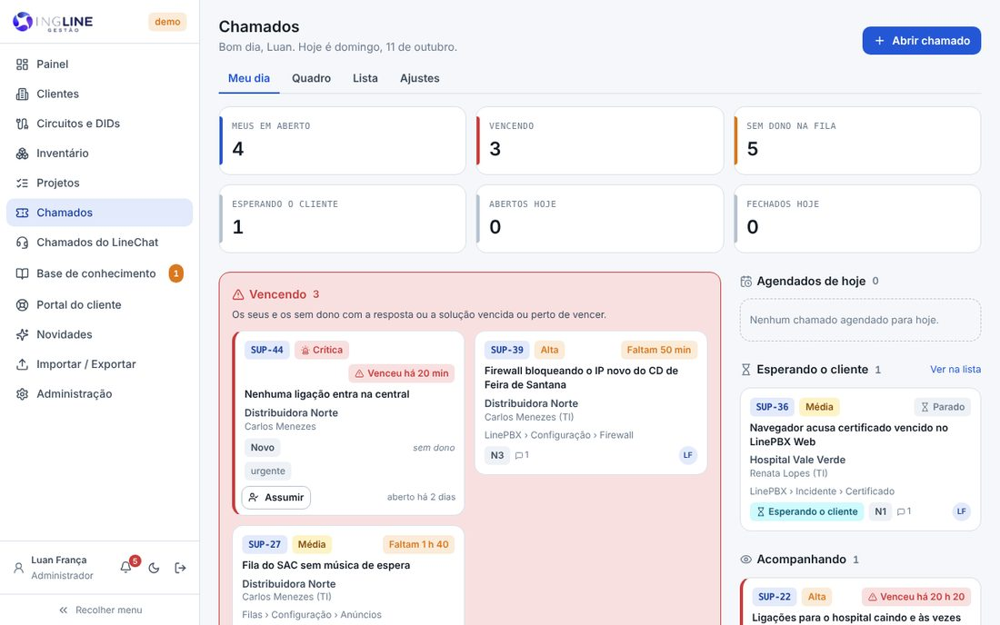

## atencao · O sininho, o tema e o Sair mudaram de lugar
No computador, a barra de cima saiu, para sobrar espaço na tela: o sininho dos avisos, o tema claro
ou escuro e o Sair ficam no rodapé do menu lateral, ao lado do seu nome (com o menu recolhido, um
embaixo do outro). No celular a barra continua: é onde ficam o botão do menu e o sininho.
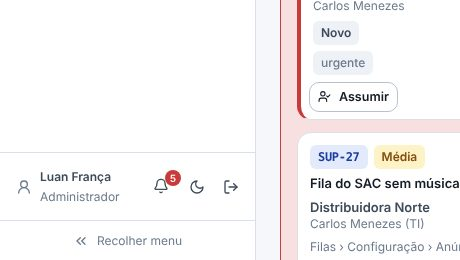

## novo · Meu dia
A primeira tela do módulo: os seus em aberto, os que estão vencendo, os sem dono na fila (com o
botão Assumir), os que esperam o cliente, os que você acompanha e os agendados de hoje. Cada número
leva para a lista já filtrada.

## novo · O quadro
Um painel por vez, uma coluna por etapa: N1, N2 e N3 continuam como colunas. Arraste o cartão para
mover (no celular, use Mover no pé do cartão). Escalonar e voltar de nível pedem o motivo; ir para uma
etapa que exige um campo vazio mostra o que falta. Fechou, tem comemoração.
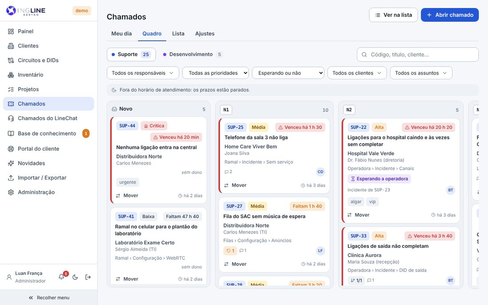

## novo · A ficha do chamado
Cada coisa no seu lugar: o relato do cliente, a descrição do andamento, a solução e a causa. Do lado,
a empresa e o contato em destaque, a classificação (assunto, tipo, gravidade, alcance e a prioridade
sugerida), os produtos e as operadoras, o que foi afetado (do cadastro), as etiquetas inteiras, o
responsável, os prazos e o tempo gasto. Um código citado no texto (SUP-12, ou um card antigo como
IS-4280) vira link.
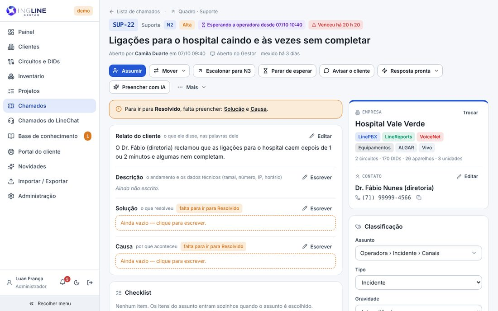

## novo · A trajetória
Por onde o chamado passou: cada etapa e nível, quanto tempo ficou em cada um, quem moveu e o motivo de
cada escalonamento. Fica na linha do tempo, ao lado das anotações e do histórico de tudo.
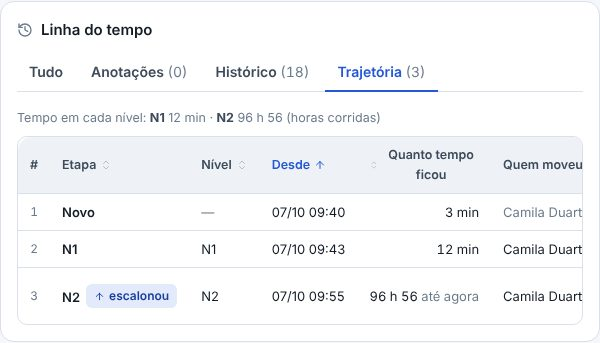

## novo · Pai, filhos, problema e ligações
O pai não fecha com filho aberto, e o filho pode estar em outro painel (como o Desenvolvimento). O
problema junta os incidentes de clientes diferentes com a mesma causa e só resolve com a causa, a
solução e a validação. As ligações (relacionado, duplicado de, repete) são feitas à mão, e a ficha
desenha todas elas, com a legenda de cada traço.
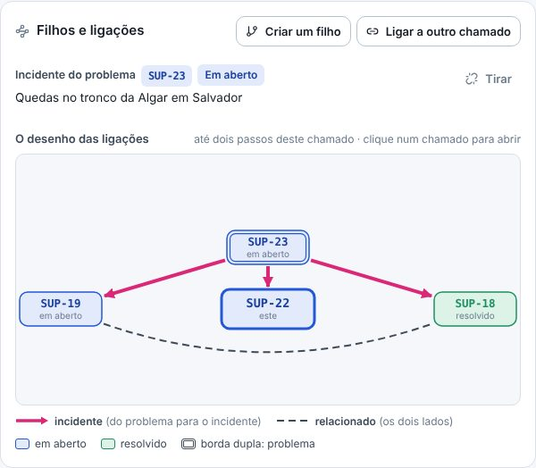

## novo · Prazos que param e a operadora
Prazo de resposta e de solução pela prioridade, em horas úteis, com o horário de atendimento e os
feriados. Esperando o cliente, o prazo para; esperando a operadora, continua correndo. O caso na
operadora guarda o protocolo, o prometido e quando cobrar. Perto de vencer e vencido, o Gestor avisa.
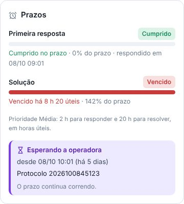

## novo · Abrir chamado, ou reabrir o de antes
Ao escolher o cliente, aparecem os chamados recentes dele: se é o mesmo problema da manhã, Reabrir
este em vez de abrir outro. A gravidade e o alcance sugerem a prioridade; trocar pede o motivo. O
chamado também nasce pelo botão Abrir chamado na conversa do LineChat e pelo robô.
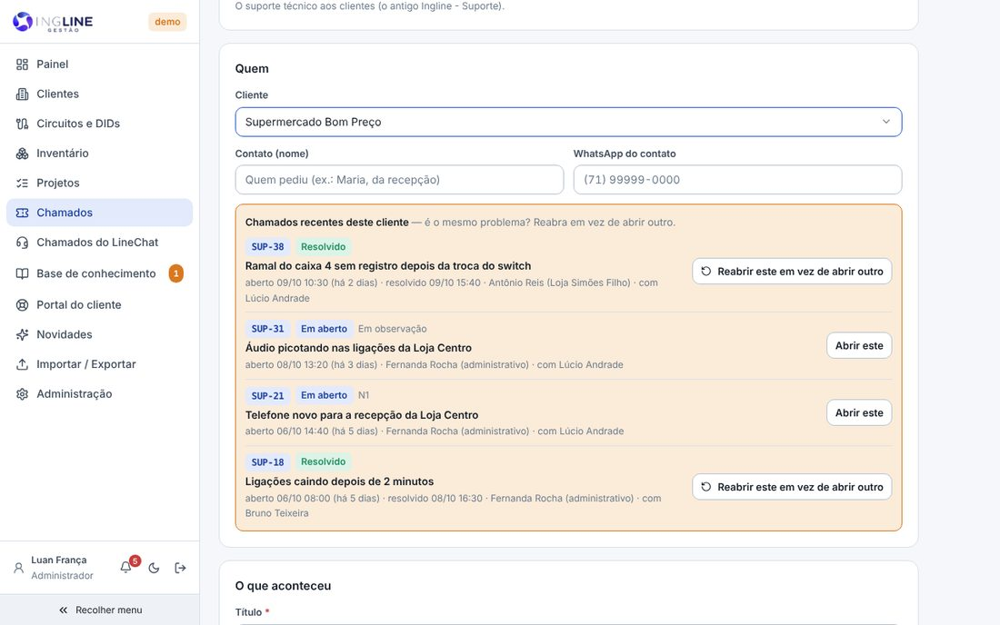

## novo · A lista
A busca acha pelo código, título, cliente, contato, telefone e pelo que o cliente disse (sem acento).
Os atalhos Meus, Vencidos, Perto de vencer, Sem dono e Esperando o cliente, os filtros, as colunas
que ordenam e o Exportar (CSV).
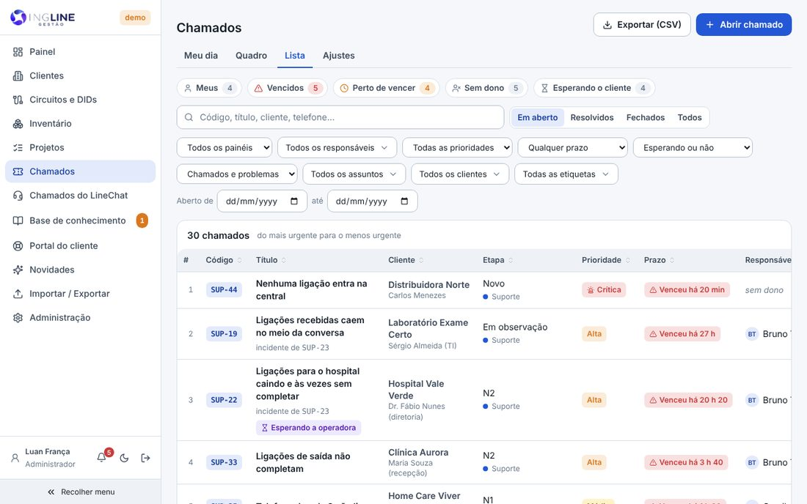

## novo · Os avisos
O sininho, no rodapé do menu: recebeu um chamado, chegou na sua etapa, o prazo está vencendo, o
cliente respondeu. Os mesmos avisos podem ir pelo WhatsApp da equipe (o número de cada pessoa fica nos
Ajustes). O cliente só recebe mensagem quando o atendente manda, pelo número oficial.
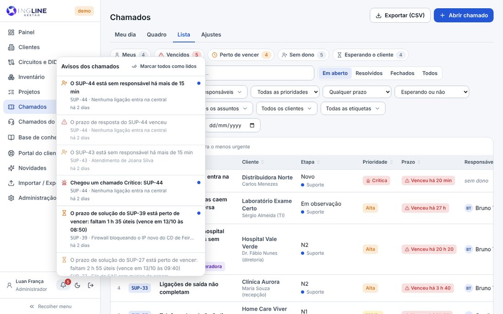

## novo · Preencher com IA
Na ficha, a IA lê a conversa do cliente no LineChat (ou o que já está no chamado) e sugere o título,
o relato, a descrição, o assunto, a gravidade e as etiquetas. Nada entra sozinho: marque o que quiser
e aplique.
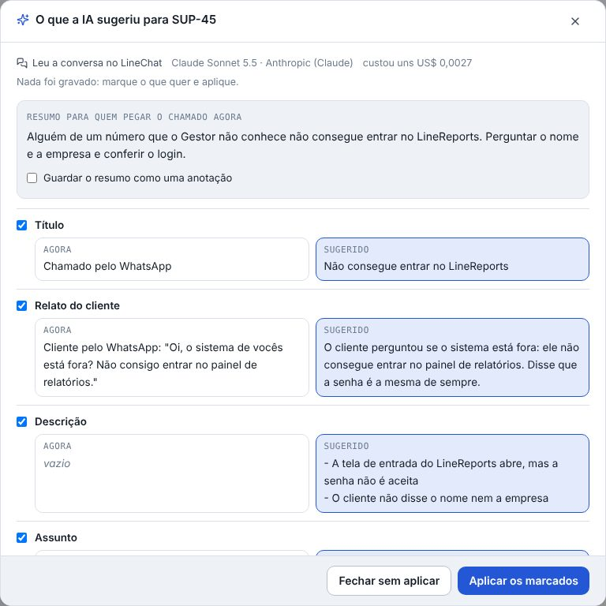

## novo · Os Ajustes do módulo
Os painéis e as etapas são da equipe: criar, renomear, mudar a ordem, o que cada etapa exige e quem é
avisado. Os assuntos em árvore (nascem em branco: cole a lista da equipe), os prazos, os avisos e o
WhatsApp, as respostas prontas, os chamados agendados, as integrações (o robô, o n8n e o Gestor
dentro do LineChat) e a IA.
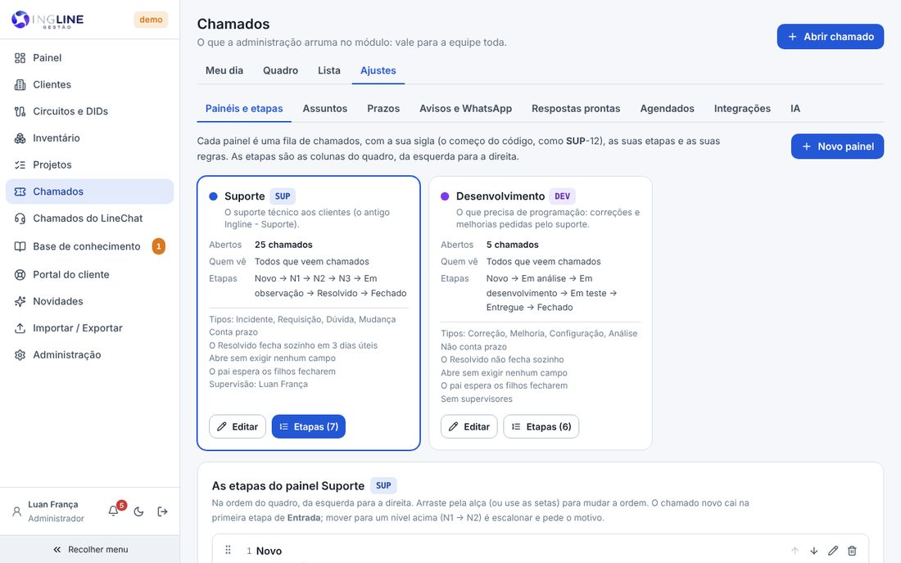
