## novo · Inventário › Relatórios
A quarta aba do Inventário (Aparelhos · Modelos · Movimentações · Relatórios), em quatro partes:
Clientes, Estoque e valor, Histórico e cadastro e Relação do cliente. O número laranja ao lado de uma
parte avisa o que pede atenção ali. Clique em qualquer número dos relatórios para ver os aparelhos
por trás dele, cada um com o link para a ficha.
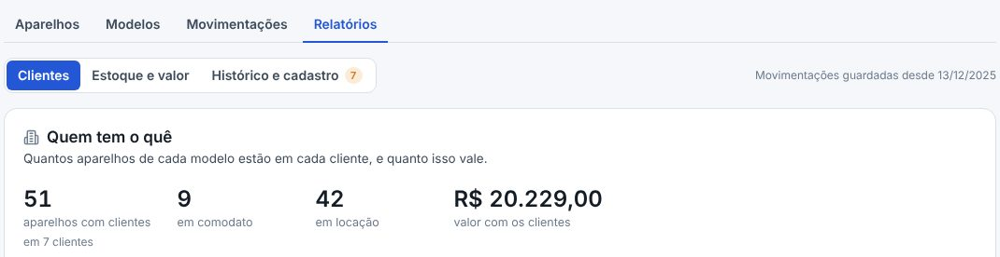

## novo · Quem tem o quê
Cada cliente numa linha e cada modelo numa coluna: quantos aparelhos nossos estão com ele, em locação
ou comodato, em quantas unidades, e quanto isso vale. Embaixo, o total com clientes e o que está no
estoque, modelo a modelo. O cliente que saiu da base (arquivado, na lixeira, sem produto ativo ou sem
o Equipamentos) aparece marcado. Os vendidos ficam de fora, porque já não são nossos. Qualquer coluna
ordena.
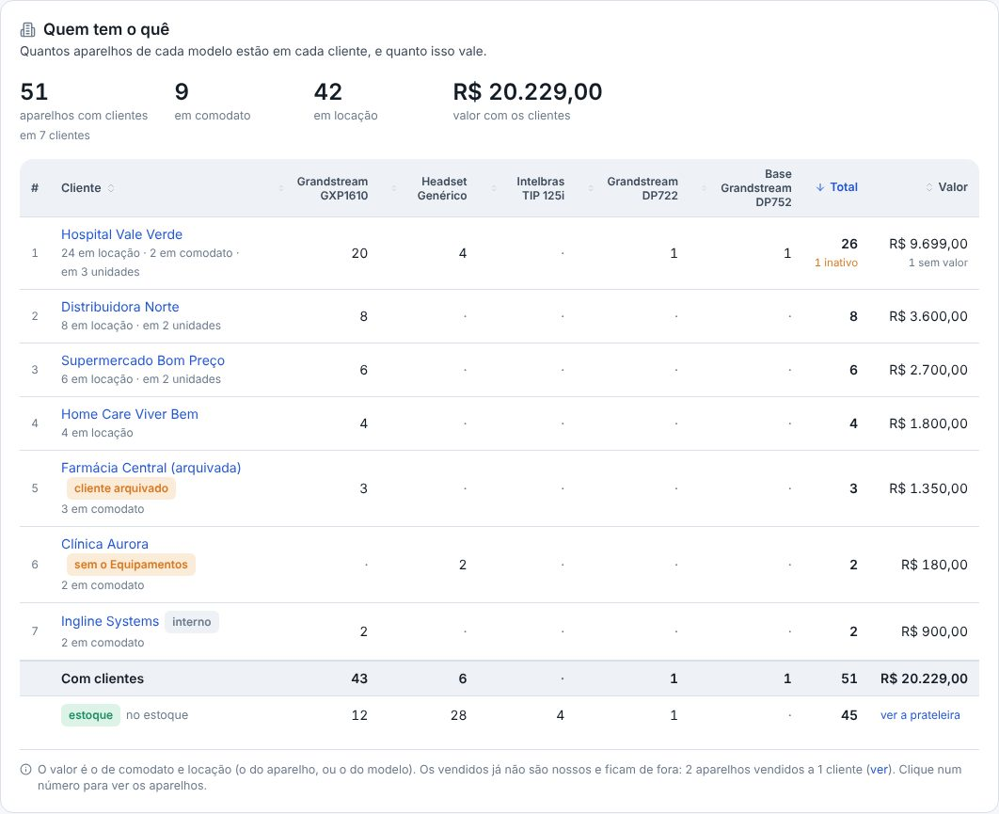

## novo · Na prateleira
O estoque por modelo: quanto tem para entregar, os inativos, há quanto tempo está parado e para
quantas semanas dá, no ritmo de saída dos últimos 90 dias. Avisa o modelo sem estoque e o de pouco
estoque. O ritmo aparece quando o Gestor tiver 4 semanas de movimentações; antes disso, só as saídas.
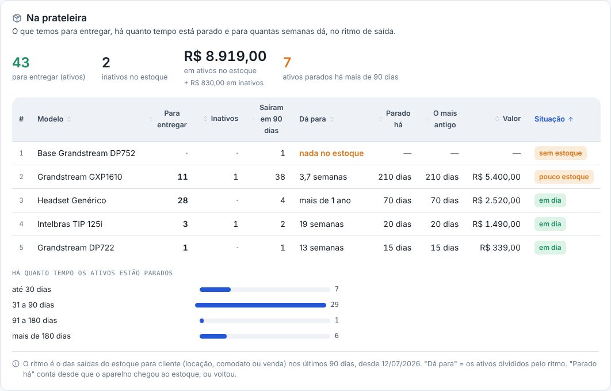

## novo · Quanto vale o parque
O dinheiro que temos em aparelho e onde ele está: em comodato, em locação, em uso interno e no
estoque (ativos e inativos), com a parte de cada modelo. O aparelho sem valor (nem dele, nem do
modelo) não soma, e o relatório diz quantos são.
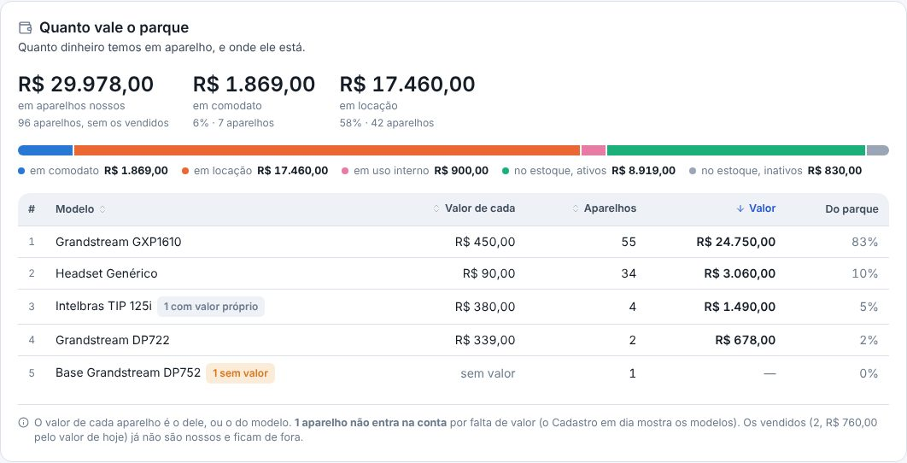

## novo · Vai e volta
O que saiu do estoque, o que voltou e quantos voltaram inativos, por modelo e por cliente, com o
tempo que o aparelho ficou no cliente antes de voltar e as últimas devoluções. Conta desde a primeira
movimentação guardada no Gestor.
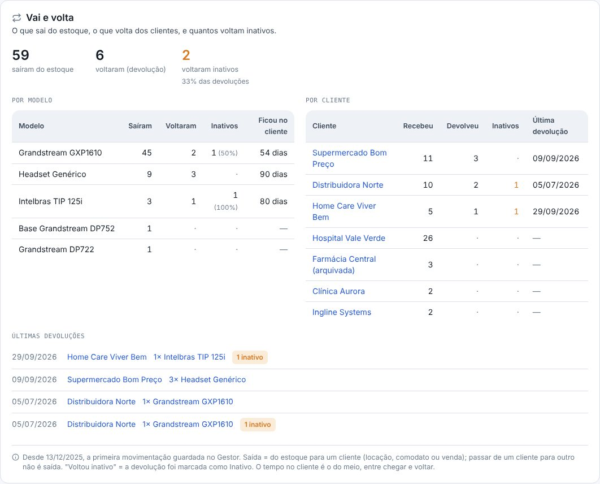

## novo · Cadastro em dia
O que falta para o inventário ficar confiável: MAC ou N/S escrito na anotação (e não no campo),
telefone sem MAC e sem N/S, modelo sem valor, cliente sem o login padrão do modelo ou sem a rede
padrão. E o que vale conferir: valor diferente do modelo e modelo sem foto. Cada item abre a lista,
com o link para corrigir.
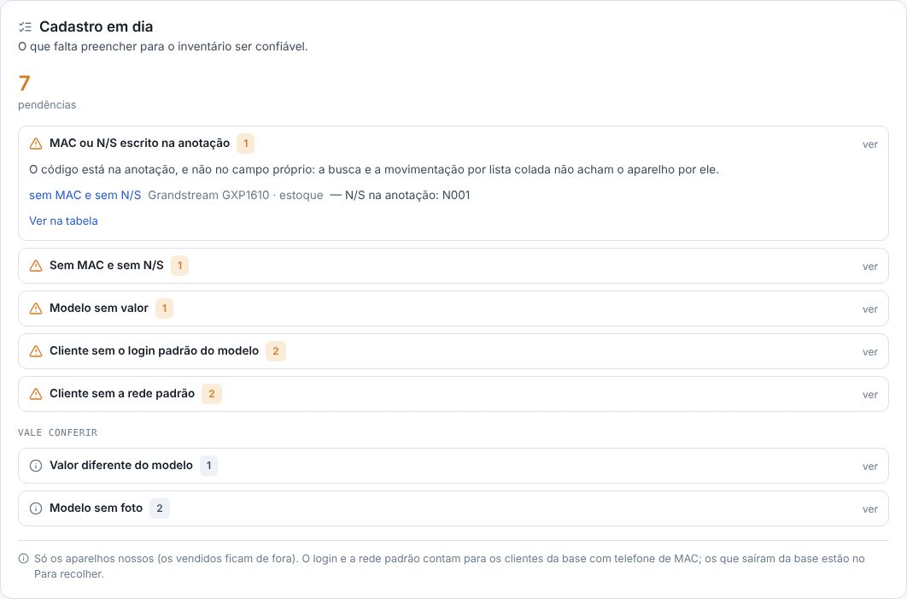

## novo · Relação de equipamentos do cliente
Escolha o cliente: os aparelhos dele por unidade (com o endereço), o resumo por modelo e o valor,
prontos para imprimir ou salvar em PDF, para conferir no local ou anexar ao contrato. Os valores e o
campo de conferência (data e assinaturas) ligam e desligam. Na ficha do cliente, aba Equipamentos, o
botão Relação para imprimir abre direto.
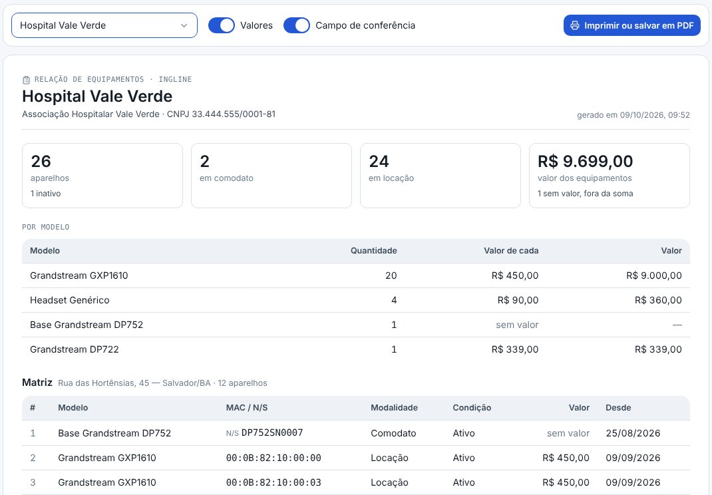

## novo · Recibo de entrega na movimentação
Ao movimentar aparelhos para um cliente (locação, comodato ou venda), dá para anexar o recibo de
entrega: PDF ou foto, até 5 arquivos. A foto do celular é reduzida antes de subir, sem perder a
leitura, e o arquivo que não é PDF nem foto avisa na hora. A devolução não tem recibo.
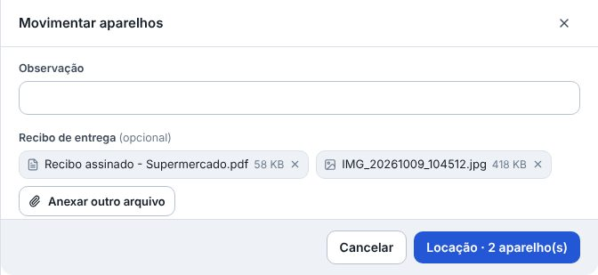

## novo · O recibo que volta assinado depois
Em Inventário › Movimentações (e na aba Equipamentos do cliente), o clipe na coluna Recibo mostra
quais entregas já têm. Abra a linha: a foto abre na tela e o PDF baixa. Se o recibo assinado só
voltou depois, é ali que se anexa, em Anexar o recibo. Tirar um arquivo só o tira da tela: ele fica
guardado e na auditoria. Na ficha do aparelho, o histórico mostra o recibo de cada entrega.
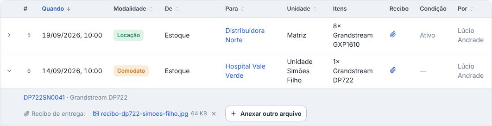

## melhorou · O DID sem titular
O titular é do circuito, e é lá que ele aparece: na lista de Circuitos e no tronco da ficha do
circuito. A coluna Titular saiu da tabela de DIDs (na Numeração e na ficha do circuito) e da aba DIDs
do cliente, que também perdeu o filtro Titular. O CSV de DIDs não traz mais o titular; o arquivo
antigo, com a coluna, continua entrando (ela é ignorada).
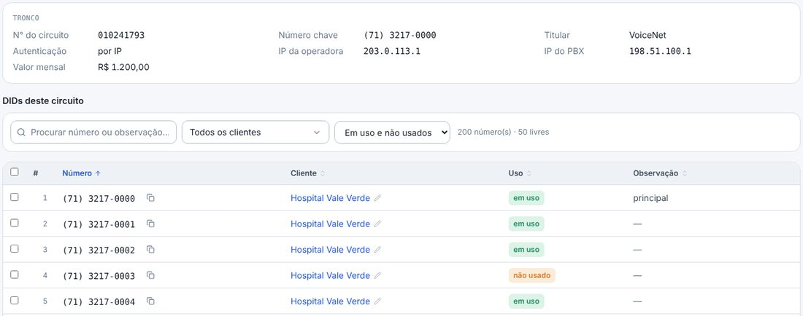

## melhorou · Chamados do cliente: esta semana e este mês
Na ficha do cliente, aba Chamados, o período ganhou Esta semana (desde a segunda-feira) e Este mês
(desde o dia 1), além de 30 dias, 90 dias e 12 meses.
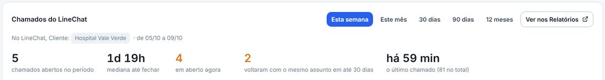

## melhorou · Clientes do projeto: clicar na coluna ordena
Na ficha do projeto, clicar no título de uma coluna da lista de clientes ordena por ela, e clicar de
novo inverte. Cliente vai pelo nome; uma etapa de lista, pela ordem das opções (em branco por último);
uma etapa de caixinha, as não feitas primeiro; e a Situação, de Pendente a Não se aplica.
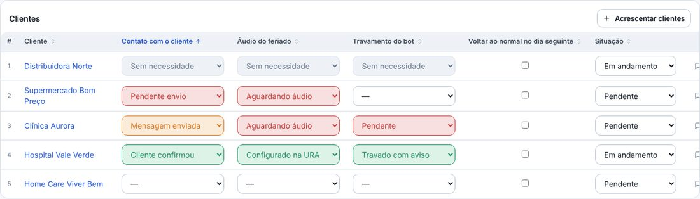

## corrigido · Clicar no Parque por modelo filtra a lista de novo
Clicar no Parque por modelo, no topo do Inventário, não filtrava a lista de aparelhos. Agora filtra:
o nome do modelo mostra todos os aparelhos dele; a parte verde da barra, só os do estoque; a azul, só
os que estão com clientes.

## corrigido · O título das colunas de valor fica em cima dos números
Nas tabelas do sistema, o título das colunas de número (Valor, Total…) ficava à esquerda, longe dos
números, que são alinhados à direita. Agora fica em cima deles.
