## atencao · O WhatsApp de cada pessoa fica em Usuários
O número por onde cada pessoa recebe os avisos dos chamados (o chamado que recebeu, o prazo vencendo,
o Crítico que chegou) agora fica no cadastro dela: Administração › Usuários › Editar, no campo
WhatsApp. Ali também dá para pausar os avisos sem apagar o número. Os números que já estavam nos
Ajustes dos chamados vieram junto.
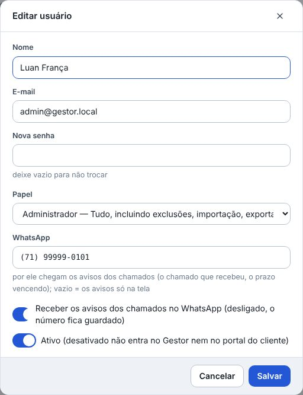

## atencao · O chamado resolvido não reabre sozinho
Quando o cliente escrever no WhatsApp que ainda não resolveu, reabra o chamado: Reabrir, na ficha,
ou "Reabrir este em vez de abrir outro", no Abrir chamado. O Resolvido continua fechando sozinho
depois dos dias úteis do painel.

## atencao · Chamados virou Painéis
No menu, em Suporte, o item **Chamados** agora se chama **Painéis**: é onde moram o Suporte, o
Desenvolvimento e o Comercial. Lá dentro, a primeira aba se chama **Todos** (os cartões dos painéis).
Nada mudou de lugar, e os Ajustes ficam em Painéis › Ajustes.

## atencao · O Comercial tem permissão própria
Só vê o Comercial quem tem a permissão **Ver o Comercial**: sem ela, o painel de Vendas e os relatórios
de vendas não aparecem. O Administrador já vem com ela. Para quem é do Comercial, dê o papel
**Comercial** em Administração › Usuários, ou marque a permissão no papel dele, em Administração › Papéis.

## novo · O painel de Vendas, para o Comercial
Um painel como o dos chamados, com o que é de venda. Ao criar o painel (Painéis › Ajustes › Painéis ›
Novo painel), escolha **Negociações (Vendas)**. A negociação tem a **mensalidade** — a que conta: cada
coluna do quadro soma, e o relatório e a meta usam ela — e a **ativação**, que fica só registrada; a
**empresa** — um cliente ou uma que ainda não é —, os campos do Comercial (o CNPJ, os contatos
principais, a origem de lead e quem indicou) e termina em **Ganho** ou **Perdido**: o perdido pede o
motivo. A tela dos painéis mostra o que está em negociação e o ganho do mês contra a **meta**. No
menu, o grupo **Comercial** leva direto às **Negociações** e aos **Relatórios**; o painel também fica em
Suporte › Painéis, como os outros.
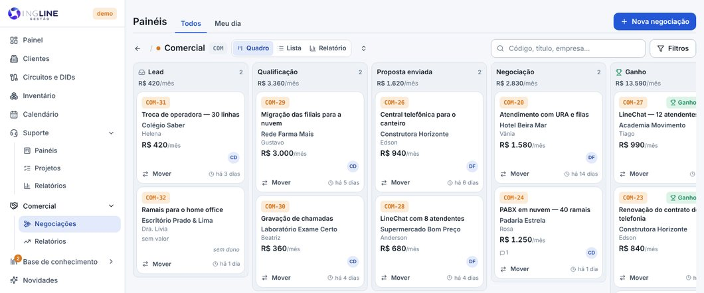

## novo · O valor por produto
Na negociação, o Valor tem **Um valor só** ou **Por produto**: cada produto com a sua mensalidade e a sua
ativação e, embaixo, os **Totais**, que viram os da negociação (o quadro, o relatório e a meta usam o das
mensalidades). Os produtos entram e saem ali mesmo, e o Exportar leva os valores de cada um.
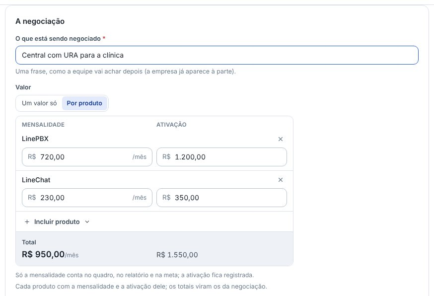

## novo · O relatório do Comercial
No painel, ao lado de Quadro e Lista, o **Relatório**: o ganho, as novas, o perdido, a conversão e o
ticket médio do período, cada um com a seta do que mudou em relação ao período anterior; **os ganhos
mês a mês**, nos últimos 12 meses, com quanto subiu ou caiu de um mês para o outro; e o **funil** — das
que entraram, até onde chegaram, onde se perderam e quantas foram ganhas. Clique em qualquer número para
ver as negociações por trás dele.
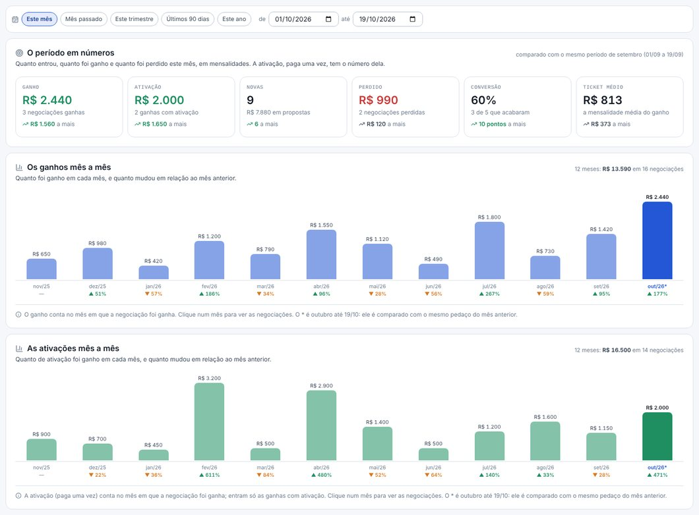

## novo · O PDF anexado abre sem baixar
Na anotação de um chamado ou de uma negociação, clique no PDF (a proposta, o contrato): ele abre numa
janela, página por página, sem baixar — o Baixar fica embaixo. Para anexar, clique na caixa de anotar e
cole o arquivo com Ctrl+V, arraste o arquivo ou use o Anexar.
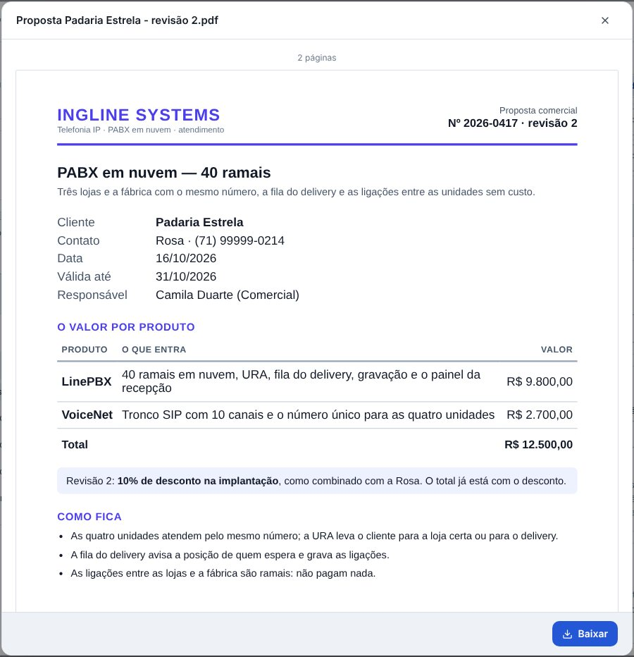

## novo · O calendário das equipes
No menu, em **Calendário**: as visitas, as viradas de sistema e para a nuvem, as folgas, os home
offices, as reuniões e as ações no cliente, no mês ou numa lista. Cada evento é de um ou mais painéis, e
quem vê o evento é quem vê o painel: quem é só do Suporte vê os do Suporte; quem é do Administrativo, do
Suporte e do Desenvolvimento vê os três. Em cima, quem está fora do escritório hoje. Os filtros (os
painéis, Só os meus, o cliente, os tipos) ficam no endereço, e quem cuida dos chamados muda os tipos e
as cores em **Tipos**.
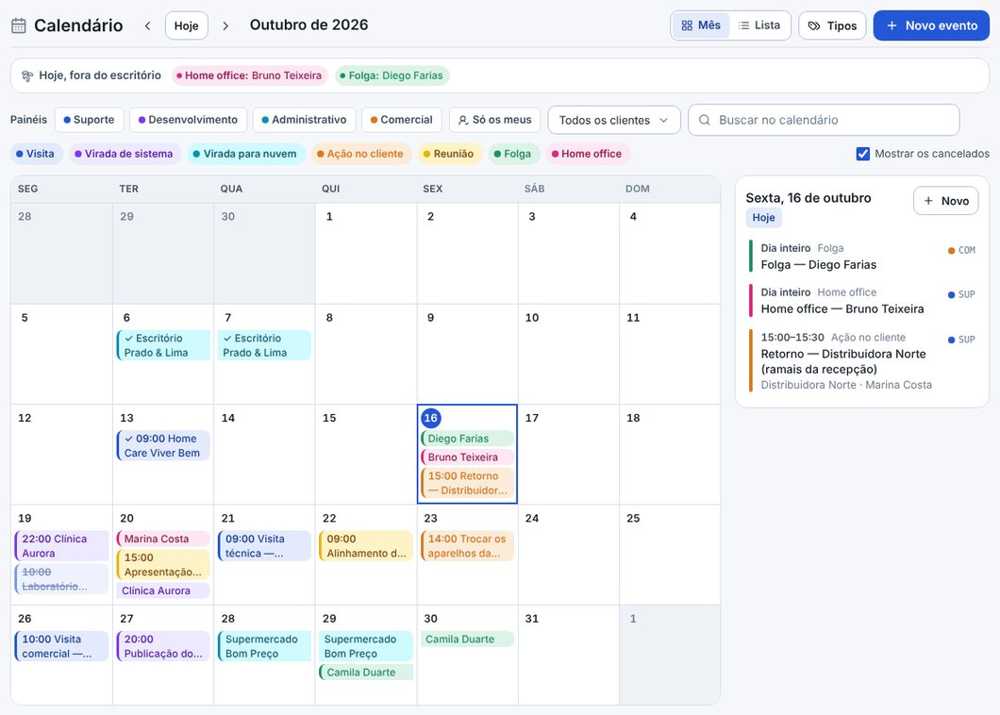

## novo · Agendar pelo chamado
Na ficha do chamado, o **Na agenda** mostra a visita ou a virada ligada a ele, e o **Agendar** põe uma no
calendário já com o chamado, o cliente e o painel. No **Meu dia**, o **Hoje na agenda** mostra o que está
marcado para hoje e quem está fora.
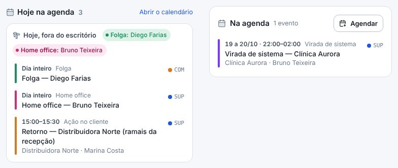

## novo · O robô do LineChat com o mapa
O robô manda o JSON dele, do jeito que o bloco Enviar webhook já manda, para o endereço novo (Painéis ›
Ajustes › Integrações), e recebe de volta a resposta que o bloco entende: CHAMADO_ABERTO, com a
mensagem ao cliente e o número do chamado, ou CHAMADO_FALHOU. O **mapa do robô**, ali mesmo, diz de onde
sai cada campo do chamado: um texto com os parâmetros entre {{ }}, como {{empresa}}. O **Como fica**
mostra o chamado que nasceria, antes de salvar. O que não bater (um assunto que não existe, uma opção
que não é do campo) fica de fora, e o chamado abre do mesmo jeito.
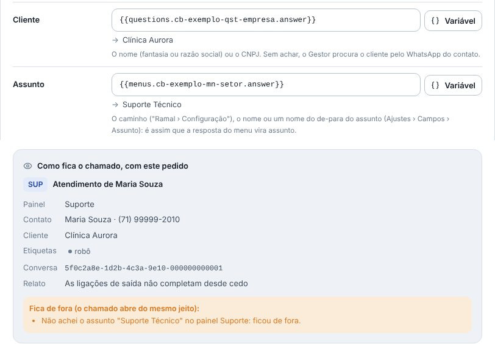

## novo · Os parâmetros do webhook, na tela
Você inclui e tira o que chega no webhook sem mexer em código: cada parâmetro ganha um nome curto
(empresa, setor) e vem de uma pergunta do robô, de um menu, de um dado do contato ou do endereço
(&setor=suporte). O **Escolher no pedido** lista o que o último pedido do robô trouxe, e a resposta de
uma pergunta entra pelo texto dela — vale também na cópia de teste do robô. Ao lado de cada parâmetro,
se ele veio no último pedido e em que campos está; renomear muda os campos junto. E o **Como deve
chegar o webhook** mostra o pedido inteiro, do jeito que o LineChat manda, com cada lugar que o Gestor
lê marcado — e, em amarelo, onde deve chegar o que não veio.
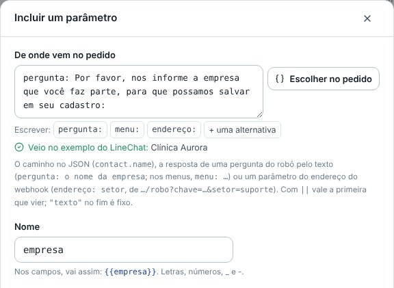

## melhorou · O relatório diário conclui a conversa
O PDF dos Chamados que vai todo dia pelo WhatsApp agora conclui a conversa logo depois de mandar: ela
não fica pendente no LineChat, esperando alguém — o relatório é só um aviso. A opção fica em
Administração › Envio automático e já vem ligada; se o LineChat não deixar concluir, a mensagem chega
do mesmo jeito e os Últimos envios dizem qual conversa ficou aberta.
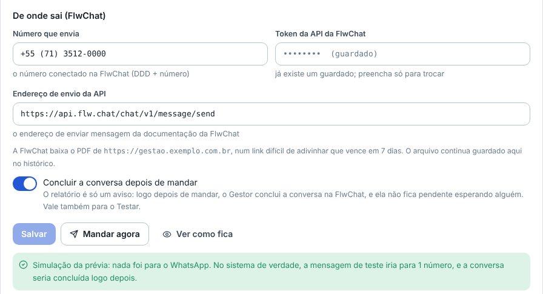

## melhorou · O de-para acha o assunto
O nome que estiver no de-para de um assunto (Ajustes › Campos › Assunto) agora também acha o assunto,
para o robô e para o n8n: ponha ali a resposta do menu do robô ("Suporte Técnico") e ela vira o
assunto.

## melhorou · A lista de usuários mostra o WhatsApp
A coluna WhatsApp mostra o número de cada pessoa, ou "pausado" para quem tem o número mas não recebe os
avisos. Nos Ajustes dos chamados, em Avisos e WhatsApp, fica só a conta de quantos recebem, com o
link para Usuários.
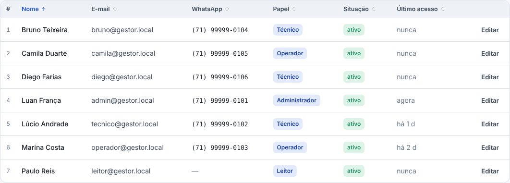

## melhorou · O Abrir chamado sem o Registro
O formulário não pergunta mais se é Chamado ou Problema: o que se abre ali é chamado. O problema (a
mesma falha em vários clientes) nasce na ficha de um deles, em Mais › Abrir um problema a partir
deste, e esse chamado vira o primeiro incidente.
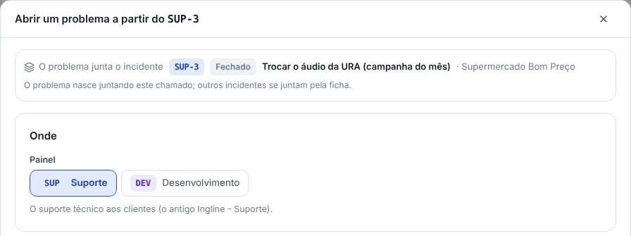

## melhorou · Sem as respostas prontas
As respostas prontas saíram: a aba dos Ajustes e o botão da ficha do chamado. Para responder rápido
ao cliente, use as respostas rápidas do próprio LineChat.
