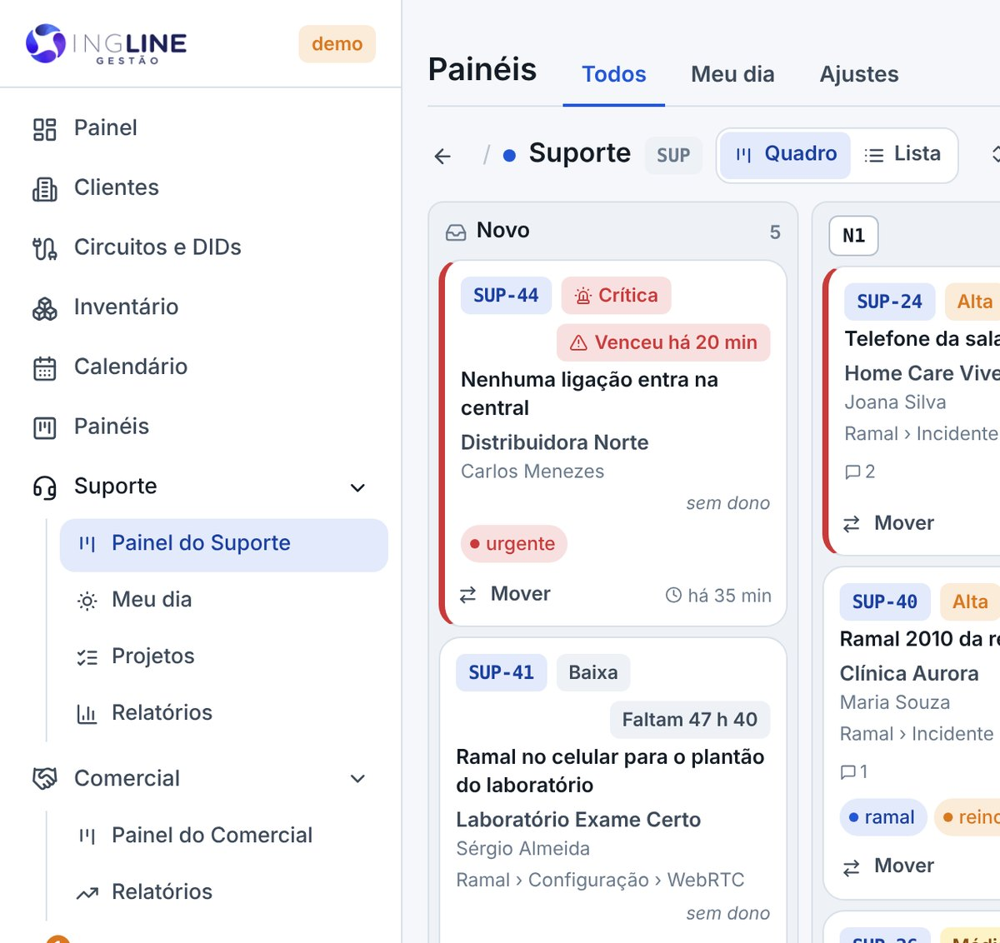
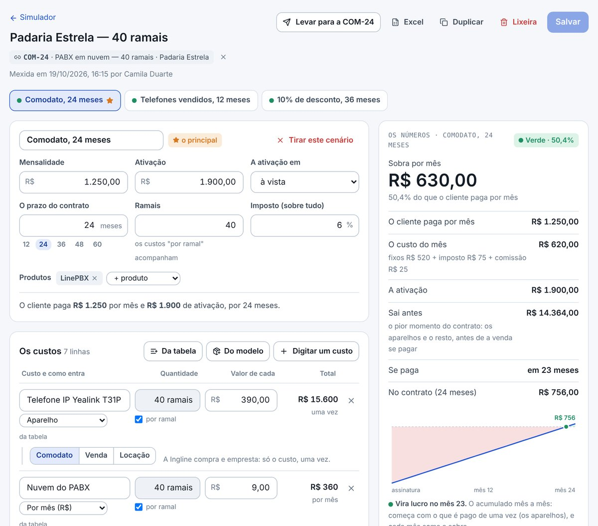
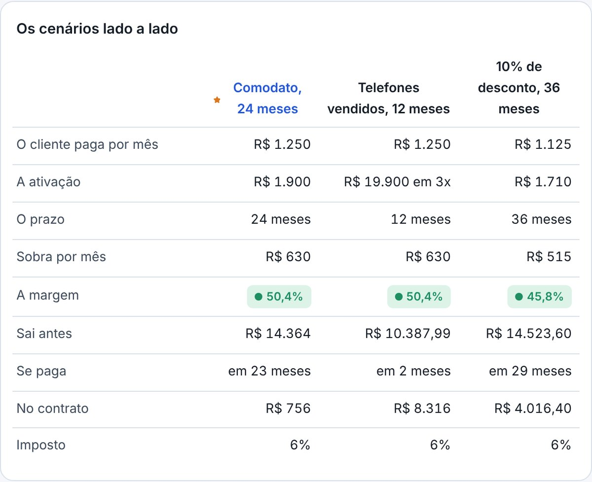
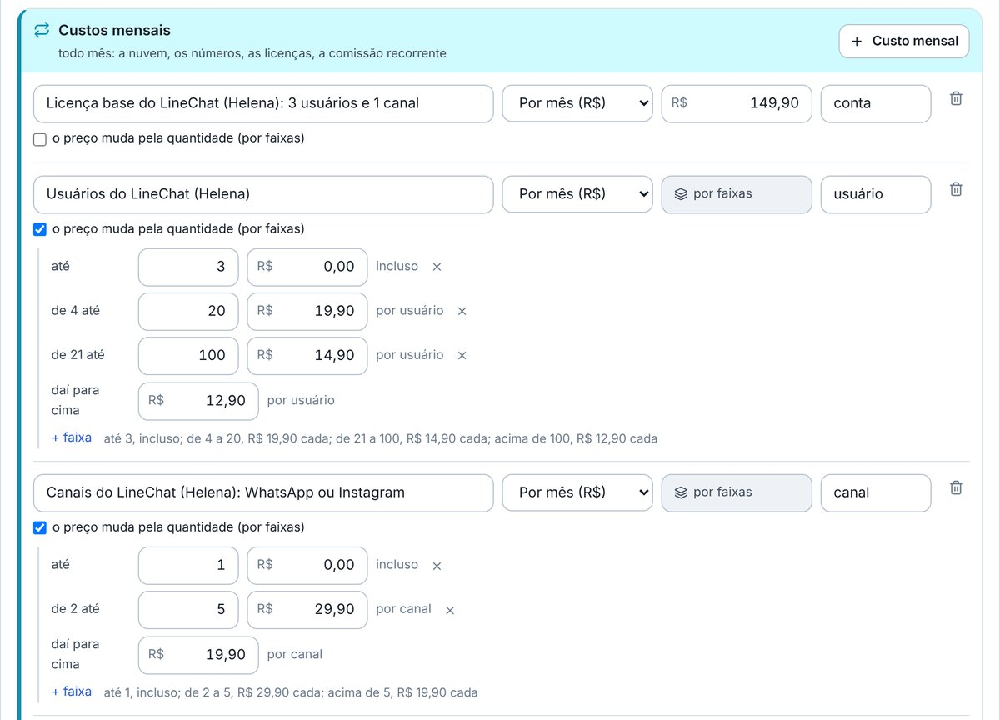
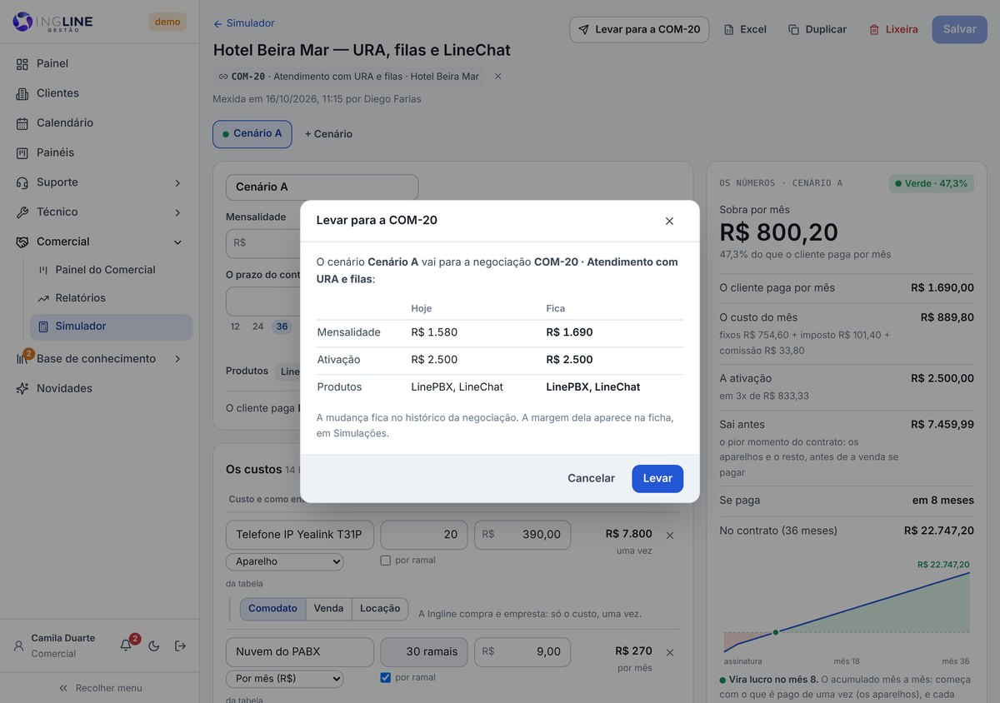
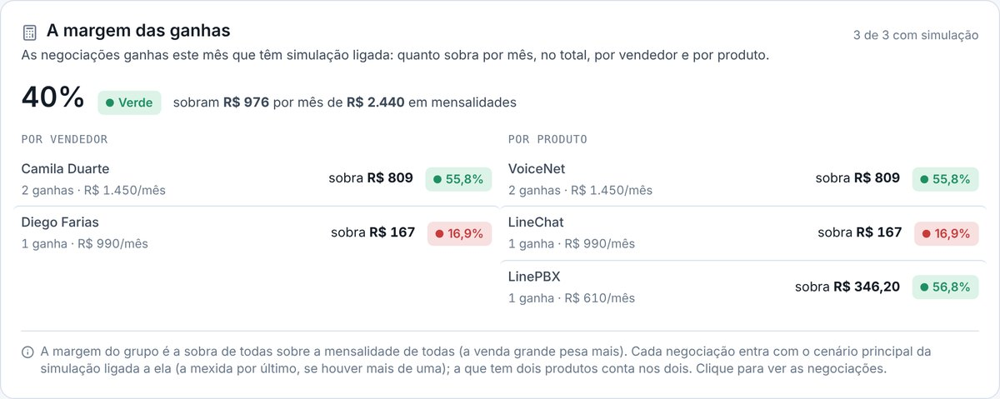
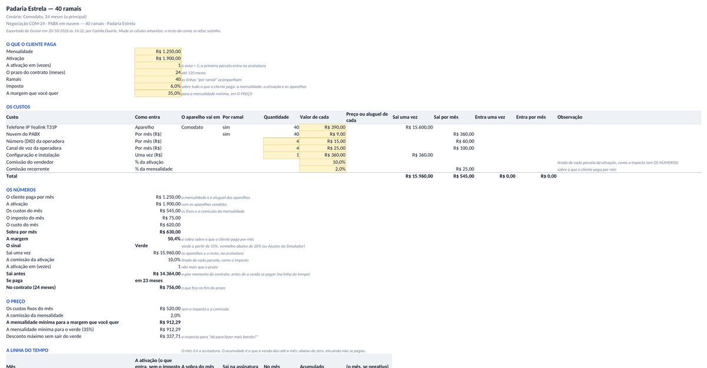
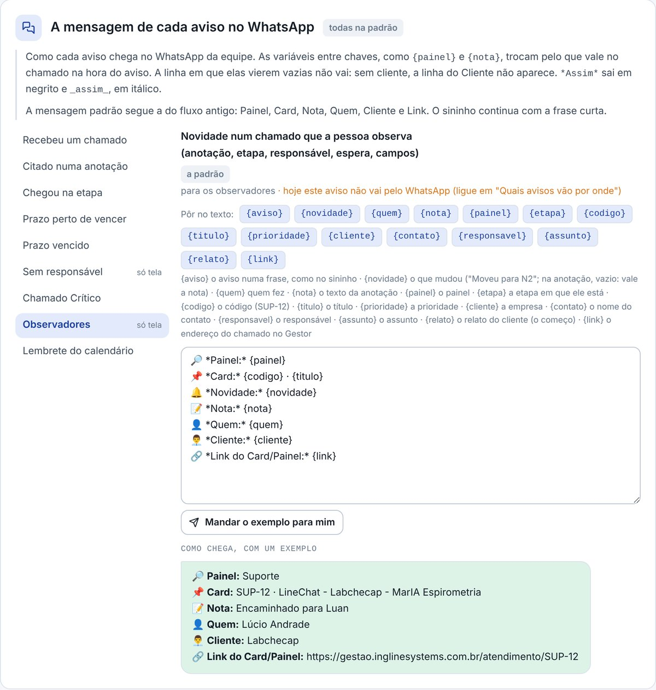
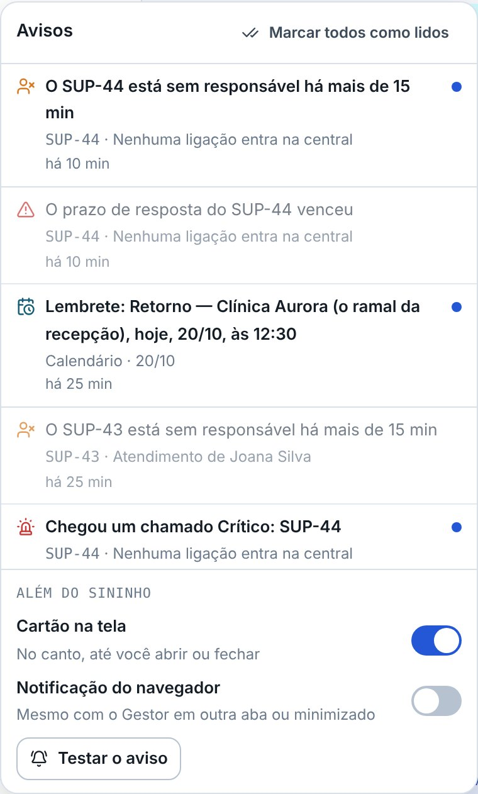
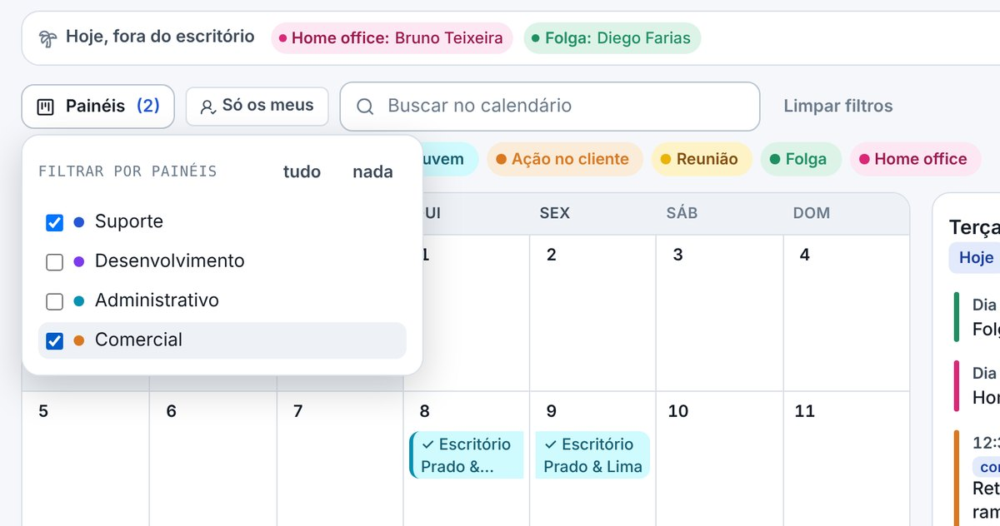

## atencao · Os avisos no WhatsApp mudaram de cara
Os avisos que a equipe recebe no WhatsApp chegam agora com uma informação por linha, como no fluxo antigo
do n8n. São elas: o painel, o card, a novidade, a nota, quem fez, o cliente e o link. A linha que viria
em branco não chega: sem cliente, por exemplo, a linha do Cliente não vai. Para os observadores receberem
pelo WhatsApp, marque o WhatsApp do aviso deles em Painéis › Ajustes › Avisos e WhatsApp, em "Quais
avisos vão por onde".

## atencao · O menu mudou: Painéis no alto e o grupo Técnico
**Painéis** agora é um item próprio no menu, logo abaixo do Calendário: é a tela de todos os painéis,
com Todos, Meu dia e Ajustes. No grupo **Suporte** ficam o **Painel do Suporte**, que abre direto o
quadro do Suporte, o **Meu dia**, os Projetos e os Relatórios. Os **Circuitos e DIDs** e o
**Inventário** foram para um grupo novo, o **Técnico**, logo abaixo do Suporte. No grupo **Comercial**,
o atalho **Negociações** passou a se chamar **Painel do Comercial**, e entrou o **Simulador**.

## novo · O Simulador do Comercial
Em **Comercial › Simulador**, ponha a mensalidade e a ativação que quer cobrar e os custos: os aparelhos
(em comodato, venda ou locação), a nuvem, os números, as comissões e o imposto. Os números mudam enquanto
você escreve: o que sobra por mês, a margem com o sinal (verde, amarelo ou vermelho), o que sai antes, em
quantos meses a venda se paga e o que fica no contrato. Diga a margem que quer e veja a mensalidade
mínima e o desconto máximo sem sair do verde. Cada simulação tem nome e pode ficar ligada a uma
negociação, que passa a mostrar a margem.

## novo · Até 3 cenários lado a lado
A mesma venda em versões diferentes: em comodato ou com os telefones vendidos, em 12 ou em 24 meses, com
desconto. **+ Cenário** copia o cenário aberto, para mudar só o que difere, e **Os cenários lado a lado**
mostra os números de cada um. A ativação pode ir em até 12 vezes, e o "se paga" acompanha as parcelas.

## novo · A tabela de custos e o LineChat da Helena
Nos **Ajustes do Simulador** ficam a tabela de custos (os de sempre, com o valor de hoje, que entram na
simulação com um clique), os modelos de cada produto e o imposto, que você muda quando quiser. Os
aparelhos ficam sem valor, para você preencher em cada simulação. A tabela já vem com a da Helena: a
licença do LineChat e os usuários, os canais e os contatos ativos por faixas, como na planilha.

## novo · Da negociação para o Simulador, e de volta
Na ficha da negociação, a parte **Simulações** mostra as simulações dela, com a margem e o sinal. O
**Simular** abre uma simulação já ligada, com a empresa, os produtos, as linhas dos modelos e os valores
da negociação. Feita a conta, o **Levar para a COM-12** põe na negociação a mensalidade, a ativação e os
produtos do cenário principal. Antes do ok, a janela mostra o que a negociação tem hoje e o que fica.

## novo · A margem das ganhas no relatório
O relatório do Comercial ganhou **A margem das ganhas**: das negociações ganhas no período que têm
simulação ligada, quanto sobra por mês e a margem com o sinal, no total, por vendedor e por produto. O
clique mostra as negociações de cada um.

## novo · A simulação no Excel, com as fórmulas
O botão **Excel** da simulação baixa uma planilha com uma folha por cenário e a **Lado a lado**. As
células amarelas são as que você muda: a mensalidade, o prazo, os ramais, as quantidades e os valores. A
sobra, a margem, o sinal, o preço mínimo e a linha do tempo se refazem sozinhos, com a mesma conta da
tela, até as faixas da Helena.

## novo · A mensagem de cada aviso, do seu jeito
Em Painéis › Ajustes › Avisos e WhatsApp, o cartão **A mensagem de cada aviso no WhatsApp** mostra como
cada aviso chega. Ali você muda o texto e põe as variáveis com os botões: {painel}, {codigo}, {titulo},
{cliente}, {nota}, {quem}, {link} e as outras. A prévia mostra como fica, com um exemplo. *Assim* sai em
negrito no WhatsApp. **Mandar o exemplo para mim** manda a mensagem para o seu WhatsApp, para você
conferir, e **Voltar à padrão** desfaz.

## novo · Os lembretes do calendário
Na janela do evento, em **Lembretes**, diga quanto tempo antes avisar: 15 minutos, 1 hora, 1 dia, 1
semana… Cabem até 5 lembretes por evento. Escolha também quem recebe: as pessoas do evento ou todos que
veem o evento. Cada tipo já traz os seus: a Visita lembra 1 dia antes e 1 hora antes, e a Reunião, 15
minutos antes. Mude os de cada tipo no botão Tipos.

## novo · O lembrete chega no sininho e no WhatsApp
Na hora marcada, o lembrete chega no sininho, que agora se chama **Avisos**, com o ícone do calendário.
O clique abre o calendário no evento. Ele também chega no WhatsApp de quem tem o número em Administração
› Usuários. O evento cancelado, o feito e o da lixeira não lembram.

## novo · Avisar quem vai, ao pôr no calendário
Ao pôr um evento no calendário, marque **Avisar agora** para quem precisa saber já: as pessoas do evento
ou todos que veem o evento. O aviso chega na hora, no sininho e no WhatsApp, dizendo quem pôs, o que é e
quando. Você não recebe o aviso do que você mesmo pôs. A caixa vem desmarcada.

## melhorou · Os painéis do calendário numa lista
No calendário, o botão **Painéis** abre a lista dos painéis: marque os que quer ver, quantos quiser.
Nenhum marcado mostra todos. O filtro de cliente saiu; para achar os eventos de um cliente, escreva o
nome dele na busca.

