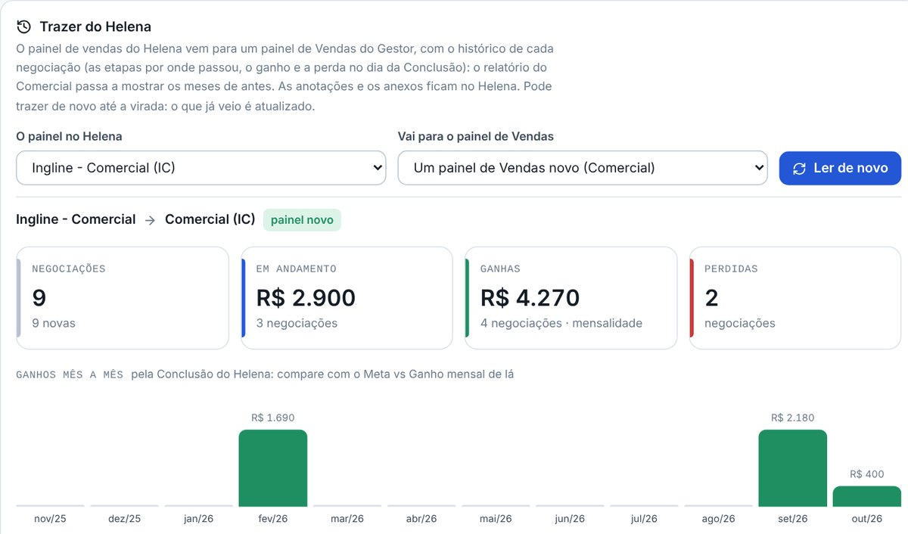
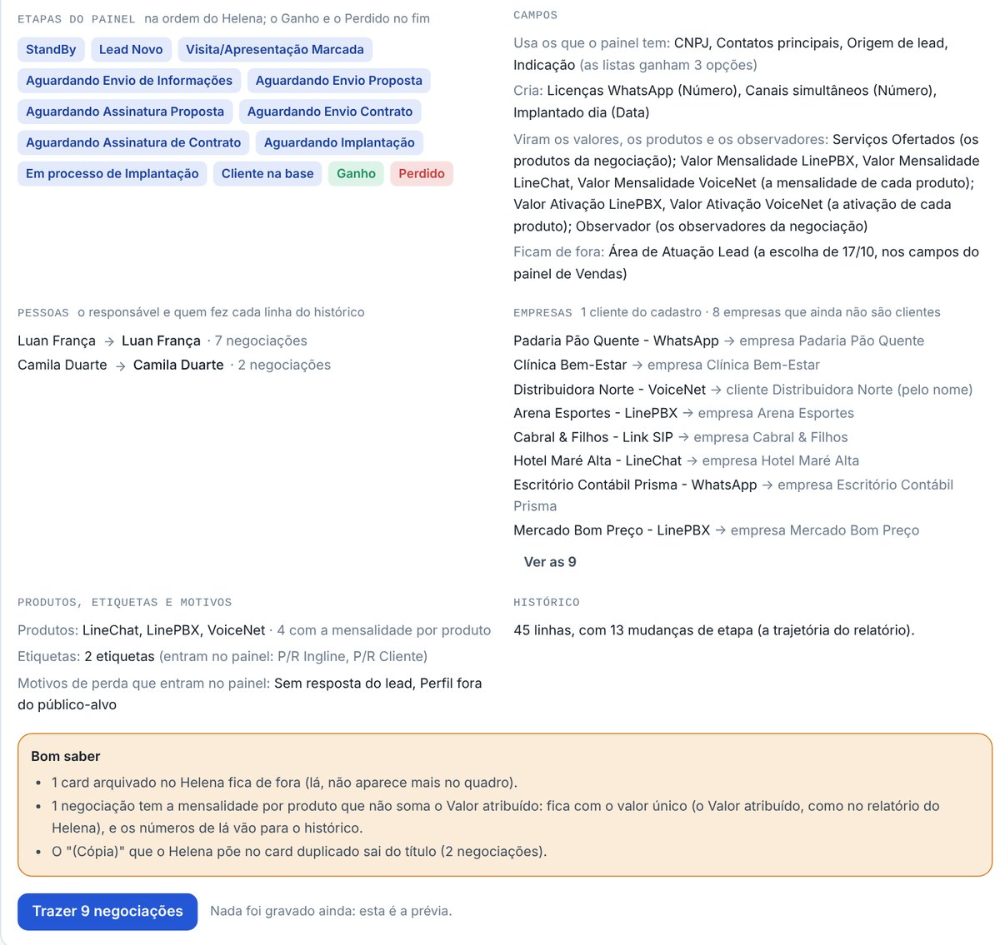
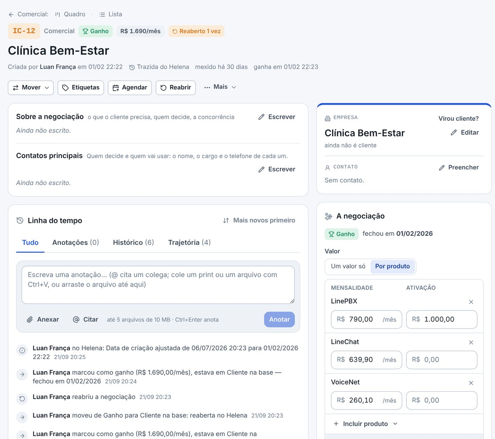
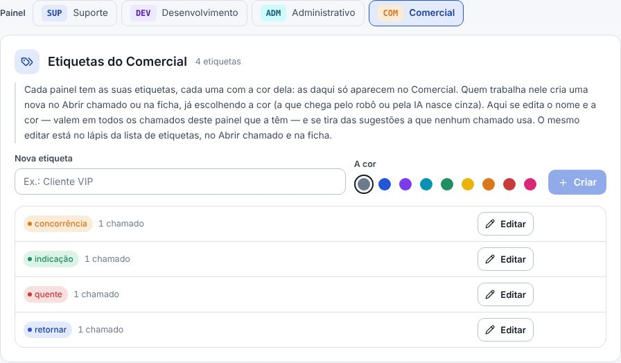
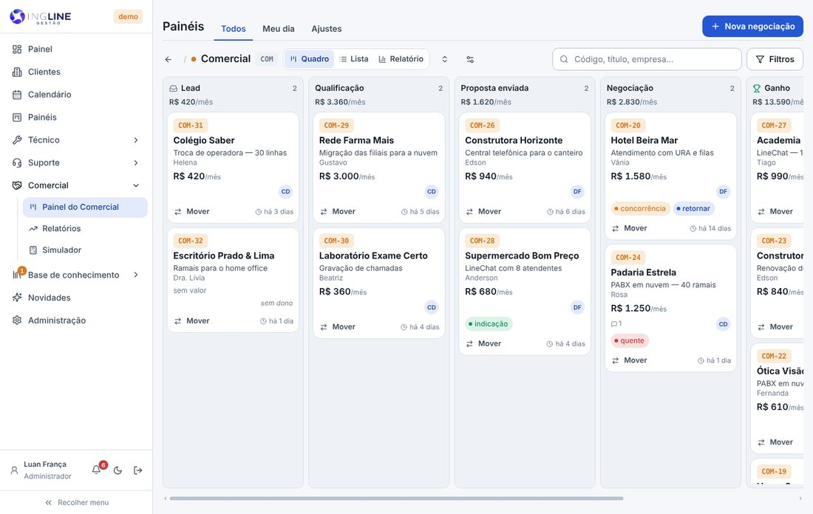
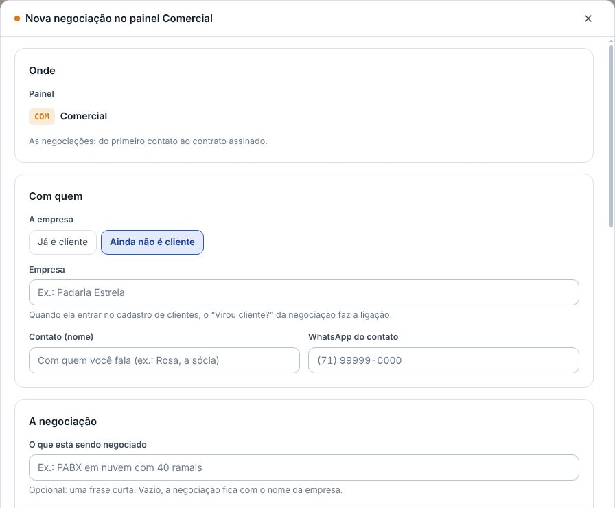
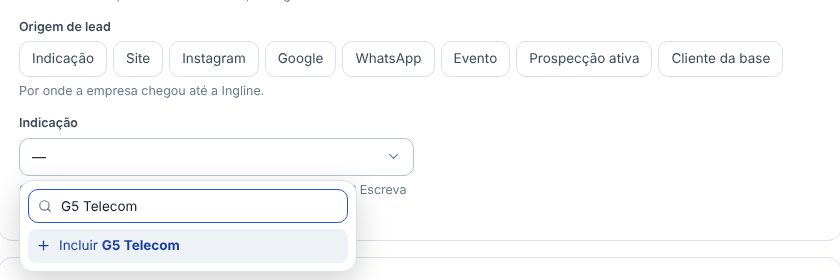
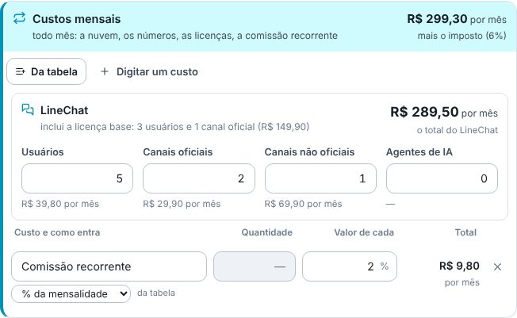
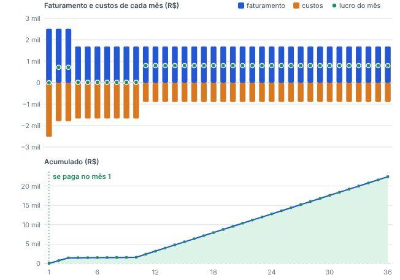

## novo · Trazer do Helena
Em **Administração › Importar / Exportar**, o cartão **Trazer do Helena** lê o painel **Ingline - Comercial**
pela chave do LineChat (a mesma dos chamados) e traz cada card para um painel de Vendas do Gestor: o que
já existe ou um painel novo, o **Comercial (IC)** — o IC-34 de lá continua IC-34. Vem o histórico de cada
negociação: onde nasceu, cada mudança de etapa, o ganho e a perda, a reabertura, a mensalidade e quem fez.
As anotações e os anexos ficam no Helena.

## novo · A prévia antes de gravar
Antes de trazer, a prévia mostra os números de agora (em andamento, ganhas e perdidas) e **os ganhos mês a
mês pela Conclusão**, para comparar com o gráfico do relatório do Helena. Mostra também as etapas (as do
Helena, na ordem de lá, com o Ganho e o Perdido no fim), os campos, quem do Gestor fica com cada nome do
Helena, as empresas que já são clientes e o que fica de fora. Só o **Trazer** grava, depois da confirmação.

## novo · O relatório com os meses de antes
A mensalidade de cada negociação é o **Valor atribuído** do card, o mesmo número que o relatório do Helena
soma, e o ganho conta no dia da **Conclusão** de lá. Assim, o relatório do Comercial no Gestor dá os mesmos
números do Helena, com o funil, o mês a mês e a ativação. Na negociação, a linha do tempo diz de onde ela
veio: *"criou a negociação (Trazida do Helena, era IC-34)"*.

## atencao · Dá para trazer de novo até a virada
Trazendo de novo, o que já veio é atualizado: a negociação fica como está no Helena, e o histórico que veio
de lá é refeito. O que a equipe fez no Gestor continua no histórico, e a prévia avisa quantas negociações
foram mexidas aqui. O que é novo no Helena entra.

## atencao · Cada painel tem as suas etiquetas
As etiquetas deixaram de ser as mesmas em todos os painéis: cada painel tem as suas, cada uma com a cor
dela. As que já existiam foram para os painéis em que estavam sendo usadas, com a mesma cor; as que ninguém
usava ficaram nos painéis de chamados. Em **Painéis › Ajustes › Etiquetas**, escolha o painel em cima para
criar, editar e tirar as dele. O chamado que passa para outro painel leva as etiquetas junto.

## melhorou · O quadro vai até o pé da tela
O quadro de cada painel ocupa a tela até embaixo, e a barra de rolar para o lado fica no pé da tela, sempre
à vista, mesmo com poucos cartões. Cada coluna rola por dentro quando tem muitos cartões.

## melhorou · Etiquetas e Agendar ao lado do Mover
Na ficha do chamado e da negociação, os botões **Etiquetas** e **Agendar** ficam logo depois do Mover: um
clique abre a lista das etiquetas do painel, para pôr, tirar ou criar, e o Agendar põe no calendário já
ligado ao card. Os botões da barra ficaram menores. As etiquetas e o Na agenda continuam lá embaixo também.

## melhorou · O cartão da negociação: a empresa em destaque
No quadro do Comercial, o cartão mostra o nome da empresa grande e em negrito, e embaixo dele, numa linha
só, o que está sendo negociado.

## novo · O título da negociação é opcional
Na Nova negociação e na ficha, o "O que está sendo negociado" pode ficar em branco: aí a negociação fica com
o nome da empresa. Se a empresa mudar (ou virar cliente), o título que era o nome dela acompanha. Os chamados
dos outros painéis continuam pedindo o título.

## melhorou · A negociação nova começa em "Ainda não é cliente"
Como a maioria das negociações é de empresas novas, a Nova negociação já abre com **Ainda não é cliente**
marcado. Para vender a quem já é cliente, é só clicar em Já é cliente e escolher na lista.

## novo · A Indicação numa lista, com o Incluir
A **Indicação** deixou de ser um texto livre: escolha numa lista. Se quem indicou ainda não está nela,
escreva o nome e clique em **Incluir**: ele entra na lista e já fica escolhido. O que já tinha sido escrito
nas negociações virou opção da lista. Em Painéis › Ajustes › Campos, qualquer lista pode ganhar o Incluir.

## melhorou · O LineChat no Simulador, só com as quantidades
Pondo o LineChat nos produtos da simulação, os Custos mensais mostram o quadro do LineChat: usuários,
canais oficiais, canais não oficiais e agentes de IA. Escreva as quantidades e ele dá o custo de cada uma e
o total do mês, como na planilha da Helena. A licença base entra sozinha, e as faixas de preço ficam por
trás, nos Ajustes do Simulador.

## melhorou · Os custos do mês, um a um
No Simulador, o detalhe de cada mês (passando o mouse no mês a mês) e o **O custo do mês**, ao lado, mostram
cada custo pelo nome — a máquina em nuvem, os números, a licença, o imposto, cada comissão —, sem juntar os
custos mensais numa linha só. E o **"Uma vez (R$)"** saiu do Investimento: lá ficam o Aparelho e o % da
ativação.

## corrigido · O gráfico do mês a mês
O gráfico do mês a mês do Simulador tem agora a escala em números redondos, e nenhuma coluna encosta na
borda. Quando a coluna do 1º mês passa da escala, o valor dela aparece inteiro, sem ficar coberto pela
coluna do lado, e as linhas brancas que cruzavam a coluna sumiram.

