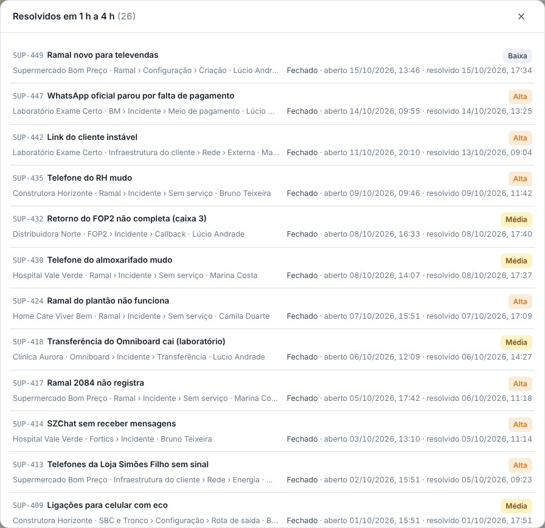
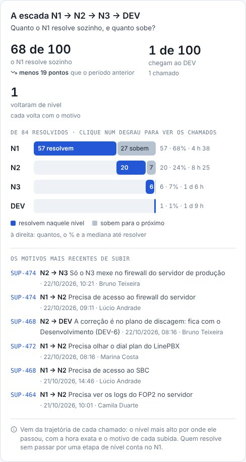
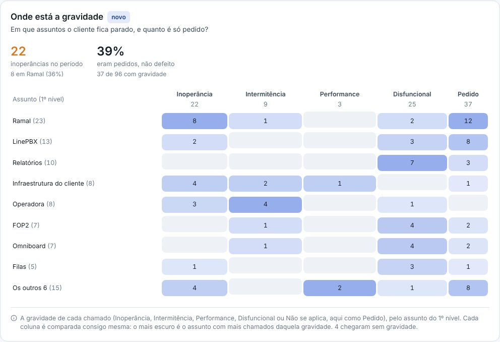
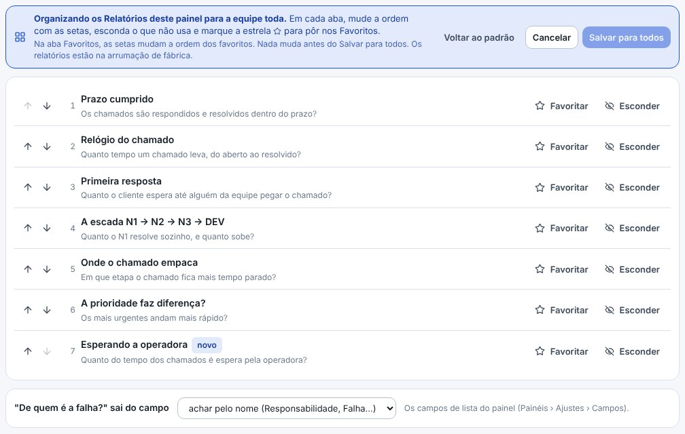
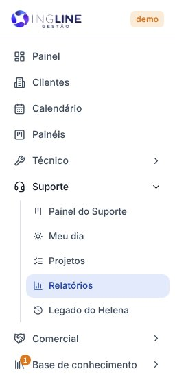

## novo · Os Relatórios de cada painel
Em cada painel, ao lado do **Quadro** e da **Lista**, agora tem **Relatórios**: 25 relatórios sobre os
chamados do Gestor, em seis abas — **Tempo, Volume, Assuntos, Clientes, Equipe e Mês** —, e a aba
**Favoritos**. No menu, **Suporte › Relatórios** abre os do Suporte. O tempo é em horas úteis (o horário
de atendimento e os feriados dos Prazos), em mediana, e o chamado conta como resolvido no Resolvido. O
período (30 dias, este mês, 12 meses…) e os filtros — assunto, gravidade, prioridade, até que nível subiu,
responsável, cliente, operadora, Responsabilidade — ficam no endereço: dá para mandar o link.

## novo · Clicar mostra os chamados
Cada número, faixa, degrau, célula e barra abre a janela com os chamados por trás dele, e cada chamado da
janela abre a ficha. A janela é a mesma conta do número.

## novo · A escada até o DEV, com o motivo de cada subida
**A escada N1 → N2 → N3 → DEV** mostra quanto o N1 resolve sozinho e quanto sobe, com a mediana de cada
nível, as voltas de nível e os motivos mais recentes de subir. Vem da trajetória de cada chamado: o nível
mais alto por onde ele passou. Na mesma aba, o Prazo cumprido por prioridade, o Relógio do chamado, a
Primeira resposta, Onde o chamado empaca e A prioridade faz diferença?

## novo · Os assuntos em árvore
Na aba **Assuntos**, **Os assuntos** mostram a árvore do painel: clique num assunto para descer (Operadora
› Incidente › Canais) e no caminho, em cima, para voltar. Cada assunto soma os de baixo, com a mediana, o
prazo e os em aberto — é o que os grupos montados à mão faziam no Helena. Ao lado, o Sobe e desce (no 1º,
2º ou 3º nível) e Os poucos que pesam muito.

## novo · Onde está a gravidade
**Onde está a gravidade** cruza o assunto com a gravidade: em que assuntos o cliente fica parado
(inoperância) e quanto é só pedido. Cada coluna é comparada consigo mesma — o mais escuro é o assunto com
mais chamados daquela gravidade.

## novo · Esperando a operadora, o tempo gasto e os problemas
Mais três que o Helena não deixava fazer: **Esperando a operadora** (quanto do tempo até resolver foi
espera pela operadora, os protocolos de cada uma e quantas vezes ela passou do prometido), **Tempo gasto**
(o tempo lançado na ficha, por pessoa, assunto e cliente) e **Os problemas** (os abertos e quantos
incidentes cada um junta).

## novo · Organizar e os Favoritos
Quem cuida dos chamados clica em **Organizar** e arruma os relatórios do painel **para a equipe toda**: a
ordem em cada aba, o que fica escondido, a estrela dos **Favoritos** e de qual campo sai o "De quem é a
falha?" (no Suporte, a Responsabilidade). Nada muda antes do **Salvar para todos**. O relatório que o painel
não usa não aparece: o Desenvolvimento, sem prazo, sem assunto e sem níveis, fica sem o Prazo cumprido, a
árvore e a escada.

## atencao · Os relatórios do Helena viraram o Legado do Helena
Os relatórios dos chamados do LineChat continuam iguais, com os assuntos de lá, em **Suporte › Legado do
Helena** (era Suporte › Relatórios). Os dois não se misturam: quase tudo mudou de régua — as horas úteis, o
Resolvido, o nível e os assuntos. O envio diário do PDF continua saindo dos gráficos marcados no Legado do
Helena, e os Relatórios novos crescem com os chamados abertos no Gestor.

