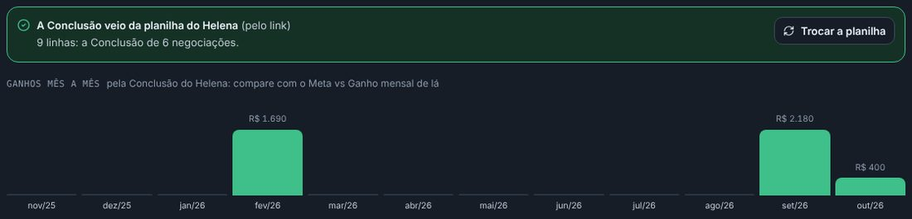

## atencao · Traga o Comercial de novo, com a planilha
Em **Administração › Importar / Exportar › Trazer do Helena**, clique em **Ler o Helena**. No Helena, abra o
painel Ingline - Comercial em **Lista** e clique em **Exportar**. Quando o aviso disser que terminou, abra a
planilha e copie o endereço dela. Cole no quadro amarelo da prévia e clique em **Usar a planilha**. Confira os
ganhos mês a mês: fev R$ 3.190, abr R$ 2.739,80, mai R$ 3.578,80, jun R$ 2.990, jul R$ 3.440, ago R$ 4.640, set
R$ 6.593,20 e out R$ 990. Depois, **Trazer** para o mesmo painel: o que já veio é atualizado, sem duplicar.

## corrigido · Os ganhos mês a mês como no Helena
A chave de API do LineChat não lê a Conclusão (o dia do ganho ou da perda) nem o histórico das etapas. Sem a
Conclusão, cada ganho caía no dia da última mudança do card, quase tudo em setembro, quando as vendas antigas
foram lançadas no Helena. A planilha que o Helena exporta tem a Conclusão: somando por ela, dá o gráfico de lá,
mês a mês. A perda também traz o motivo de lá.

## melhorou · O que a planilha não traz
O histórico das etapas não está na planilha, e a chave não lê. Por isso, a negociação trazida nasce na etapa
em que o card está. Se o Google não deixar baixar pelo link, baixe a planilha como .csv (Arquivo › Fazer
download) e escolha o arquivo. A cada vez que trouxer de novo, exporte a planilha de novo.
