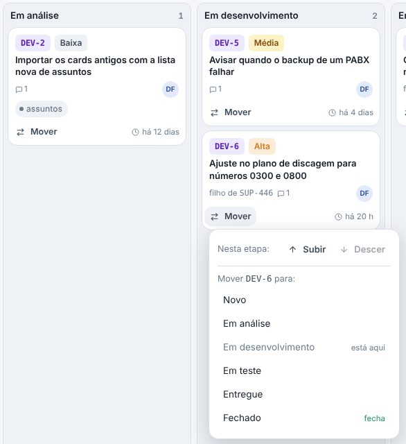
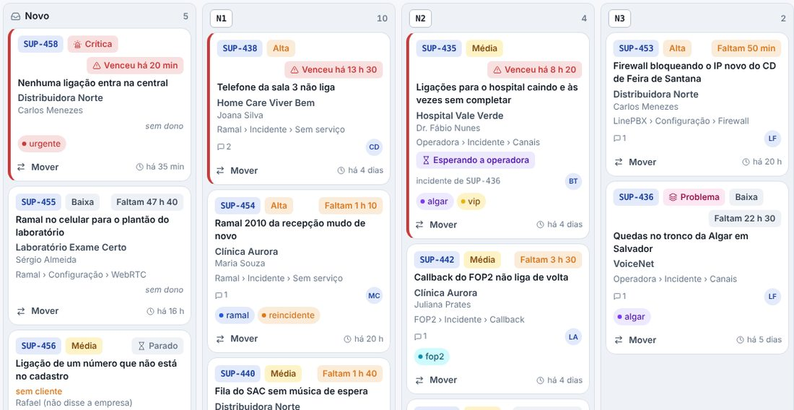
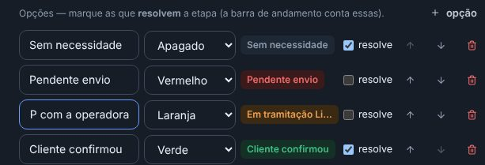

## novo · Arrume a ordem dos cartões dentro da etapa
Nos painéis que não contam prazo (o Desenvolvimento, os painéis trazidos do Helena e os outros sem prazo), arraste
o cartão para cima ou para baixo na mesma coluna: uma linha azul mostra onde ele cai, e a ordem fica a mesma para
todo mundo. Pelo celular, use Subir e Descer no Mover do cartão. O cartão que chega na etapa aparece no alto. No
Suporte, que conta prazo, o mais urgente continua primeiro; no Resolvido e no Fechado, o mais recente.

## melhorou · As colunas do quadro, um pouco mais largas
No quadro de todos os painéis (Suporte, Desenvolvimento, Comercial e os seus), cada coluna ficou uns 15% mais
larga, e alarga mais um pouco quando sobra espaço na tela. O título do cartão quebra menos e não é
mais cortado com "…" tão cedo, e o código, a prioridade e o prazo cabem numa linha só. As colunas que não cabem
na tela continuam rolando para o lado; no celular, nada muda.

## corrigido · O nome comprido da opção não desarruma a etapa do projeto
Na janela do projeto (Novo projeto ou Editar), nas opções de uma etapa de escolha, o nome comprido fazia o
exemplo colorido crescer e empurrava a lixeira para a linha de baixo. Agora todas as linhas ficam alinhadas,
do mesmo tamanho, e o exemplo comprido é cortado com "…" (o nome inteiro aparece ao passar o mouse).

