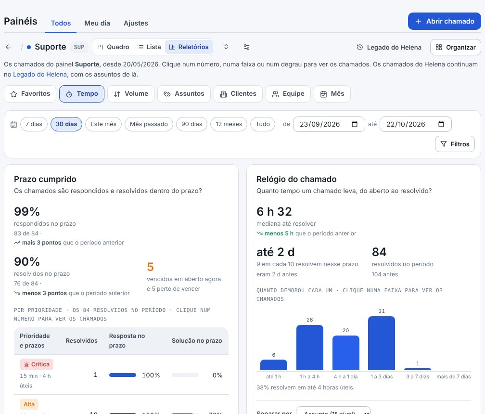
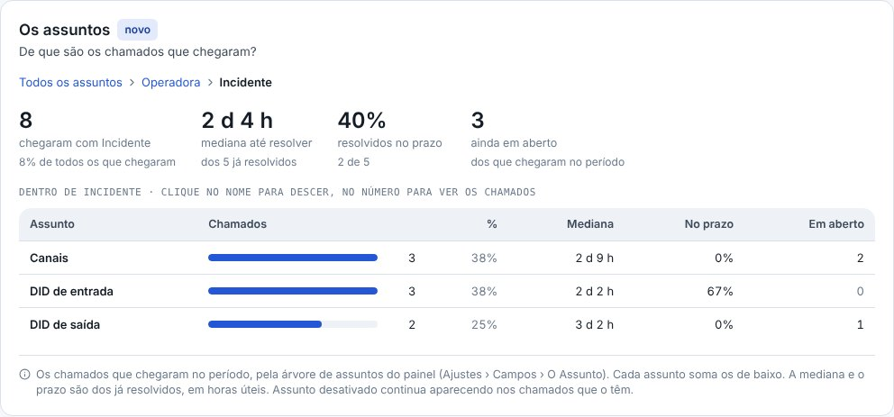
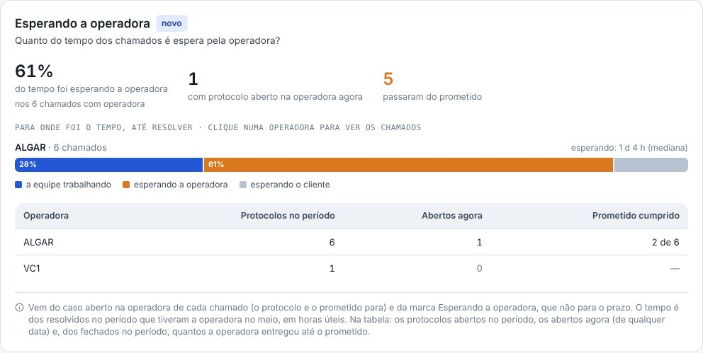
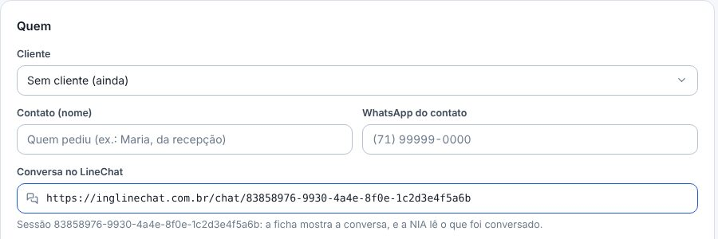
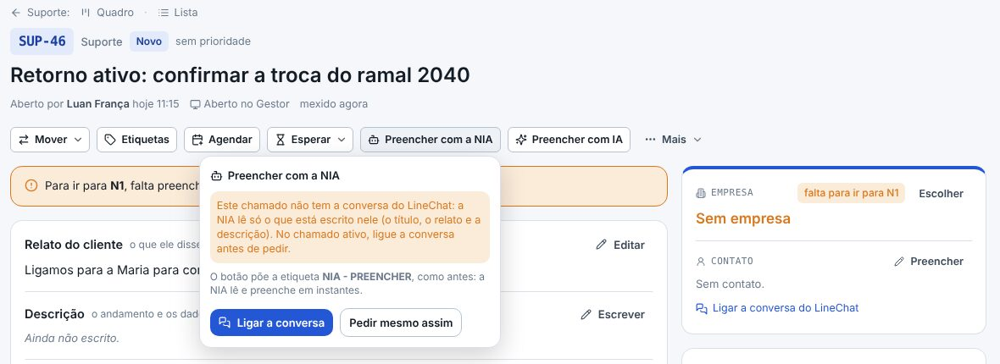
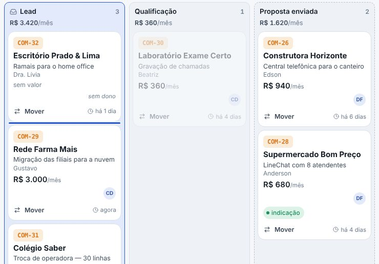
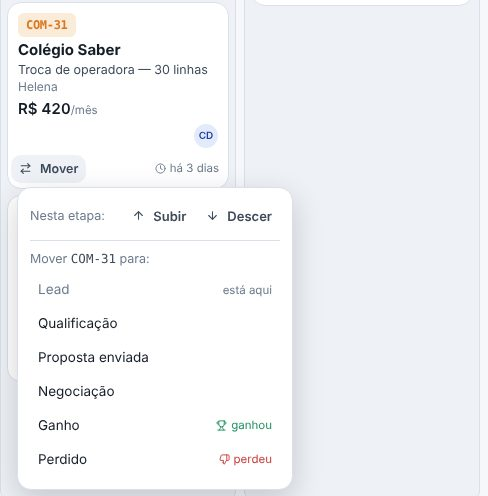
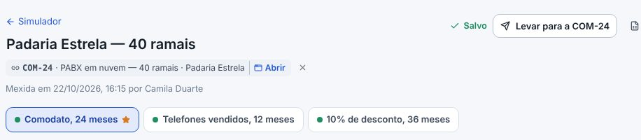

## atencao · Os relatórios do Helena viraram o Legado do Helena
Os relatórios dos chamados do LineChat continuam iguais, com os assuntos de lá, em **Suporte › Legado do
Helena** (era Suporte › Relatórios). Os dois não se misturam: quase tudo mudou de régua — as horas úteis, o
Resolvido, o nível e os assuntos. O envio diário do PDF continua saindo dos gráficos marcados no Legado do
Helena, e os Relatórios novos crescem com os chamados abertos no Gestor.

## novo · Os Relatórios de cada painel
Em cada painel, ao lado do **Quadro** e da **Lista**, agora tem **Relatórios**: 25 relatórios sobre os
chamados do Gestor, em seis abas — **Tempo, Volume, Assuntos, Clientes, Equipe e Mês** —, e a aba
**Favoritos**. No menu, **Suporte › Relatórios** abre os do Suporte. O tempo é em horas úteis (o horário
de atendimento e os feriados dos Prazos), em mediana, e o chamado conta como resolvido no Resolvido. O
período (30 dias, este mês, 12 meses…) e os filtros — assunto, gravidade, prioridade, até que nível subiu,
responsável, cliente, operadora, Responsabilidade — ficam no endereço: dá para mandar o link.

## novo · Clicar mostra os chamados
Cada número, faixa, degrau, célula e barra abre a janela com os chamados por trás dele, e cada chamado da
janela abre a ficha. A janela é a mesma conta do número.

## novo · A escada até o DEV, com o motivo de cada subida
**A escada N1 → N2 → N3 → DEV** mostra quanto o N1 resolve sozinho e quanto sobe, com a mediana de cada
nível, as voltas de nível e os motivos mais recentes de subir. Vem da trajetória de cada chamado: o nível
mais alto por onde ele passou. Na mesma aba, o Prazo cumprido por prioridade, o Relógio do chamado, a
Primeira resposta, Onde o chamado empaca e A prioridade faz diferença?

## novo · Os assuntos em árvore
Na aba **Assuntos**, **Os assuntos** mostram a árvore do painel: clique num assunto para descer (Operadora
› Incidente › Canais) e no caminho, em cima, para voltar. Cada assunto soma os de baixo, com a mediana, o
prazo e os em aberto — é o que os grupos montados à mão faziam no Helena. Ao lado, o Sobe e desce (no 1º,
2º ou 3º nível) e Os poucos que pesam muito.

## novo · Onde está a gravidade
**Onde está a gravidade** cruza o assunto com a gravidade: em que assuntos o cliente fica parado
(inoperância) e quanto é só pedido. Cada coluna é comparada consigo mesma — o mais escuro é o assunto com
mais chamados daquela gravidade.

## novo · Esperando a operadora, o tempo gasto e os problemas
Mais três que o Helena não deixava fazer: **Esperando a operadora** (quanto do tempo até resolver foi
espera pela operadora, os protocolos de cada uma e quantas vezes ela passou do prometido), **Tempo gasto**
(o tempo lançado na ficha, por pessoa, assunto e cliente) e **Os problemas** (os abertos e quantos
incidentes cada um junta).

## novo · Organizar e os Favoritos
Quem cuida dos chamados clica em **Organizar** e arruma os relatórios do painel **para a equipe toda**: a
ordem em cada aba, o que fica escondido, a estrela dos **Favoritos** e de qual campo sai o "De quem é a
falha?" (no Suporte, a Responsabilidade). Nada muda antes do **Salvar para todos**. O relatório que o painel
não usa não aparece: o Desenvolvimento, sem prazo, sem assunto e sem níveis, fica sem o Prazo cumprido, a
árvore e a escada.

## novo · O botão da NIA na ficha
Para a NIA preencher o chamado, não precisa mais etiquetar: na ficha, clique em **Preencher com a NIA**. Por
baixo, o botão põe a mesma etiqueta (**NIA - PREENCHER**), então a NIA continua igual. Enquanto ela trabalha, o
botão mostra **NIA preenchendo…** e a ficha se atualiza sozinha; quando ela termina, chega um aviso e o botão fica
**NIA preencheu**, em verde (ou **NIA não preencheu**, em vermelho). Clique nele para ver **quando ela preencheu,
quando foi pedida e por quem, o que ela mudou e as anotações dela** — e o **Preencher de novo**. Vale também para
os chamados que vocês etiquetaram à mão antes do botão. As etiquetas ficam em **Painéis › Ajustes › IA**, no
cartão **A NIA na ficha**, onde também se desliga o botão.

## novo · A conversa do chamado ativo
O chamado ativo (quando a equipe chama o cliente) não vem do robô, e por isso ficava sem a conversa. Agora, ao
**abrir o chamado**, cole o **link da conversa no LineChat** (ou só o código da sessão) no campo **Conversa no
LineChat**: a tela mostra a sessão que achou. Na ficha, **Ligar a conversa do LineChat** faz o mesmo depois, e o
**Trocar** põe o link de outra conversa (ou tira). Com a conversa ligada, a ficha mostra o link, a **NIA lê o que
foi conversado**, e a resposta do cliente na mesma conversa entra no chamado, sem abrir outro.

## melhorou · A NIA avisa quando falta a conversa
No chamado sem a conversa do LineChat, o **Preencher com a NIA** avisa antes de pedir — sem ela, a NIA lê só o que
está escrito no chamado — e oferece **Ligar a conversa** ali mesmo.

## novo · A ordem do quadro do Comercial, arrastando
No quadro do **Comercial**, arraste a negociação para cima ou para baixo na coluna, como já arrastava de uma
etapa para outra: a linha azul mostra onde ela vai cair, e a ordem fica guardada para todo mundo. Arrastando
para outra etapa, ela também cai onde a linha mostra. A negociação que chega numa etapa sem lugar escolhido
(pelo Mover ou pela ficha) aparece no alto da coluna. No Suporte, o quadro continua pondo o mais urgente
primeiro; no Ganho e no Perdido, o mais recente.

## novo · Subir e Descer, no celular
No celular, que não arrasta, o **Mover** do cartão do Comercial tem **Subir** e **Descer**, para trocar a
ordem na coluna.

## corrigido · As colunas do quadro com a mesma largura
A coluna com um texto comprido (um título cortado com "…") ficava mais larga que as outras. Agora todas têm
a mesma largura, em todos os painéis, e o nome comprido da etapa quebra em duas linhas.

## melhorou · A simulação abre numa janela, sem sair da ficha
Na ficha da negociação, clicar numa simulação em **Simulações** abre a simulação inteira numa janela por cima
da ficha, e o **Simular** abre a nova ali também. Ela salva sozinha; fechando a janela (o X, o Esc ou um
clique fora), você volta para a ficha, com a lista e a margem atualizadas. **Página inteira** leva para o
Simulador.

## melhorou · No Simulador, a negociação abre numa janela
Na simulação, o chip da negociação ligada ganhou o **Abrir**: a ficha da negociação abre numa janela por cima
da simulação, sem sair dela. Na lista do Simulador, o chip da negociação também abre numa janela.

## melhorou · Os tipos do calendário numa lista
No calendário, os tipos (Visita, Folga…) viraram o botão **Tipos**, como o **Painéis**: ele abre a lista com
uma caixa por tipo, cada um com a cor dele, e mostra quantos estão marcados. O botão de quem cuida dos tipos
agora se chama **Editar tipos**.

## corrigido · Os ganhos mês a mês como no Helena
No **Trazer do Helena**, o LineChat recusava o pedido de cada card (*"The value 'Logs,Key,…' is not valid"*):
sem o card inteiro, não vinham o histórico nem a **Conclusão**, e cada ganho caía no dia da última mudança do
card (no Comercial, quase tudo em setembro). Agora o Gestor pede cada detalhe separado, como já pedia a lista
dos cards. Depois de atualizar, em **Administração › Importar /
Exportar › Trazer do Helena**, é só **Ler o Helena** de novo, conferir na prévia os **ganhos mês a mês** (fev
R$ 3.190, abr R$ 2.739,80, mai R$ 3.578,80, jun R$ 2.990, jul R$ 3.440, ago R$ 4.640, set R$ 6.593,20 e out
R$ 990, como no gráfico de lá) e **Trazer** para o mesmo painel: o que já veio é atualizado, sem duplicar.

## melhorou · A prévia avisa quando falta a Conclusão
Se uma negociação ganha ou perdida vier sem a Conclusão do Helena, a prévia diz quantas, embaixo dos ganhos
mês a mês e em **Bom saber**, antes de você trazer. E, se o LineChat recusar algum detalhe do card, a prévia
diz qual e traz o resto.
