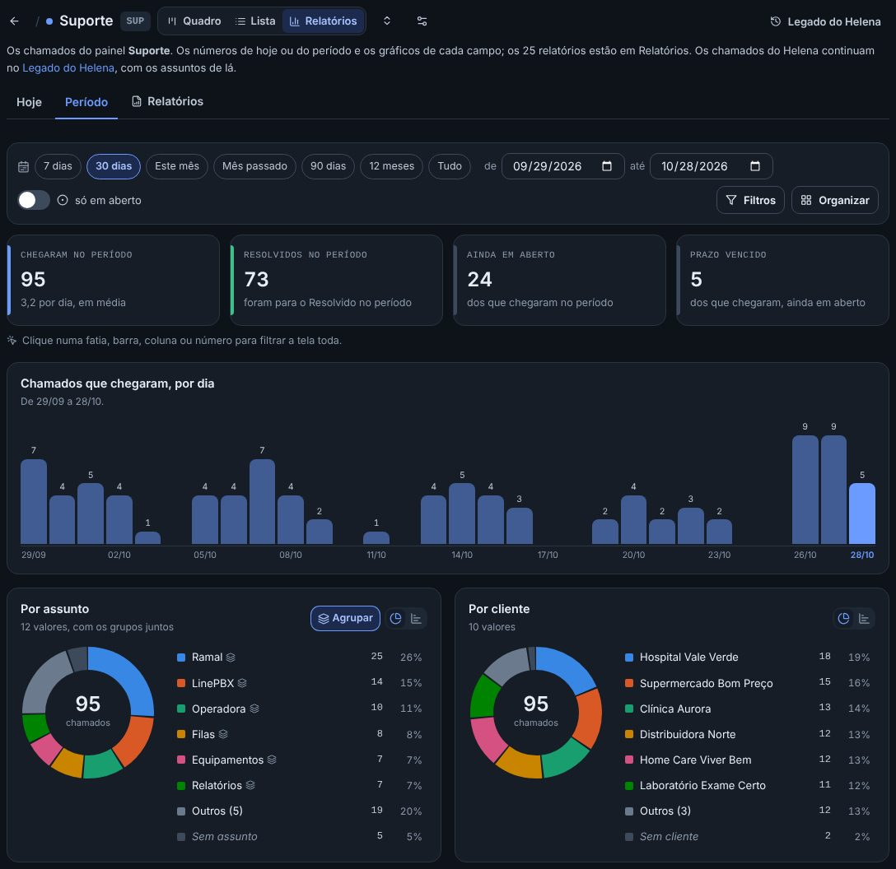
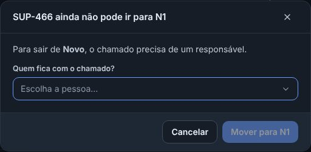
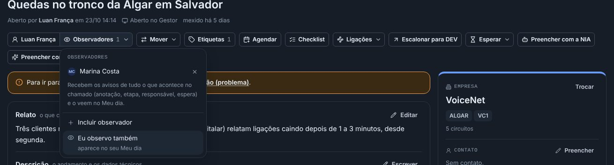
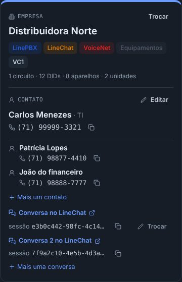
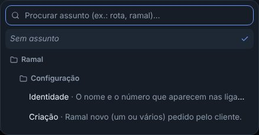
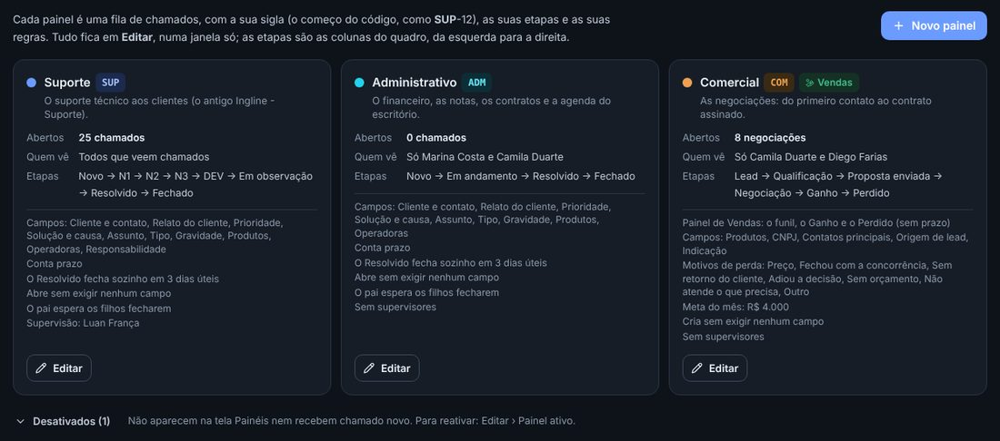

## novo · Os Relatórios abrem nos números de hoje, com os gráficos de pizza
Nos Relatórios de cada painel, em cima, ficaram as três partes do Legado do Helena: Hoje, Período e Relatórios. Hoje
e Período mostram os números (chegaram, resolvidos, em aberto, prazo vencido), os chamados por hora ou por dia e os
gráficos de pizza ou barras: por assunto, cliente, tipo, etapa, produto, canal, responsável, prioridade e os campos do
painel. Clicar numa fatia filtra a tela toda; clicar de novo desfaz. Os 25 relatórios continuam em Relatórios.

## atencao · O chamado só sai do Novo com um responsável
Para tirar o chamado do Novo (para o N1, para o Resolvido, para qualquer outra etapa), ele precisa de alguém
responsável. Pelo quadro, ao arrastar um chamado sem responsável, a janela pergunta quem fica com ele e já move. Na
ficha, o botão do responsável fica laranja e o aviso diz o que falta. O Assumir continua fazendo tudo de uma vez. Na
negociação do Comercial, nada muda.

## melhorou · A barra da ficha: Responsável, Observadores, Checklist e Ligações
O responsável virou um botão na barra de cima: mostra quem está com o chamado e troca ali mesmo. Colado nele, o botão
Observadores mostra quem recebe os avisos, inclui, tira e tem o Eu observo também (o cartão Observadores saiu da ficha).
O checklist vazio saiu da ficha: o botão Checklist traz ele de volta. Ligar a outro chamado, Criar um
filho e Definir o pai ganharam o botão Ligações, como o Esperar. O Copiar o link ficou ao lado do código, no alto.

## melhorou · A ficha mostra só o que tem
O Checklist, os Filhos e ligações e o Na agenda vazios não aparecem mais. Eles voltam sozinhos quando o chamado ganha um
item, uma ligação ou um evento marcado (pelo Agendar da barra).

## melhorou · A linha do tempo começa nas Anotações
A ordem das abas agora é Anotações, Histórico, Trajetória e Tudo, e a ficha abre nas Anotações.

## novo · Vários contatos e várias conversas no chamado
No cartão do contato, Mais um contato inclui outro (o nome e o WhatsApp, ou um clique num contato do cliente), e Mais
uma conversa liga outra conversa do LineChat. Cada um tem o X para tirar. O contato e a conversa de cima continuam os
principais: o aviso ao cliente e a NIA usam eles. O robô acha o chamado aberto por qualquer uma das conversas, e a busca
acha o chamado pelos outros contatos.

## melhorou · O assunto em pastas
Ao escolher o assunto do chamado, o que tem outros dentro (como Operadora e Operadora › VC1) virou uma pasta: aparece
como o título do grupo e não se escolhe mais; escolhe-se o de dentro. Na busca, cada assunto aparece com o caminho
inteiro. Nos filtros do quadro e da lista, a pasta continua filtrando ela e o que está dentro.

## corrigido · Fechar um chamado aberto de dentro de outro volta para o primeiro
Abrindo um chamado de dentro de outro (pelo desenho das ligações, por um código no texto), o X agora volta para o
chamado de antes, e não para o quadro. Um X a mais, e volta para a tela.

## atencao · Ver a senha guardada não pede mais a sua senha
O olho das senhas guardadas (os acessos, o tronco, os ramais) mostra a senha na hora, por 30 segundos, sem digitar a sua
senha antes. Só quem tem a permissão de ver senhas vê o olho, e cada vez que alguém vê fica na auditoria, com o nome, a
data e a hora. Exportar com senhas continua pedindo a sua senha.

## melhorou · Trocar a prioridade não pede o motivo
Escolher uma prioridade diferente da sugerida grava na hora, na ficha e no Abrir chamado, sem a janela do motivo.

## melhorou · O painel desativado sai do meio dos Ajustes
Em Painéis › Ajustes › Painéis, só os painéis em uso ficam na grade. Os desativados vão para o fim, numa parte
fechada, Desativados (1): clique para ver e, para reativar, Editar › Painel ativo. Pelo "ver em Ajustes › Painéis" da
tela dos painéis, a parte já abre aberta.

