## atencao · Para começar: o painel e a etapa do Comercial
Nada muda até montar: crie o painel em Painéis › Ajustes › Novo painel › Implantação e, no painel do Comercial, abra a
etapa Em processo de Implantação e escolha Ao chegar aqui, abre a implantação › No painel Implantação; inclua a etapa
Implantado antes do Ganho e ligue A negociação vem para cá quando a implantação termina. Os módulos do
card são os de Administração › Produtos: confira se os do LinePBX e do LineChat estão todos lá.

## novo · O painel de Implantação: um card por cliente
O card de cada cliente novo passa pela Curadoria, pela Configuração e pelos Testes, chega no Concluído quando os testes acabam e no
Implantado quando a implantação foi feita junto com o cliente. O cartão do quadro
mostra quanto da parte da etapa já foi feito. Para criar: Painéis › Ajustes › Novo painel › Implantação, que já vem com
as etapas e os campos do LineChat e do LinePBX.
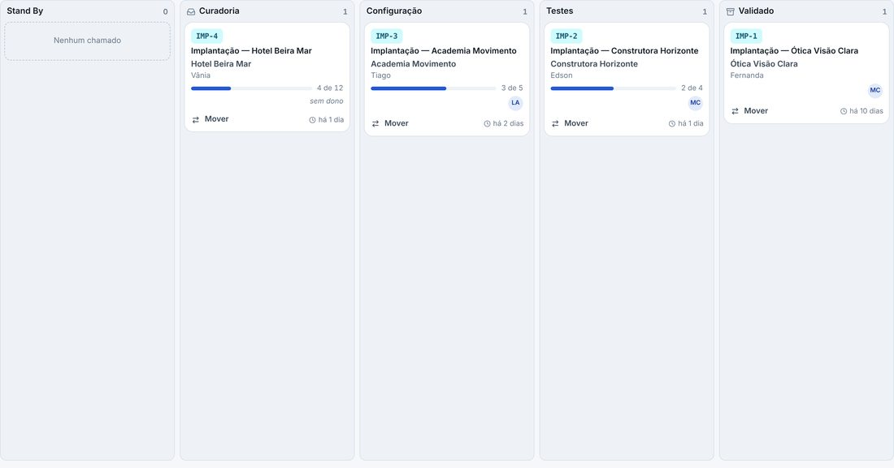

## novo · O Painel da Implantação no menu Suporte
No menu, Suporte › Painel da Implantação abre o quadro da implantação, como o Painel do Suporte abre o do suporte. Na
tela do painel e nos cards dele, o item fica marcado.
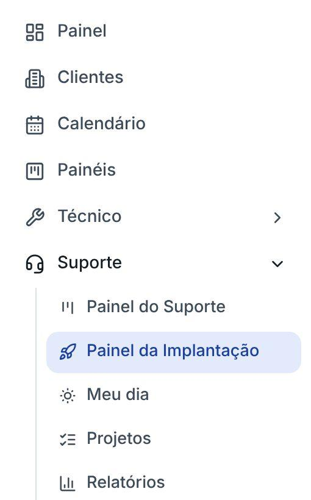

## melhorou · Os Detalhes da proposta na negociação
Os campos que vieram do Helena (as licenças corporativas e de callcenter, de voz e do WhatsApp, os canais simultâneos, a
faixa numérica e as licenças dos números oficiais) saíram do canto e ganharam um cartão próprio no meio da ficha da negociação, os
Detalhes da proposta, com os números lado a lado. Os que já estavam no Comercial vão para lá na atualização, e os que o
Trazer do Helena criar também.
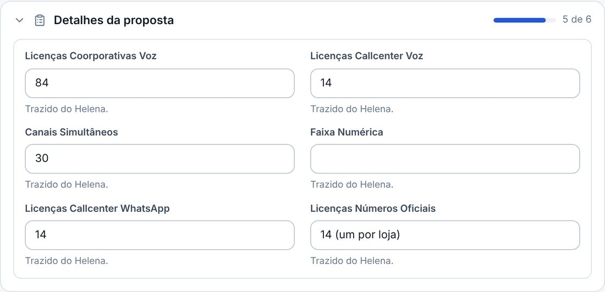

## melhorou · Os Contatos principais saíram da negociação
O contato da negociação é o da lateral: o principal e o Mais um contato, com o nome, o WhatsApp e o e-mail. O campo Contatos
principais saiu da ficha e do Abrir negociação; o que já estava escrito nele fica guardado (volta se o campo for ligado
de novo, em Painéis › Ajustes › Campos).

## novo · O e-mail dos contatos
O contato de cada chamado e de cada negociação agora tem o e-mail, como o WhatsApp: no Abrir chamado, no Abrir negociação
e no Editar do contato, na lateral da ficha, onde ele aparece com o link para escrever. Cada um do Mais um contato
também tem o seu. Ao escolher um contato do cadastro do cliente, o e-mail dele vem junto; a busca acha pelo e-mail; e o
card da implantação leva o e-mail do contato da negociação.

## melhorou · O Mês a mês do Simulador, sem as colunas
No Simulador, o Mês a mês ficou com os totais do contrato, a linha do acumulado (o pior momento e o mês em que a venda se
paga) e a tabela, que agora fica sempre aberta. O gráfico de colunas saiu. O detalhe de cada mês, com o que entrou e o
que saiu parte a parte, aparece com o mouse sobre a linha ou com um clique na linha do mês, na tabela.
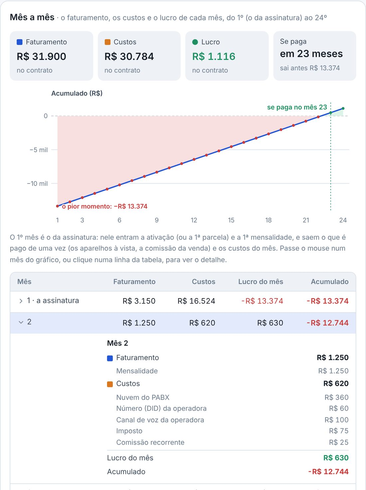

## novo · A ficha em partes, com quem marcou cada caixinha
No meio da ficha, um cartão por parte (Curadoria, Configuração, Testes), com um bloco para cada produto do card. A equipe
técnica marca o que já configurou, o suporte marca o que já testou, e cada caixinha mostra quem marcou e quando. Os
Módulos a ativar (os do catálogo do produto) são escolhidos na Curadoria; na Configuração, a Ativação dos módulos é o
checklist só deles.
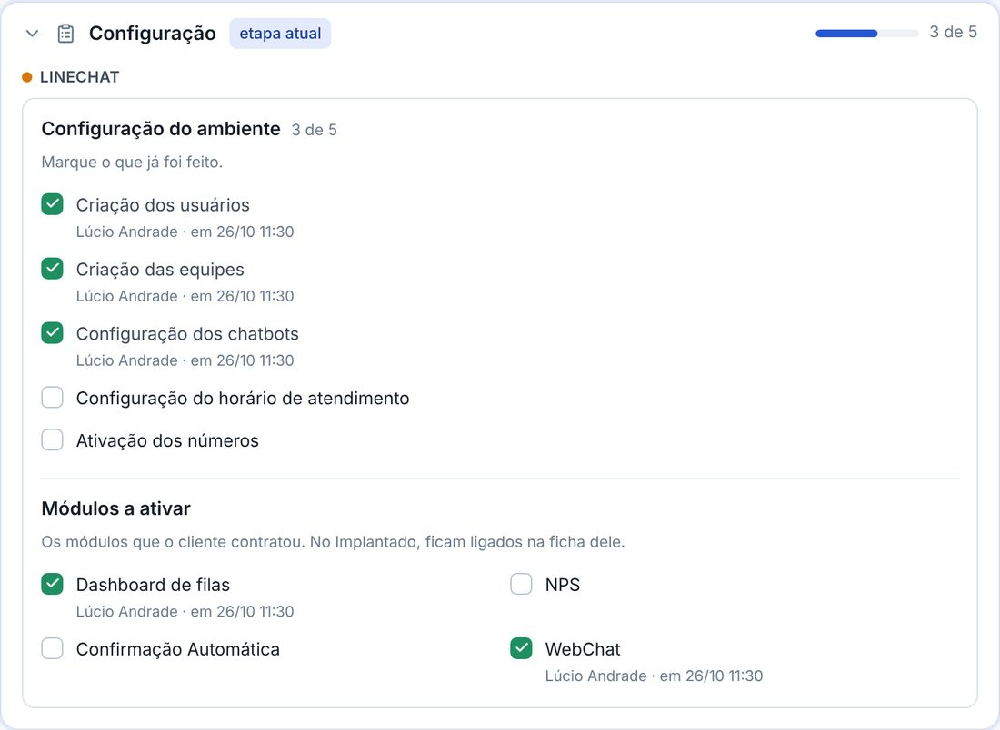

## novo · As caixinhas em pastas
A Configuração do ambiente do LinePBX vem em pastas: Servidor, Asterisk, LinePBX Web, Módulos e Telefones, cada uma com a
conta do que já foi feito. Quem cuida dos chamados cria, renomeia e tira caixinhas e pastas ali mesmo, no Editar as
caixinhas do card (vale para todos os cards do painel), ou em Painéis › Ajustes › Campos.
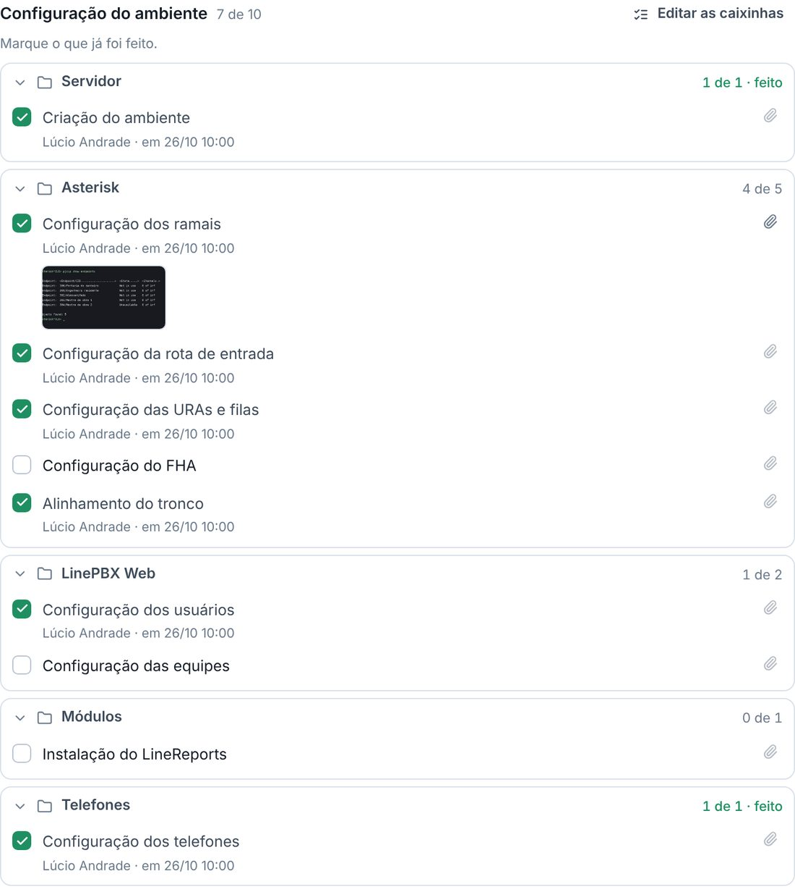

## novo · Anexar nos campos da Curadoria
Cada campo da Curadoria tem o Anexar: a lista de ramais em PDF, o print do chatbot, a planilha dos usuários. A imagem
aparece em miniatura e abre grande com um clique; o PDF abre no leitor, sem baixar; o Word e o Excel baixam com um clique.
Em Painéis › Ajustes › Campos, o Recebe anexos liga o Anexar em qualquer outro campo, de qualquer painel.
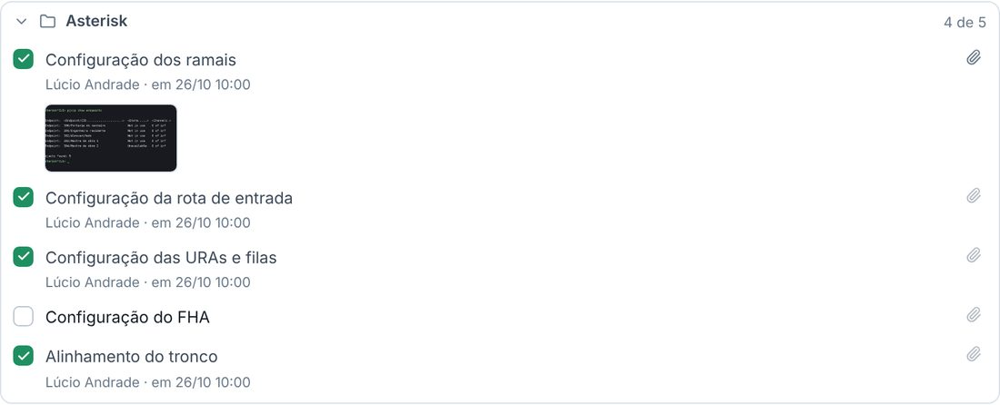

## novo · A negociação abre o card sozinha
Ao mover a negociação para Em processo de Implantação, a janela mostra o cliente, os produtos e o card antes de gravar.
A empresa que ainda não é cliente entra no cadastro de clientes (com a Matriz): só falta o CNPJ, que a janela pede (os
14 números, que entram no formato enquanto se digita; a janela não confere o dígito verificador). Os produtos entram no
cadastro em implantação, sem a data. O Ganho continua à parte, quando começar a faturar.
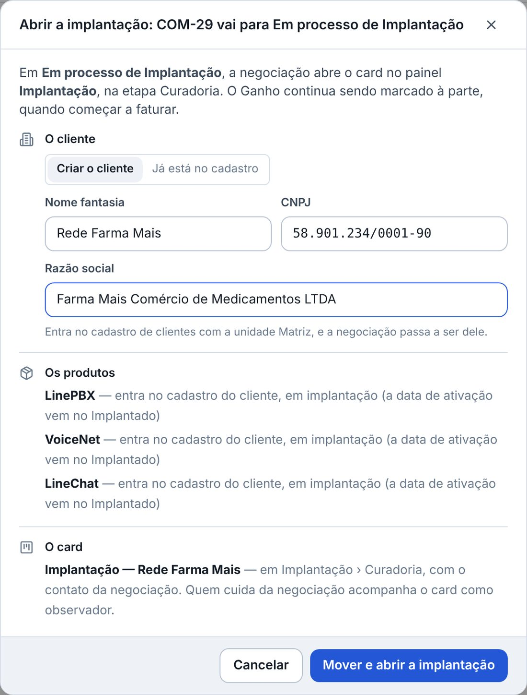

## novo · O Implantado liga os produtos e os módulos no cadastro
No Implantado, a janela mostra como a ficha do cliente vai ficar: os produtos ganham a data de ativação do dia e os
módulos escolhidos na Curadoria ficam ligados (o que ainda não foi marcado na Ativação dos módulos, a janela avisa). Não precisa mais digitar de novo na ficha do cliente. E a negociação vai sozinha, no Comercial,
de Em processo de Implantação para Implantado; o Ganho continua quando começar a faturar.
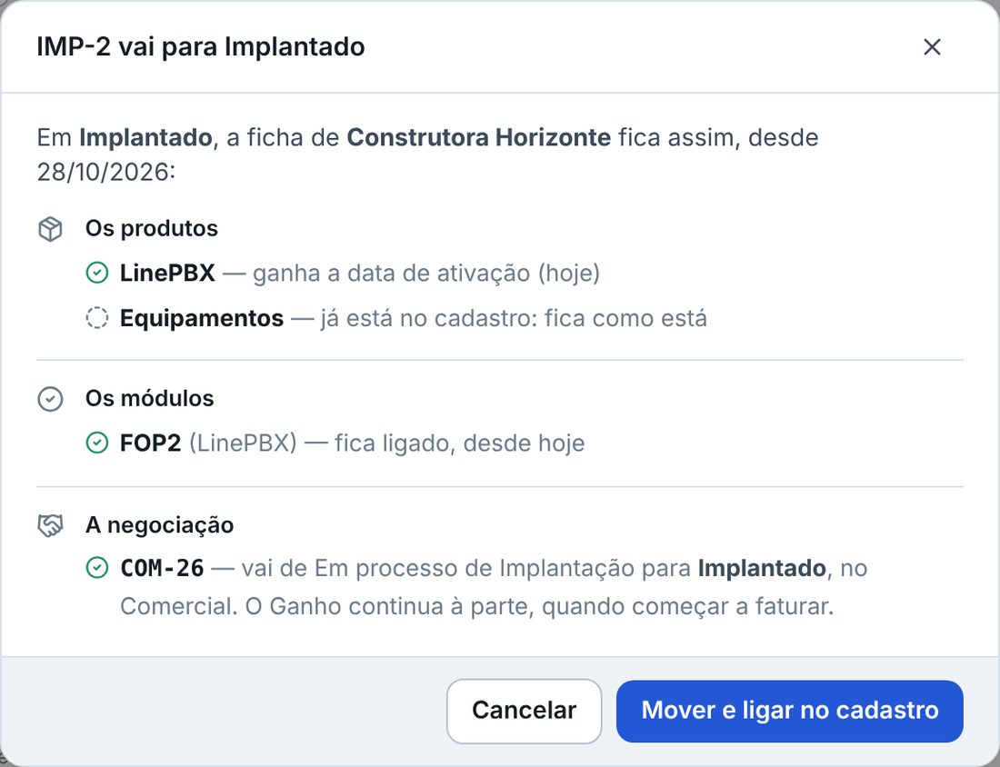

## melhorou · O produto em implantação na ficha do cliente
Em Clientes › Produtos, o produto que entrou pela implantação aparece como em implantação, sem a data, até o Implantado.
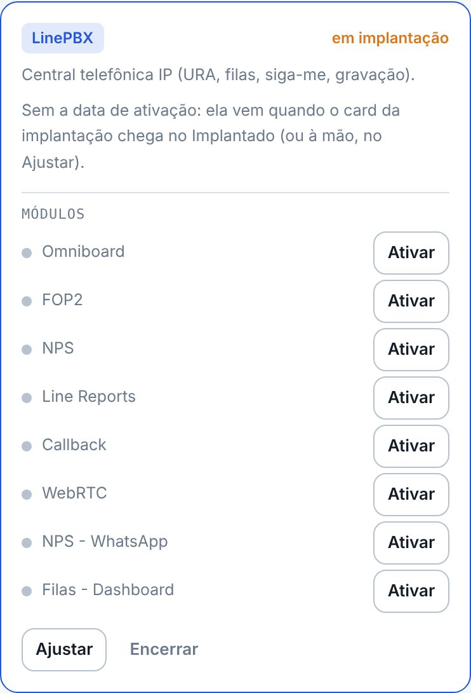

## novo · Os campos ganham a parte, o produto e as caixinhas
Em Painéis › Ajustes › Campos, qualquer campo pode ter a parte da ficha (vai para o meio da ficha, num cartão) e o
produto (só aparece no chamado que tem o produto). Dois tipos novos: Caixinhas, para o que já foi feito, e Módulos do
produto. E o Tempo gasto agora liga e desliga em cada painel, como os outros campos do sistema.
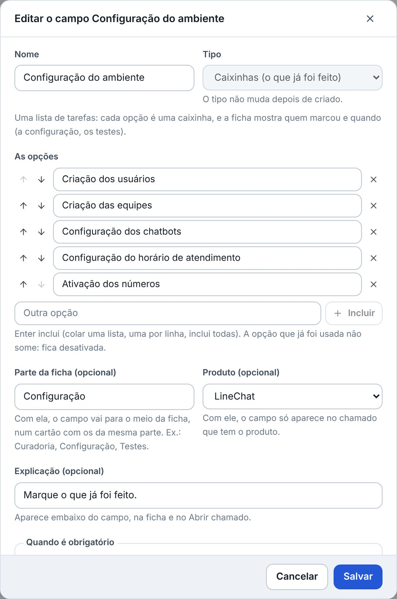

## novo · A etapa do Comercial que abre a implantação
Em cada etapa do funil do Comercial dá para escolher se ela abre a implantação, e em qual painel. No painel de
chamados, a etapa pode ligar no cadastro, como o Implantado. E a etapa Implantado do Comercial recebe a negociação
quando a implantação termina.
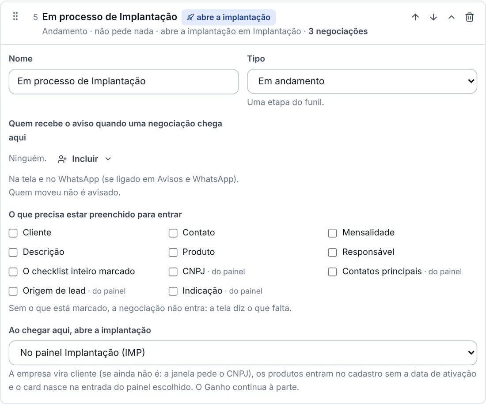
