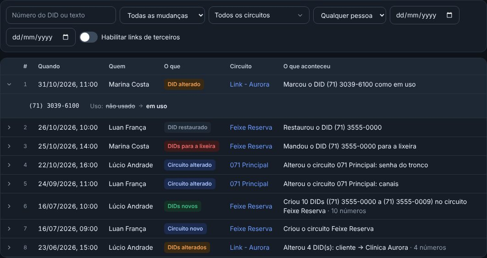
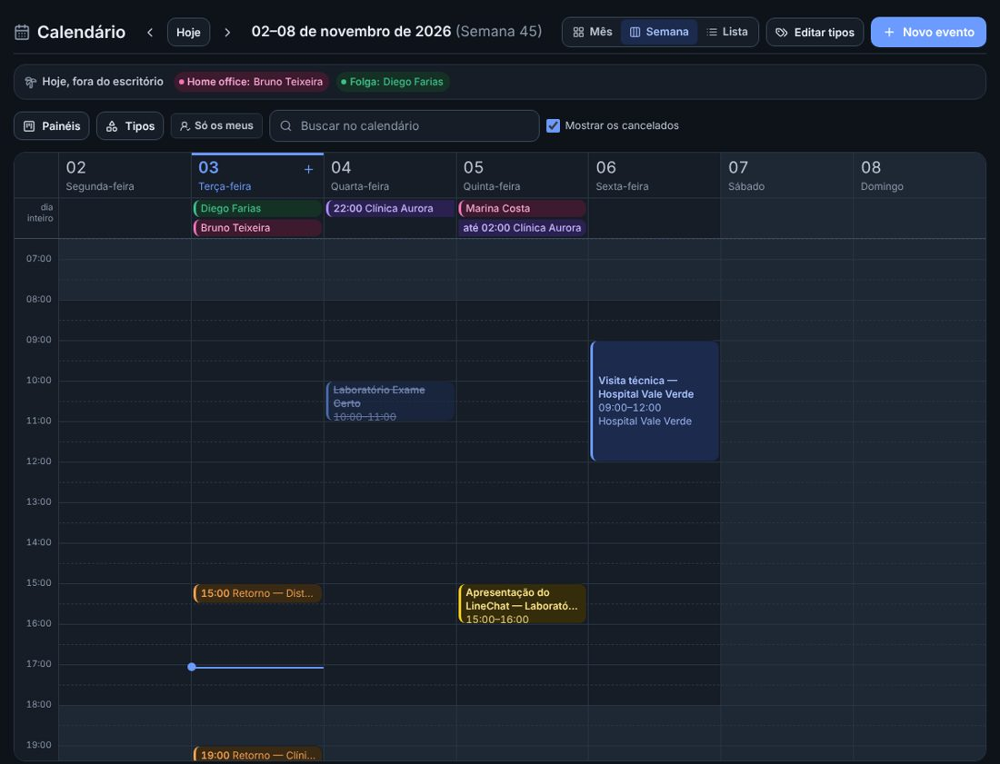
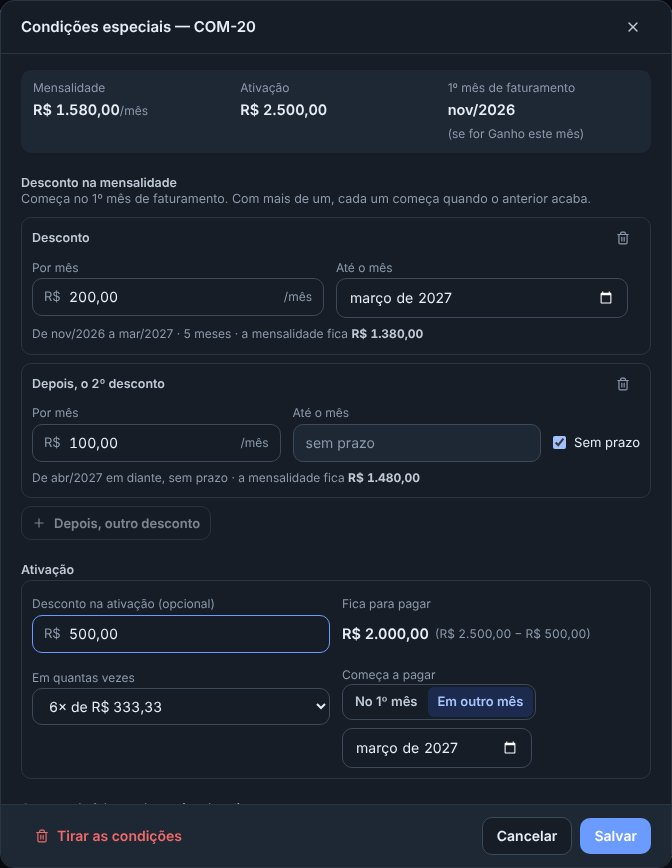
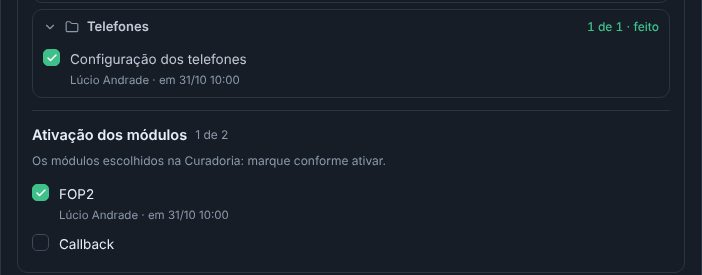

## novo · As Movimentações dos circuitos e dos DIDs
Em Circuitos e DIDs, a aba Movimentações registra tudo o que muda: o circuito novo, alterado, na lixeira ou restaurado; os
DIDs novos, atribuídos, liberados, trocados de circuito, com o uso ou a observação mudados, na lixeira ou restaurados; e a
importação da planilha. Cada linha diz quando, quem e o que aconteceu; clicando, abre o que mudou (Cliente: Clínica Aurora →
livre). A senha do tronco aparece só como trocada. Dá para filtrar pelo número do DID, pelo tipo, pelo circuito, por quem
fez e pelo período, e a ficha do circuito mostra as dele. O que já tinha acontecido veio junto.

## novo · O Calendário abre na Semana
O Calendário agora abre na Semana, com os sete dias lado a lado, como no Outlook: em cima, o que é do dia inteiro (a folga,
o home office); embaixo, as horas, com cada evento na altura da hora dele e a linha azul da hora de agora. Dois cliques numa
hora vazia abrem um evento novo naquela hora. As setas andam uma semana. O Mês e a Lista continuam no alto, e o calendário
lembra o jeito de ver que você usou por último.

## melhorou · As Condições especiais da negociação
As condições combinadas agora se chamam Condições especiais, e a janela ficou mais simples. O desconto na mensalidade começa
no 1º mês de faturamento, que é o mês do Ganho: basta o valor e até que mês vai, ou marcar Sem prazo. Com mais de um, cada
um começa quando o anterior acaba (R$ 200 até março, depois R$ 100 sem prazo). A ativação ganhou o desconto, o quanto fica,
em quantas vezes (com o valor da parcela) e quando começa a pagar: no 1º mês ou num mês escolhido. Embaixo, Como fica a
cobrança mostra mês a mês a mensalidade, o desconto, a parcela da ativação e o total.

## melhorou · A Ativação dos módulos voltou para a Configuração
Na ficha do card de implantação, a Configuração de cada produto volta a ter a Ativação dos módulos: os módulos escolhidos em
Módulos a ativar (a Curadoria) aparecem ali, e a equipe marca cada um conforme ativa. O que os cards já tinham marcado voltou
junto. No Implantado, a janela avisa o módulo escolhido que ainda não foi marcado, sem travar.

