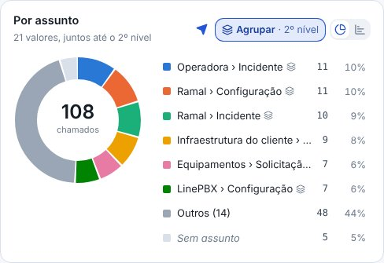
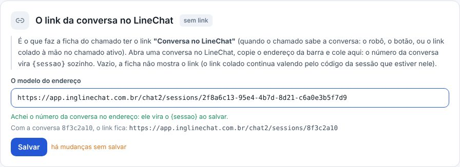

## melhorou · O Agrupar sobe um nível por clique
No gráfico Por assunto dos Relatórios, o primeiro clique no Agrupar junta no 2º nível ("Ramal › Incidentes", "Ramal › Configuração"); o segundo junta no 1º ("Ramal"); o terceiro separa tudo de novo. O botão mostra em que nível está, e clicar num grupo continua filtrando ele e o que está dentro.

## novo · O link da conversa no LineChat
Na ficha do chamado, quem administra vê "Pôr o link do LineChat" ao lado da sessão quando o link ainda não foi configurado. Ele abre Painéis › Ajustes › Integrações no lugar certo: cole o endereço de uma conversa aberta no LineChat, e o número da conversa vira o modelo sozinho. Daí em diante, a ficha mostra "Conversa no LineChat", e o código da sessão também abre a conversa.

