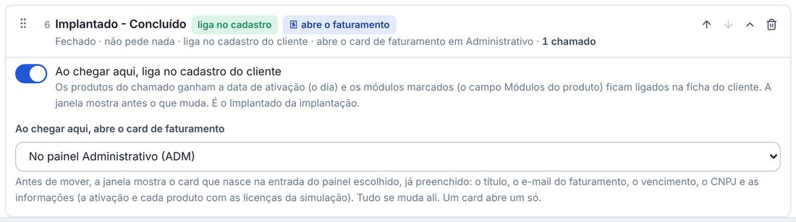
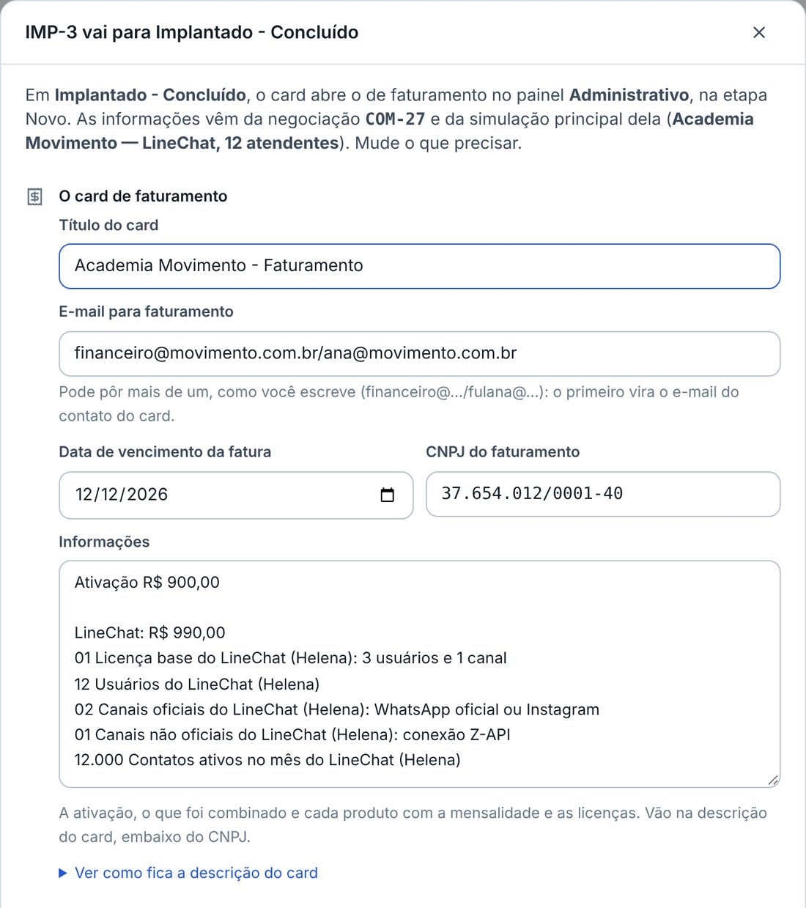
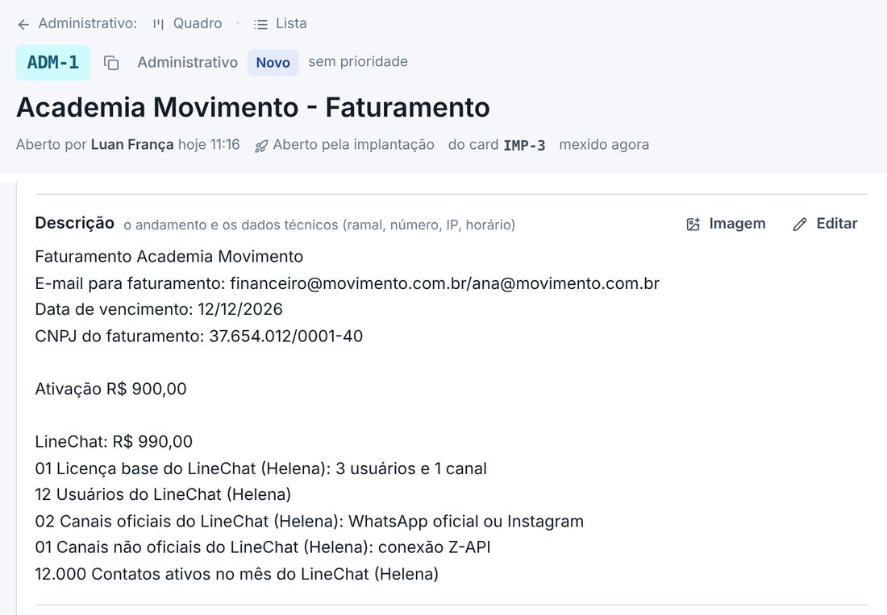
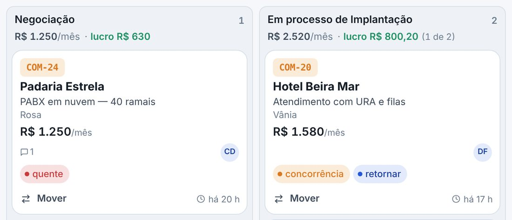
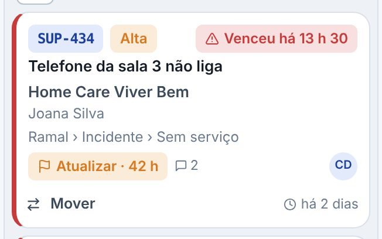
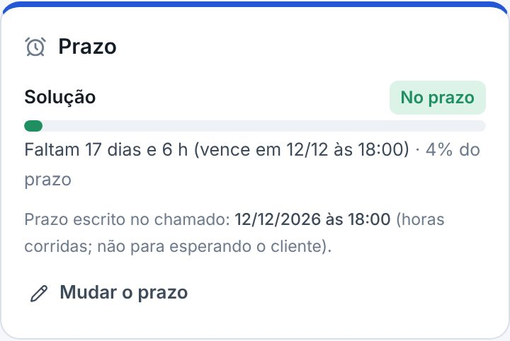
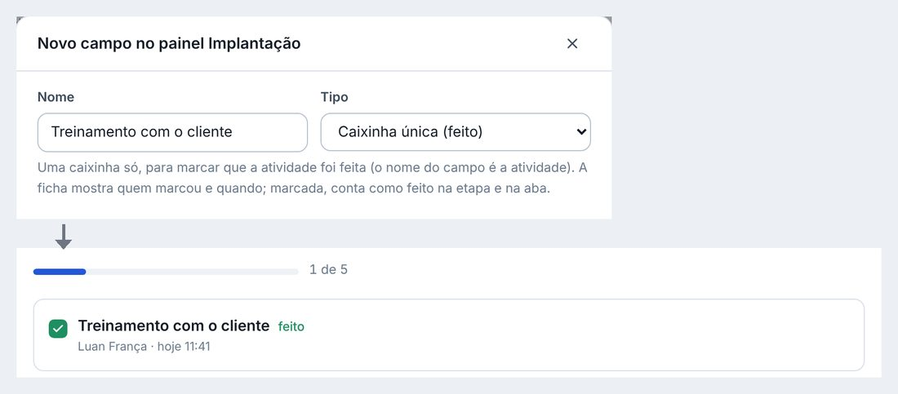
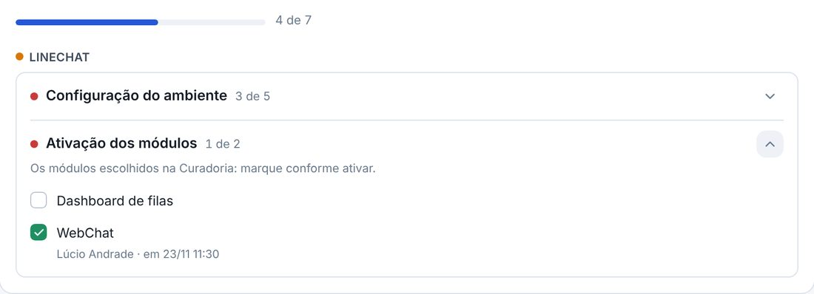

## atencao · O Abrir chamado sem os chamados recentes
Ao escolher o cliente no Abrir chamado, a lista "Chamados recentes deste cliente", com o "Reabrir este em vez de abrir outro", não aparece mais. O chamado fechado continua reabrindo pela ficha, em Mais › Reabrir.

## novo · O card de faturamento no Implantado - Concluído
Na implantação, o card que chega no Implantado - Concluído pode abrir um card de faturamento no painel administrativo. Para ligar, uma vez só: Configurar do painel da implantação › a etapa Implantado - Concluído › Ao chegar aqui, abre o card de faturamento › escolha o Grupo Line - ADM › Salvar.

## novo · A janela do faturamento, já preenchida
Antes de mover, a janela mostra o card que vai nascer: o título, o e-mail para faturamento (pode pôr mais de um), a data de vencimento, o CNPJ e as informações, com a ativação, o que foi combinado e cada produto com a mensalidade e as licenças da simulação principal. Tudo se muda ali, e o "Ver como fica a descrição do card" mostra o texto inteiro.

## novo · O card de faturamento no administrativo
O card nasce na primeira etapa do administrativo, com a descrição no formato que você escrevia à mão: o Faturamento, o e-mail, o vencimento, o CNPJ e as informações. Ele fica ligado ao card da implantação (um card abre um só), você entra como observador, e quem a etapa avisa recebe o aviso.

## novo · O lucro ao lado do valor das colunas do Comercial
No quadro do Comercial, cada coluna mostra, ao lado da soma das mensalidades, o lucro: a soma da sobra por mês da simulação principal de cada negociação. A negociação sem simulação fica de fora, e a coluna diz quantas entraram, como "(1 de 2)".

## novo · Imagens no relato e na descrição
No Abrir chamado e na ficha, o relato e a descrição recebem imagens: cole o print com Ctrl+V na caixa ou use o botão Imagem. Elas aparecem em miniatura embaixo do texto e abrem grandes com um clique. Na ficha, a imagem vai na hora, sem esperar o Salvar do texto.

## novo · A marca de atualizar
Cada painel pode marcar o chamado em que ninguém mexe: no Configurar › As regras, ligue o Marcar o chamado sem atualização e escolha as horas (24, por exemplo). O cartão, a lista e a ficha mostram a bandeirinha laranja "Atualizar · 26 h" até alguém mexer. O aviso automático não conta como mexer.

## novo · O prazo escrito em cada chamado
No Configurar › As regras, o Conta prazo agora escolhe entre o prazo do assunto e o escrito em cada chamado. Com o escrito, o Abrir chamado pede o dia e a hora, e o bloco Prazo da ficha escreve, muda e tira o prazo. Ele conta em horas corridas e não para esperando o cliente.

## novo · A caixinha única
Um tipo de campo novo, a Caixinha única (feito): uma caixinha só, para marcar que uma atividade foi feita, diferente das caixinhas de várias opções. Crie em Configurar › Campos › Novo campo, com o nome da atividade. Na ficha, marcada, ela mostra feito, quem marcou e quando, e conta como feito na aba e na etapa.

## melhorou · Os checklists recolhidos ao abrir o card
O checklist do card, as caixinhas e os módulos começam recolhidos quando você abre o card: aparecem o nome e a conta, como 39 de 39 · feito. A setinha no canto direito, ou um clique no nome, mostra tudo, e outro clique recolhe. Quando o aviso do que falta leva até um campo recolhido, ele abre sozinho.

## melhorou · A ficha na frente dos avisos
O chamado aberto pelo cartão do aviso agora aparece na frente dos cartões. Eles voltam a aparecer quando a ficha fecha.

## melhorou · O Trocar sem os painéis pessoais dos outros
A lista do Trocar, no alto do painel, mostra os painéis da equipe e o seu painel pessoal. Os painéis pessoais das outras pessoas não aparecem mais nela.

## melhorou · Sem o "avisou pelo WhatsApp" no histórico
O aviso que o Gestor manda para a equipe pelo WhatsApp não entra mais no histórico do chamado. Os de antes também saem da tela.
