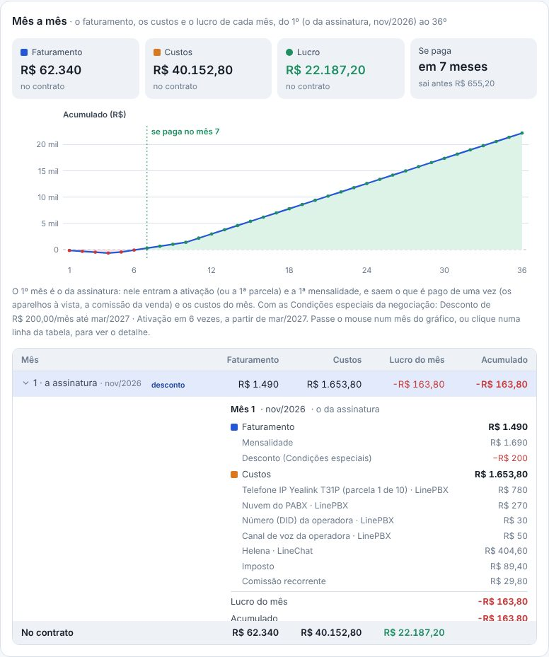
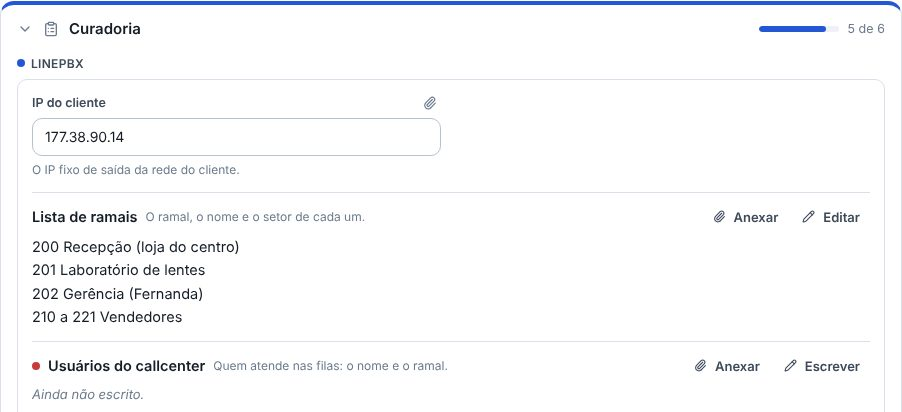
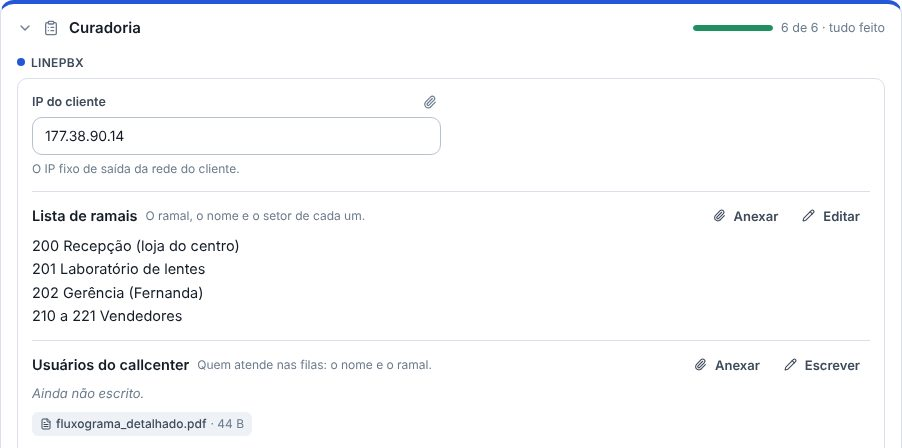

## novo · O Simulador conta as Condições especiais
A simulação ligada a uma negociação usa o que foi combinado nela: o desconto na mensalidade, em cada mês em que vale, e a ativação combinada (o desconto, as vezes e o mês da 1ª parcela). O 1º mês do contrato é o do Ganho; antes do Ganho, o mês de hoje. O cartão Condições especiais, ao lado dos números, mostra a sobra nos meses com desconto e o desconto somado no contrato. As condições continuam mudando na ficha da negociação, e o card fica com o valor cheio.

## melhorou · O mês a mês com o desconto
Cada mês diz o mês do calendário, e o mês com desconto ganha a marca "desconto". No detalhe do mês, o desconto aparece em vermelho, com o sinal de menos. O faturamento, os custos, o lucro, o "Se paga" e o Excel já vêm com ele.

## novo · A bolinha vermelha no que falta
Na Curadoria, na Configuração e nos Testes, o campo que ainda falta tem uma bolinha vermelha antes do nome: o mesmo que o "N de M" da parte conta. Nas caixinhas, a bolinha fica até a última ser marcada.

## melhorou · O documento anexado conta como preenchido
O campo com um arquivo anexado conta como feito, mesmo sem nada escrito: no "N de M" da ficha e do quadro, e no que a etapa pede para o card andar. Tirando o anexo, ele volta a faltar.

