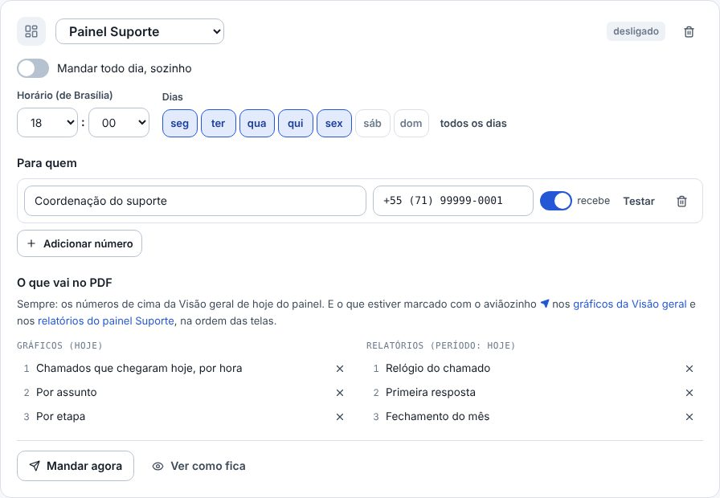
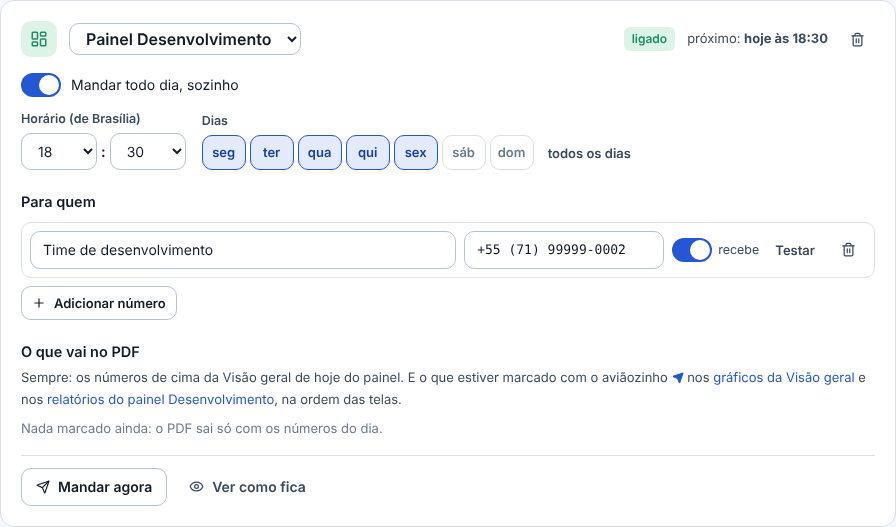
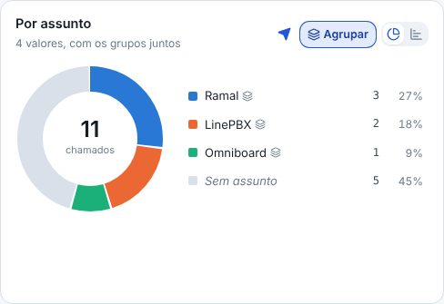
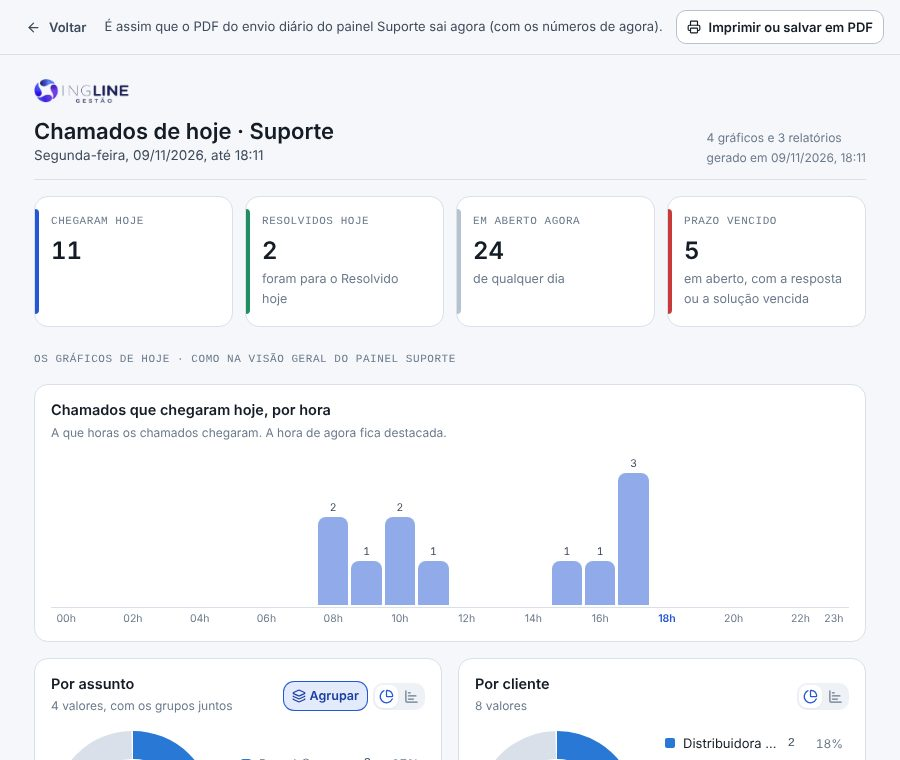
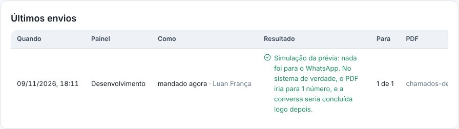

## atencao · O envio que já existia agora sai do Suporte
O PDF de todo dia saía dos tickets do LineChat (o Legado do Helena). Agora ele sai do painel Suporte, com o mesmo horário
e os mesmos números de antes. O que estava marcado no Legado veio junto quando tem um relatório equivalente no painel,
como o Relógio do chamado, a Primeira resposta e o Fechamento do mês. Confira em Administração › Envio automático.

## novo · Um envio para cada painel
Em Administração › Envio automático, cada envio é um cartão com o painel de onde sai, o horário, os dias e quem recebe.
Para criar outro, escolha o painel em Novo envio do painel. Cada painel tem um envio, e o mesmo número pode estar em mais
de um. Os painéis de Vendas ficam de fora, porque já têm o relatório do Comercial.

## novo · O aviãozinho nos Relatórios de cada painel
Quem administra vê o aviãozinho no canto de cada gráfico da Visão geral (Hoje e Período) e de cada um dos 25 relatórios.
Azul, o item vai no PDF do envio daquele painel. Clique de novo para tirar. Vale para a equipe toda.

## melhorou · O PDF com os números de hoje do painel
O PDF leva os números de cima da Visão geral de hoje e os gráficos marcados, do jeito que a equipe arrumou, com a largura
e com pizza ou barras. Também leva os relatórios marcados, com o dia de hoje como período. O nome do arquivo tem a sigla
do painel, como chamados-sup-04-11-2026.pdf, e Ver como fica mostra o PDF de cada envio.

## melhorou · Os últimos envios dizem de qual painel saíram
A lista de baixo mostra o painel de cada envio. A ligação com a FlwChat (o número que envia, o token e o concluir a
conversa) continua uma só, para todos os envios. Quando algo muda na tela, aparece embaixo a barra para salvar.

