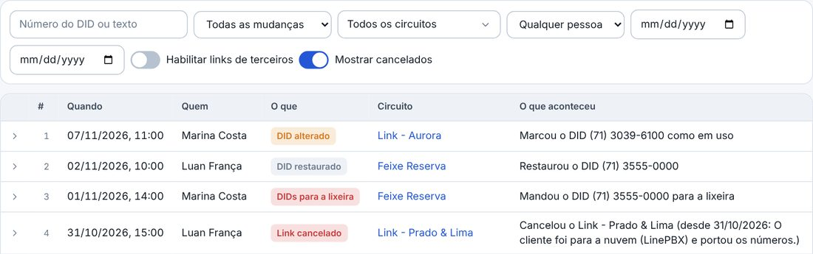
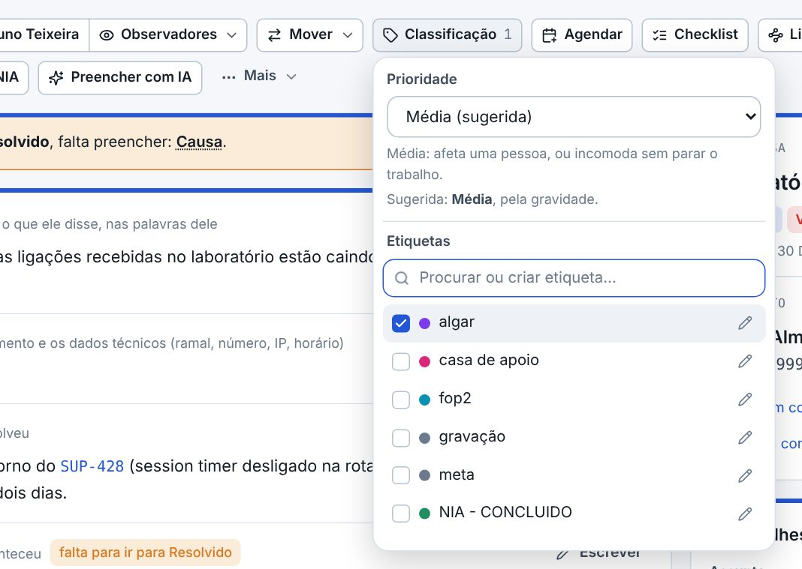

## atencao · Os cancelados só aparecem com a caixa marcada
No calendário, o evento cancelado não aparece mais riscado: ele sai da Semana, do Mês e da Lista, e volta marcando Mostrar os cancelados. Nos Circuitos, na Numeração e nas Movimentações, o link cancelado e os números dele só aparecem ligando Mostrar cancelados. Na ficha do cliente e do chamado, os números do link cancelado não contam.

## atencao · A prioridade e as etiquetas no botão Classificação
Na ficha do chamado, o botão Etiquetas da barra virou Classificação: a Prioridade fica em cima, com a sugerida, e as etiquetas embaixo, no mesmo menu. O cartão Classificação saiu da lateral, e o que sobrava nele (como o Assunto e os Produtos) ficou no cartão Detalhes. Quando falta a prioridade para mudar de etapa, o aviso abre esse menu. Na negociação e no painel sem prioridade, o botão continua Etiquetas.

## novo · Repetir o evento
No evento novo, o campo Repetir: Não repete, Todo dia, Todo dia útil, Toda semana ou Todo mês, até uma data ou sem data para acabar. Cada data vira um evento de verdade: o Feito, o Cancelar e os lembretes valem um por um. Sem data para acabar, o calendário fica sempre preenchido até 12 meses à frente. Um evento que já existe também passa a se repetir pelo Editar, e na ficha do chamado a repetição ocupa uma linha só.

## novo · Só este ou este e os próximos
Ao editar um evento que se repete, a janela pergunta antes o que mudar: só esta data, ou ela e as seguintes (as de antes ficam como estão). Mudando só a hora ou o título, cada data fica no dia dela. Trocando a repetição, as datas canceladas e as feitas ficam no dia delas, e as outras andam para a regra nova.

## melhorou · Excluir o que se repete
O Excluir de um evento que se repete dá as duas opções: só este, ou este e os próximos, e aí a repetição para nele. As datas que vão juntas para a lixeira são uma linha só lá. Restaurando, elas voltam juntas e a repetição volta a ser como era.

## novo · Cancelar o link
Na ficha do circuito, o botão Cancelar o link pede o dia e o motivo. O link não vai para a lixeira: sai das listas, dos cartões e do Painel, com os números dele, mas a ficha continua, com a faixa do cancelamento, os números e as movimentações. Ele não recebe números novos, nem pela faixa, nem pela edição, nem pela planilha. Se foi engano, o Reativar traz de volta.

## melhorou · Mostrar cancelados
Na lista de Circuitos e na Numeração, o interruptor Mostrar cancelados traz os links cancelados, com a marca do dia em que foram cancelados. O cancelamento e a reativação entram nas Movimentações e na auditoria, e a exportação dos circuitos e dos DIDs traz o cancelamento numa coluna.

