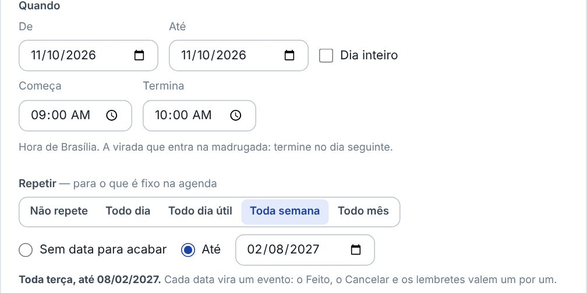
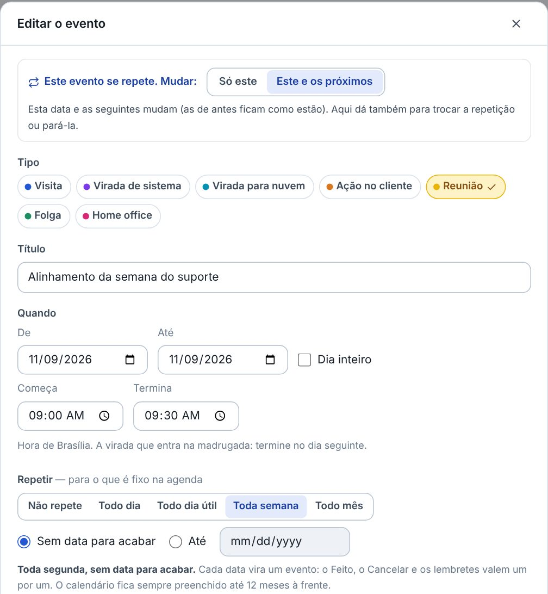
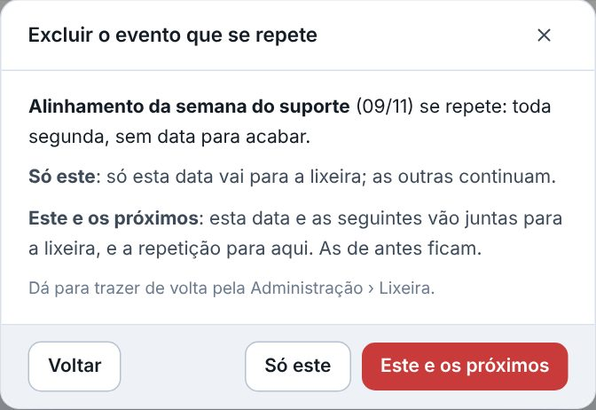
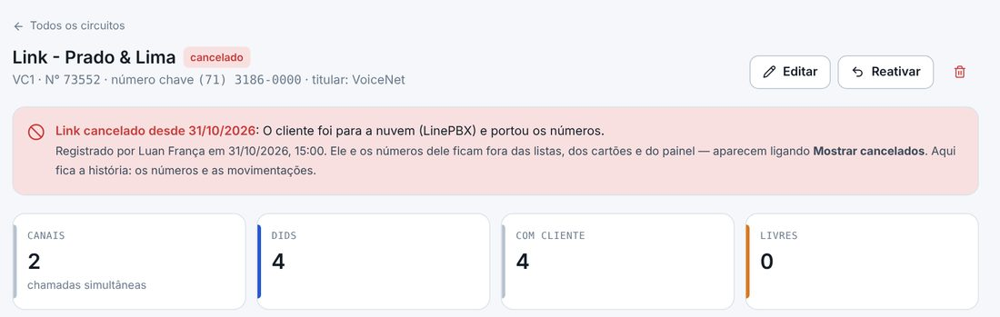
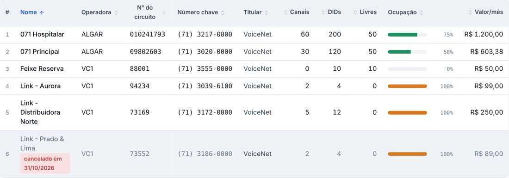

## novo · Repetir o evento
No evento novo, o campo Repetir: Não repete, Todo dia, Todo dia útil, Toda semana ou Todo mês, até uma data ou sem data para acabar. Cada data vira um evento de verdade: o Feito, o Cancelar e os lembretes valem um por um. Sem data para acabar, o calendário fica sempre preenchido até 12 meses à frente. Um evento que já existe também passa a se repetir pelo Editar.

## novo · Só este ou este e os próximos
Ao editar um evento que se repete, a janela pergunta antes o que mudar: só esta data, ou ela e as seguintes (as de antes ficam como estão). Em "Este e os próximos" dá também para trocar a repetição ou pará-la. O evento que se repete tem o ícone de repetição no calendário e a linha Repete no detalhe.

## melhorou · Excluir o que se repete
O Excluir de um evento que se repete dá as duas opções: só este, ou este e os próximos, e aí a repetição para nele. As datas que vão juntas para a lixeira são uma linha só lá, e voltam juntas.

## novo · Cancelar o link
Na ficha do circuito, o botão Cancelar o link pede o dia e o motivo. O link não vai para a lixeira: sai das listas, dos cartões, da Numeração e do Painel, com os números dele, mas a ficha continua, com a faixa do cancelamento, os números e as movimentações. Não recebe números novos. Se foi engano, o Reativar traz de volta.

## melhorou · Mostrar cancelados
Na lista de Circuitos e na Numeração, o interruptor Mostrar cancelados traz os links cancelados, com a marca do dia em que foram cancelados. O cancelamento e a reativação entram nas Movimentações e na auditoria.

