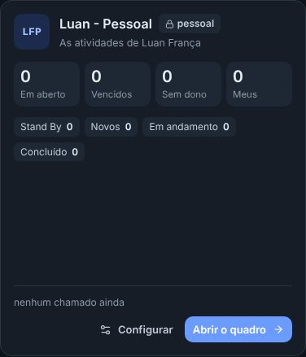
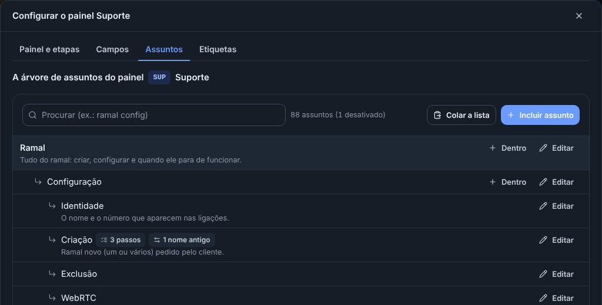
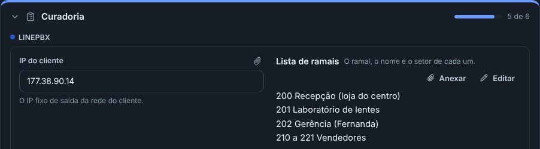
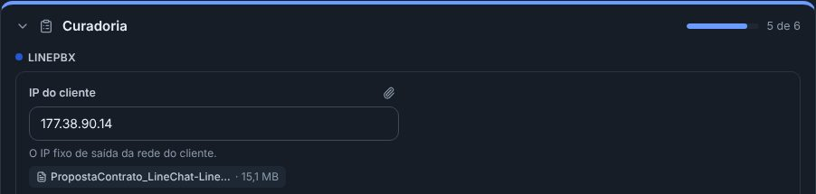

## novo · O seu painel pessoal
Cada pessoa que trabalha nos chamados tem agora um painel pessoal, que só ela e quem tem o perfil de administrador veem (os administradores encontram os da equipe numa parte à parte, embaixo da tela Painéis). Ele abre pelo menu, em Suporte › Meu painel. Nasce seco, com as etapas Stand By, Novos, Em andamento, Concluído e Validado, e você liga os campos que quiser no Configurar dele. Quem já tinha um painel Pessoal continua com o mesmo, do jeito que estava.

## melhorou · O Configurar abre ali mesmo, com tudo do painel
O Configurar do alto do painel (e o dos cartões da tela Painéis) abre uma janela por cima da tela em que você está, sem ir para os Ajustes. No alto, as abas Painel e etapas, Campos, Assuntos e Etiquetas. Na aba Painel e etapas vale o Salvar; nas outras, cada mudança já vale na hora.

## novo · Metade ou a linha inteira
Na janela do campo, num grupo do meio da ficha, escolha a Largura na ficha: Metade (lado a lado com o vizinho, como a Operadora Doadora) ou Linha inteira (como a Faixa Numérica). Os campos que ninguém mexeu continuam como estavam.

## novo · Repetir em dias da semana
No calendário, a Toda semana do Repetir ganhou os dias: marque Ter e Qui para "toda terça e quinta". O dia do evento já vem marcado; cada data vira um evento, como nas outras repetições.

## melhorou · Anexos de até 30 MB nos campos do card
O Anexar de cada campo do card (os Detalhes da proposta, os campos da Curadoria, as caixinhas) aceita arquivos de até 30 MB cada, no lugar dos 10 MB de antes. O contrato assinado e a proposta escaneada, que passavam do limite, agora cabem. Na anotação continua como era: até 5 arquivos de 10 MB.

