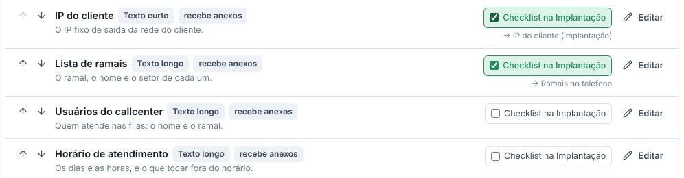
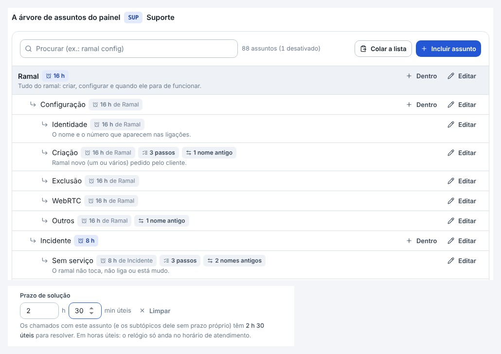
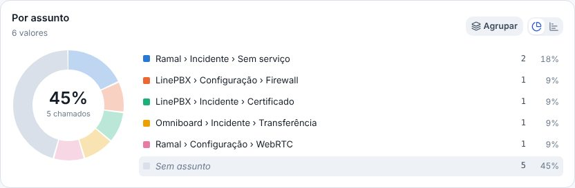

## melhorou · As partes da ficha em abas
No meio da ficha, as partes viraram abas: Curadoria, Configuração, Testes e Implantação. Cada aba mostra a conta, ou o ✓ quando tudo foi feito. A ficha abre na aba da etapa em que o card está, e as etapas "Implantado - …" abrem na Implantação. A bolinha vermelha marca a aba com algo que a próxima etapa pede, e clicar no que falta abre a aba certa.

## melhorou · As partes no cartão da implantação
No painel da implantação, o cartão do quadro mostra uma barrinha para cada parte, em qualquer etapa. Em azul, a parte da etapa do card. Em laranja, a que ficou para trás, como a configuração faltando com o cliente já implantado. Em cinza, a que ainda vem. A parte que acabou vira só o ✓ com o nome. Nos outros painéis, nada muda.

## novo · O checklist do card
Um tipo de campo novo para o que muda de cliente para cliente, como os ramais do telefone e os do softphone. Você cria o campo uma vez em Configurar › Campos, e cada card monta a própria lista na ficha. Escreva um item e tecle Enter, ou cole a lista inteira, que cada linha vira um item. Cada item marcado mostra quem marcou e quando. O lápis corrige e o × tira o item.

## novo · O checklist na Implantação, com um clique
Em Configurar › Campos, marque a caixinha Checklist na Implantação ao lado de um campo, como a Lista de ramais. O Gestor cria sozinho, na aba Implantação, o checklist com um item para cada linha da lista, ou para cada opção escolhida. Se a lista mudar, o checklist acompanha e a marca de quem já fez continua. O × tira um item só daquele card, sem mexer na lista, e o Voltar traz de volta. Desmarcar a caixinha manda o checklist para os Excluídos.

## atencao · O prazo de solução agora vem do assunto
O prazo de solução de cada chamado agora é o do assunto, e não mais o da prioridade. Sem assunto, ou com um assunto sem prazo cadastrado, o chamado fica sem prazo, e a ficha diz o porquê: "Sem prazo: o assunto selecionado não tem prazo cadastrado". A primeira resposta não tem mais prazo. A prioridade continua, para ordenar o quadro e os relatórios. O Prazo cumprido dos relatórios agora separa pelo assunto.

## novo · O prazo no cadastro do assunto
Em Configurar › Assuntos, o Editar de cada assunto tem o Prazo de solução, em horas e minutos úteis. O subtópico sem prazo próprio usa o do assunto de cima: as 16 h do Ramal valem para todo o Ramal › Configuração. Na árvore, cada assunto mostra o prazo dele, o herdado e de quem, ou "sem prazo". Em Ajustes › Prazos ficam o horário de atendimento e os feriados, que contam as horas úteis.

## melhorou · O PDF do envio diário com os subtópicos
No PDF do envio diário, o gráfico Por assunto mostra cada subtópico, como Ramal › Configuração › WebRTC, e não mais só Ramal com tudo somado. O papel não tem o botão de separar os grupos, por isso ele já sai separado, ocupando a linha inteira para os nomes caberem. Na Visão geral, nada muda.

## corrigido · Só o seu painel pessoal no evento do calendário
Na janela do evento do calendário, a lista de painéis mostra só o seu painel pessoal, e não mais os pessoais dos colegas. O pessoal de outra pessoa só aparece se o evento já estava nele.
