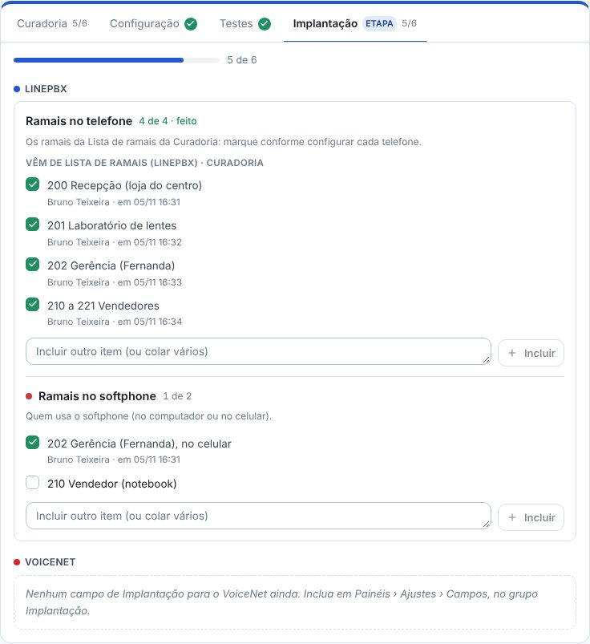
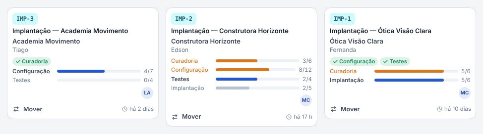
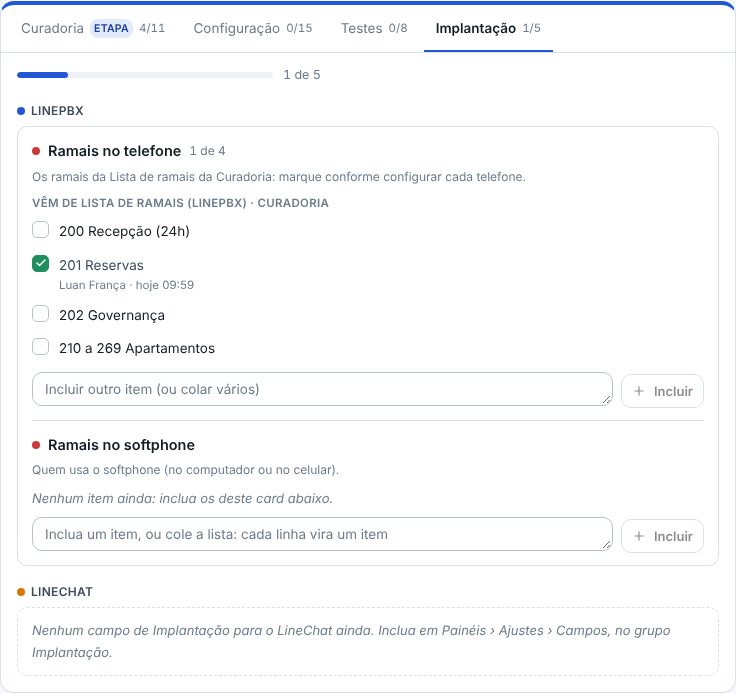

## melhorou · As partes da ficha em abas
No meio da ficha, as partes viraram abas: Curadoria, Configuração, Testes e Implantação. Cada aba mostra a conta, ou o ✓ quando tudo foi feito. A ficha abre na aba da etapa em que o card está, e as etapas "Implantado - …" abrem na Implantação. A bolinha vermelha marca a aba com algo que a próxima etapa pede, e clicar no que falta abre a aba certa.

## melhorou · As partes no cartão da implantação
No painel da implantação, o cartão do quadro mostra uma barrinha para cada parte, em qualquer etapa. Em azul, a parte da etapa do card. Em laranja, a que ficou para trás, como a configuração faltando com o cliente já implantado. Em cinza, a que ainda vem. A parte que acabou vira só o ✓ com o nome. Nos outros painéis, nada muda.

## novo · O checklist do card
Um tipo de campo novo para o que muda de cliente para cliente, como os ramais do telefone e os do softphone. Você cria o campo uma vez em Configurar › Campos, e cada card monta a própria lista na ficha. Escreva um item e tecle Enter, ou cole a lista inteira, que cada linha vira um item. Cada item marcado mostra quem marcou e quando. O lápis corrige e o × tira o item.

## novo · Os itens que vêm de outros campos
Na janela do checklist do card, marque em "Os itens vêm de" os campos das outras abas, como a Lista de ramais da Curadoria. Cada linha da lista, ou cada opção escolhida, vira um item na Implantação. Se a Curadoria mudar a lista, o checklist acompanha sozinho e a marca de quem já fez continua. Esses itens só se marcam no checklist; para corrigir ou tirar, mude no campo de onde vieram.

