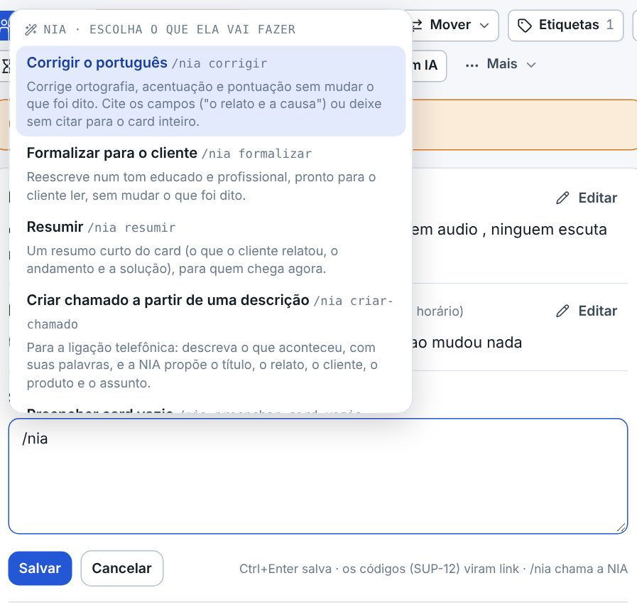
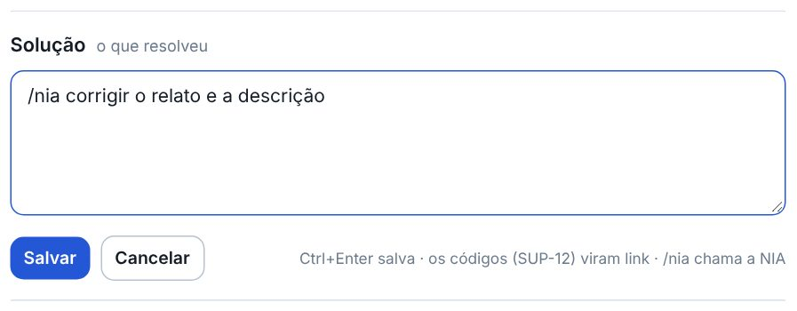
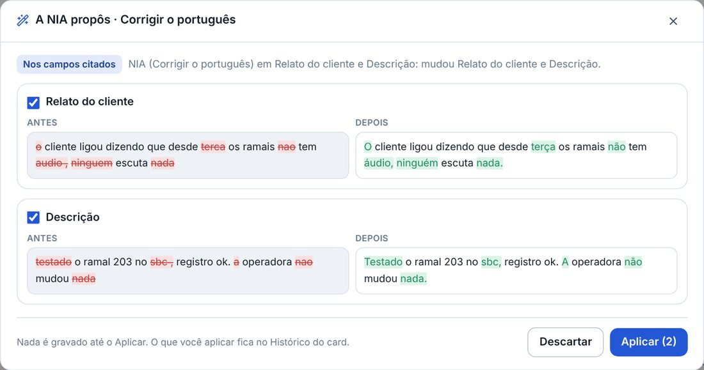
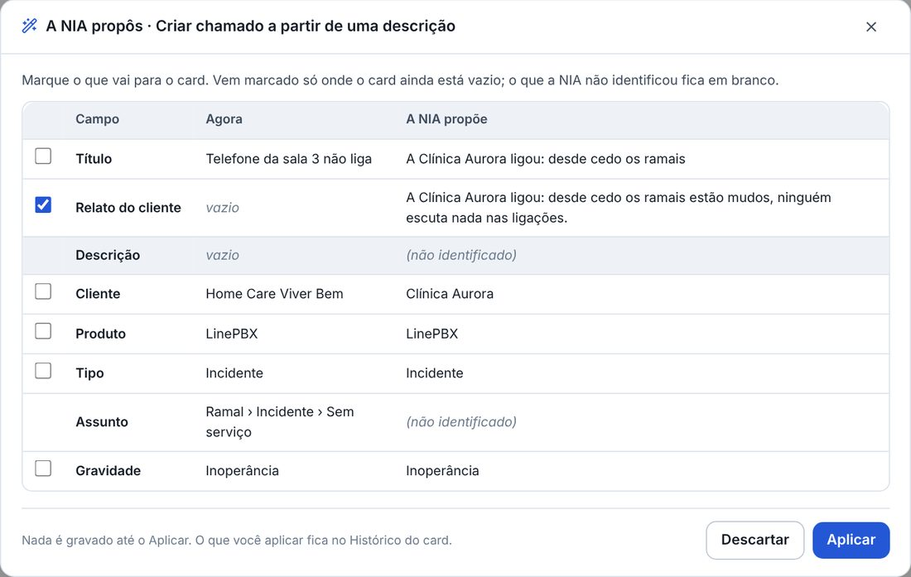
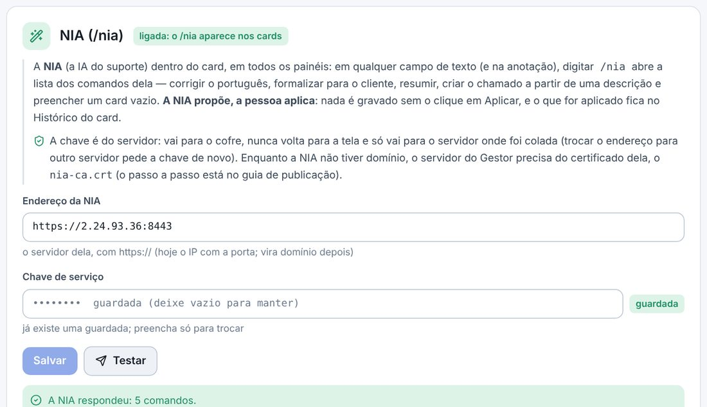

## atencao · A NIA propõe, você aplica
A NIA nunca escreve sozinha no card. Ela mostra o antes e o depois de cada campo, com o que mudou em destaque, e só grava
o que ficou marcado quando você clica em Aplicar. O Histórico do card diz o que você aplicou. Ela lê o card como está
gravado: o que você escreveu e ainda não salvou, salve antes de chamar.

## novo · /nia em qualquer campo do card
No título, no relato, na descrição, na solução, na causa, na solução de contorno, na validação, na Sobre a negociação e
na anotação, em todos os painéis: escreva /nia e a lista dos comandos abre ali, com o nome e o que cada um faz.
Continuar escrevendo filtra (/nia cor deixa só o Corrigir o português); as setas e o Enter escolhem, Esc fecha.

## novo · O pedido na mesma linha
Depois do comando, escreva o que quer e aperte Enter: /nia corrigir o relato e a causa trabalha só esses campos;
/nia corrigir, sem citar campo, trabalha o card inteiro. O /nia e o pedido saem do campo. Enquanto a NIA lê, o campo
fica parado com o aviso a NIA está lendo.

## novo · O antes e o depois, campo por campo
A janela mostra cada campo com o antes e o depois lado a lado (no celular, um embaixo do outro) e uma caixa marcada onde
mudou. O que já estava certo aparece assim, sem caixa. Desmarque o que não quiser e clique em Aplicar.

## novo · O que você aplicou fica no Histórico
Aplicar grava pelo caminho de sempre da ficha, com o seu nome, e o Histórico ganha a linha da NIA com o que foi gravado,
como aplicou a NIA (Corrigir o português): mudou Relato do cliente. O que ficou desmarcado não entra.

## novo · O resumo do card
O /nia resumir escreve um resumo curto do card: o que o cliente relatou, o andamento e a solução. Aplicar põe o resumo no
campo onde você escreveu o /nia; na anotação, ele vira o rascunho, e você anota como sempre.

## novo · O chamado a partir da ligação
No card sem relato, a dica: escreva /nia criar-chamado e descreva o que aconteceu, com as suas palavras. A NIA propõe o
título, o relato, o cliente, o produto, o tipo, o assunto e a gravidade, numa tabela com o que está no card agora. O que
ela não identificou fica em branco; vem marcado só o que ainda está vazio.

## novo · A NIA nas Integrações
Em Painéis › Ajustes › Integrações › NIA (/nia): o endereço da NIA, a chave de serviço (vai para o cofre e nunca volta
para a tela) e o Testar, que diz quantos comandos vieram. Sem os dois, o /nia não aparece nos cards. O botão NIA da ficha
e o Preencher com IA continuam como estavam.

