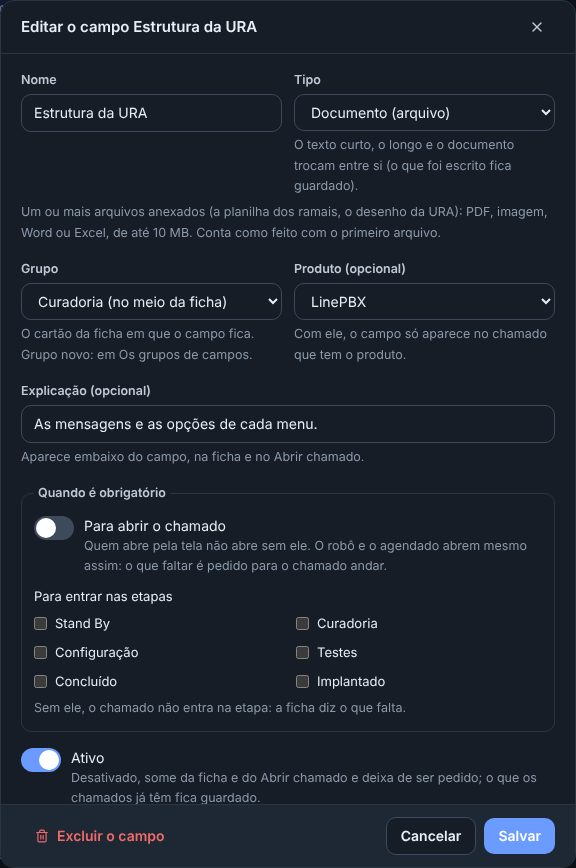
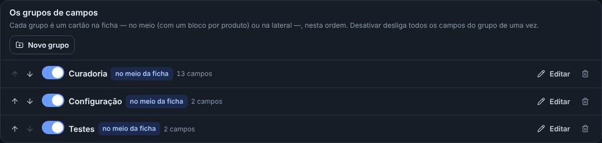
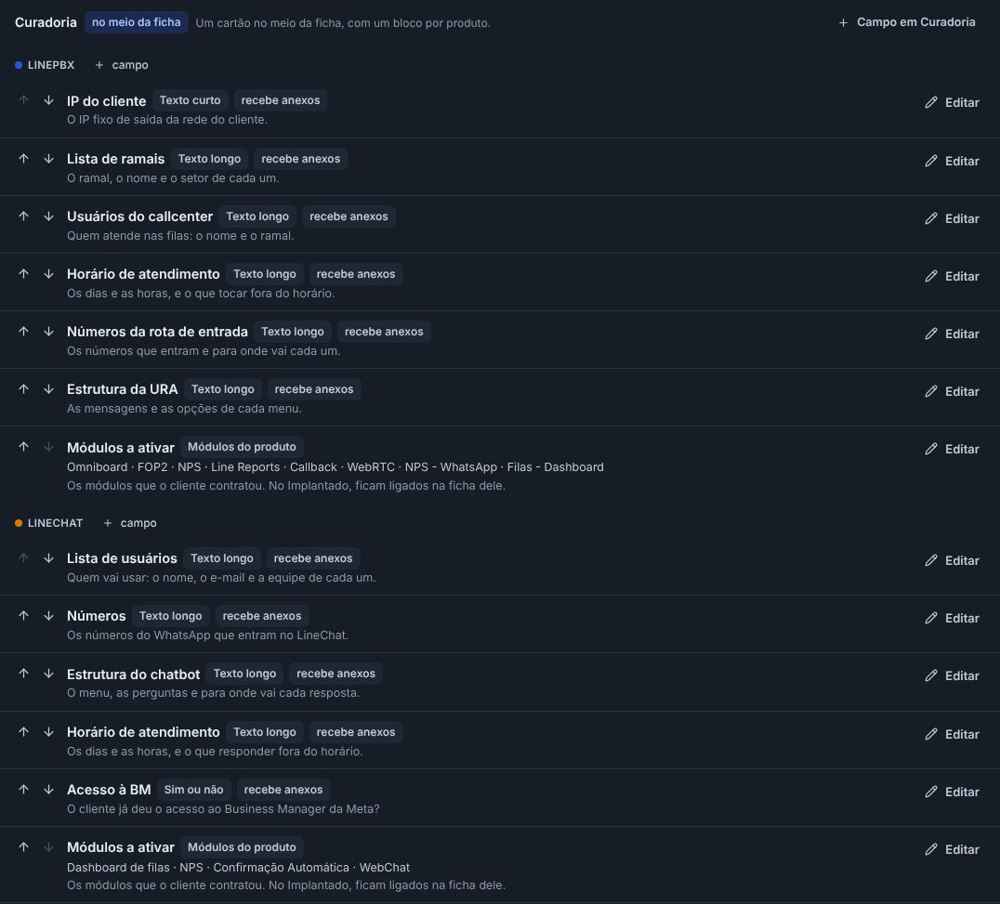
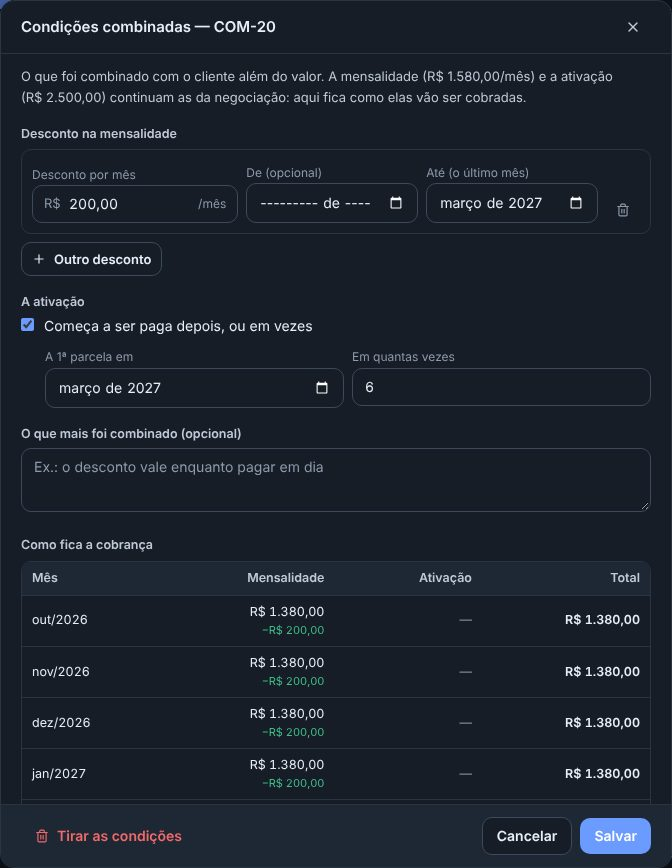
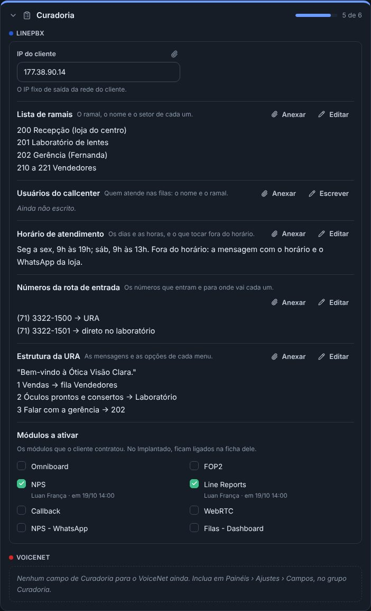

## atencao · Excluir é excluir: o campo e a caixinha somem de vez da tela
Em Painéis › Ajustes › Campos, o campo ganhou o Excluir o campo (além do desativar): ele sai da ficha, do Abrir chamado e das regras, e o nome
fica livre. O que os chamados preencheram continua guardado e volta pelo Restaurar, na parte Excluídos, no fim da aba. A caixinha excluída
some de todos os cards, mesmo dos que já a marcaram, e as que estavam desativadas foram excluídas.

## novo · Os grupos de campos
Cada grupo é um cartão da ficha: no meio (com um bloco por produto, como a Curadoria e os Detalhes da proposta) ou na lateral, abaixo da
Classificação. Em Ajustes › Campos › Os grupos de campos: Novo grupo, renomear, mudar a ordem, ativar ou desativar todos os campos de uma vez
e excluir.

## melhorou · Os campos separados por grupo e por produto
A lista dos campos não mistura mais nada: primeiro os da Classificação, depois cada grupo, e dentro dele um bloco para cada produto (LinePBX,
LineChat, VoiceNet). Cada grupo e cada produto tem o seu + campo, que já nasce no lugar certo.

## novo · As condições da negociação
Na ficha da negociação, o cartão Condições combinadas: o desconto na mensalidade até um mês, a ativação que começa a ser paga mais tarde e em
quantas vezes, e o que mais foi combinado. Como fica a cobrança mostra mês a mês o que o cliente paga. O valor da negociação não muda: continua
o que conta no quadro, na meta e no relatório.

## melhorou · Todos os produtos na Curadoria
A Curadoria, a Configuração e os Testes mostram um bloco para cada produto do card, mesmo o que ainda não tem campo (o VoiceNet, por exemplo),
com o aviso de que falta incluir.

## novo · O campo Documento
Um tipo novo de campo: o arquivo anexado (PDF, imagem, Word, Excel). Conta como feito com o primeiro arquivo. O texto curto e o longo viram
documento sem perder o que foi escrito.

## melhorou · Os testes podem ficar sem nenhuma caixinha
O Editar as caixinhas aceita deixar o campo vazio. E a Ativação dos módulos saiu da Configuração: os módulos escolhidos na Curadoria ligam no
Implantado do mesmo jeito.

## melhorou · A ficha com o detalhe azul e o Abrir chamado mais enxuto
Todos os cartões da ficha têm o detalhe azul no alto, como o da Empresa. No Abrir chamado, o painel ficou numa faixa fina.

## melhorou · O agendamento já vem com a hora
O evento novo (no Calendário e no Agendar da ficha) começa com o Dia inteiro desmarcado, das 9h às 10h: é só trocar a hora. A folga e o
home office continuam do dia inteiro.

## melhorou · O Simulador começa com 12 meses
A simulação nova traz 12 meses de contrato. E o painel desativado não aparece mais na escolha dos Ajustes.
